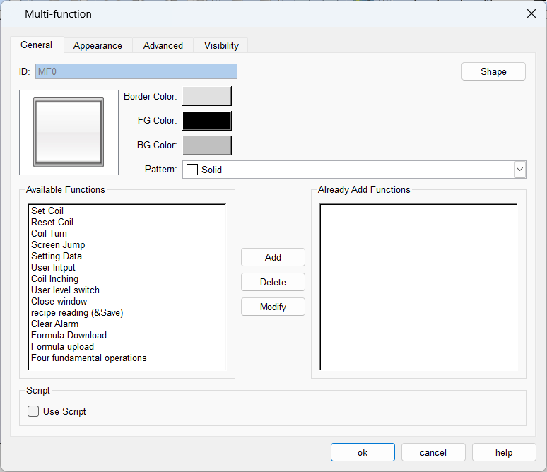
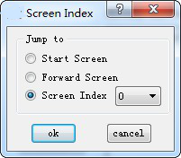
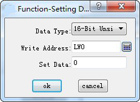
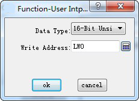

# Multi-function Button

Multi-function button allows realizing the function of multi-step custom operation through one single control. It can simplify user operation. Clickon the toolbar or double-click the existing multi-function button to enter the property page.

• General:

**1. Button Appearance: shape, color, style, and other settings.**

**2. Available functions**

Several functions are listed for user to select.

• Set Coil: Set the input address.

• Reset Coil: Reset the input address.

• Coil Alternation: Invert the input address value; if the address value is 0, then it becomes 1; if 1, it becomes 0;

• Coil Jog: When touched, the input address will be set; reset after releasing;

• Screen Jump: Jump to the selected screen. Modify it to choose the screen to jump to.

• Set data: Write the set value to the set address. You can select the type of data to be written, as well as the address and the data.

• User input: Enter a value and write it to the set address. You can select the data type to be written and set the address to be written. When this command is executed, it will appear the data input interface where you can perform the above operation.

Select an available function and click Add to add the function to the list of selected features.

User level switching: Use this function to log out of the currently logged in user and switch to another level of user login.You can specify other users on the settings screen.

Close Window: Use this function to close the current window, this function can only be used when in the window interface.

Recipe Read & Save: Use this function to read and save the current recipe in the HMI and save it.

Clear Alarms: Use this function to clear existing alarm messages.After selecting the information item in the placed historical alarm display, click this button to complete the content deletion of the corresponding item.

Recipe Download: Use this function to write the recipe data in the RWI address to the HMI and reset it after completing the operation.

Recipe Upload: Use this function to read the recipe contents from the HMI to the RWI register area and reset it after completing the operation.

Four operations: This function can be used to complete the basic processing of numerical content, in the selection of this function can be double-clicked on the function for detailed function settings, select the type of operation, data category, operand type and other information.

When "User Input" and "Coil Jog" are selected, only the User Input will be executed while the coil jog will not.

**3. Added functions**

When you select an available function, the function is listed here. Double click it or click "Modify" to set or modify. Click "Delete" to delete this function.

Clicking the multifunction button while the configuration is running means performing all of the selected functions.

**4. Macro**

Select "Execute Macro" to see the list of macros. Choose a macro, and click the multi-function button to execute it when the project runs.

Label, Advanced and Visibility settings: Refer to those of the Bit Button.

Refer to “Bit Switch” for hot keys of Advanced.
