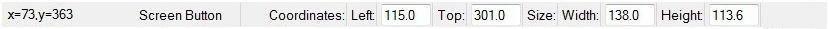
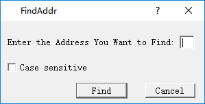
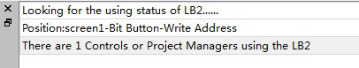
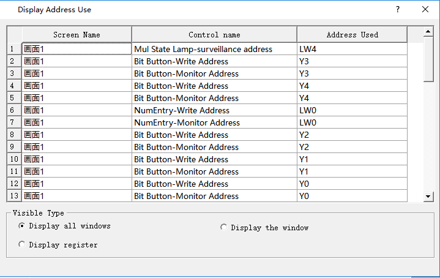
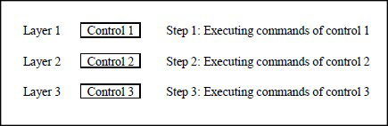
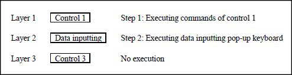

# CommandHMI Control Instructions

CommandHMI configuration software provides full-featured basic controls. Users can double-click or right-click the control in the view area to set the properties. The position and size of controls can be modified manually in the status bar below or directly drag the mouse.

Address input of controls: It is available to input an address directly through a keyboard when it needs to operate on the PLC address. The address name is case-insensitive.

Status combo box: In the toolbar, there is a combo box where to display and change the state of bit button, bit indicator, multi-state button, multi-state indicator, graphics move, message display and picture display.

When a control of the above type is selected, its current state is displayed in the status combo box that users can pull down to change the current state.

Address Search: Query the use of an address and list the information of control occupying this address; double-click the information item to select the control.

Enter the address and select "Find", then the information output window will list the search results:

Choose the search result and double-click to select the control occupying the address currently.

Address Display: Click the "Address Display" to show the list of addresses used by the configuration project; double-click a message, then it will pop up the property page of control using this address so as to set the property settings easily and quickly.

In the Display Mode, you can specify the selected address information or display all the screens.

Overlay of control: You can execute multiple controls by one operation through stacking controls. CommandHMI supports stacking up to 32 controls. When multiple controls are overlaid and touched, the corresponding operations are performed in the order in which they are superimposed, as shown in Figure below:

Superimposing the control 1, 2 and 3, after the touch, execute in turn the command 1, 2 and 3.

If there is a screen switch button in the overlaid control, it will switch the screen when it comes to the turn of this command. The superimposed button commands that are after the screen button will not be executed. Similarly, if there is a pop-up input keyboard, it will pop up a keyboard while without executing the after commands.

