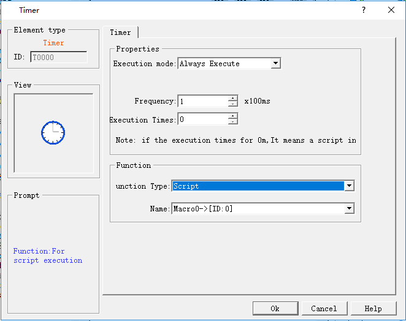

# Timer

Timer is a control whose function can be triggered by time. In CommandHMI configuration software, Timer is designed for a macro trigger control. Click on the toolbar or double click the existing Timer to enter the setting page of Timer:

**Control**

• Execution mode: Choose an execution mode between Always Execute and Address Triggered.

1\. "Always Execute" means always executing the macro command at a certain frequency set by user.

2\. "Address Triggered" means executing the macro command at the set frequency when the value of the specified bit is 1 while no execution when the value of the specified bit is 0.

• Address: When "Address Triggered" mode is selected, the address input field appears where to input the bit address controlling the execution of the macro. When its value is 1, the macro runs.

• Frequency: The frequency at which the selected macro runs ranging from 0.1 to 60S.

• Execution Times: Run times of the selected macro. When the value is 0, the macro will be executed all the time.

**Function**

• Function type: Select the type of function to be executed. The function of timer control in CommandHMI configuration software is macro.

• Name: The name of the macro to be executed. The timer cannot be set when no macro is present.

The size of the timer control cannot be changed, but the position can. When the project runs, the timer control is not displayed on the HMI.
