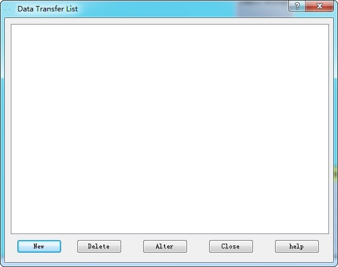
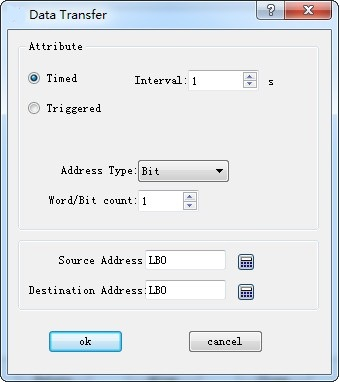

# Data Transmission

Used to transmit data between PLC and HMI or between PLC and PLC. Click "Data Transmission" in the Project Manager to show the current data transmission list.

Figure 7-36

The transmission list lists details of all the current transmission items. Users can create, delete and modify them. CommandHMI configuration software supports up to 512 data transmission items.

To create a new one or modify an existing transmission item, it needs to enter the Property Setting page:

Figure 7-37

**1. Attribute**

Timing / Trigger: Select the trigger mode for data transfer.

Timing: Perform data transfer at the set interval.

Triggering: The transmission signal is controlled by specified address. Execute this command when the address value is 1.

Automatic reset: When the value of address trigger is 1, set it automatically to 0.

Address Type: Select the address type to transfer data: Bit / Word / Double Word.

Word / Bit: Input the length of the data to be transferred. The length range is 1~ 64.

**2. Address**

Source Address: The source address of the transmitted data, which must be of the same type as the type of address set in the "Property".

Destination Address: The destination address of the transmitted data, which must be of the same type as the type of address set in the "Property".

Destination address and Source address cannot be on the same PLC.
