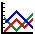
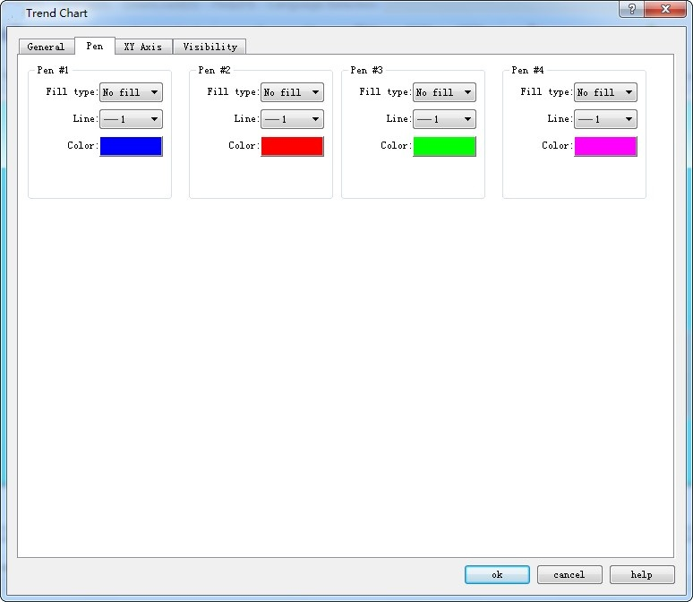
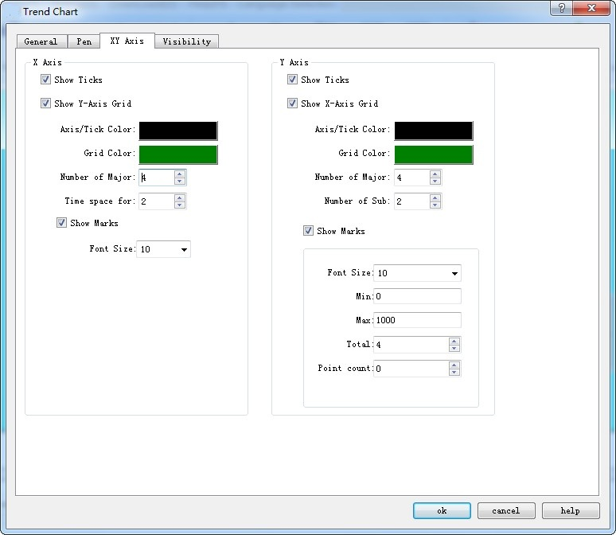

# Trend Chart

**Trend Chart Summary:**

Dynamic, variable and continuous value displayed continuously.

Draw reference curves of multiple data. Take the time as the horizontal axis, the value as the vertical coordinate axis, in order to accurately and intuitively judge the change tendency of a certain value during a period of time.

Up to 8 polylines can be displayed (line graph).

Add properties of the trend graph:

1. Select the Trend Chart icon in the toolbar, and then the properties dialog box appears, as shown in Figure 4-50

Figure 4-50    Trend Chart Common Dialog Box

• Background color: Change the background color of the trend chart. The effect cannot be visible until you click OK.

• Data type: 7 kinds of data types are available for users.

• Read trigger bit: Only when the "Read trigger bit address" value is 1, the curve will move around.

• Curve number: Number of lines, up to 8.

• Automatic reset of Read trigger bit: Whe the read address detected is 1, then the address value is assigned to 0.

• Number of data points per group: Number of data shown on the X-axis.

• Sampling time: The sampling frequency.

• Read Address: The value of the Read Address represents the value of each line on the Y-axis direction. According to different data group numbers and data types, Read address can be read continuously (16-bit data) or read at intervals (32-bit data).

• Variable data points: According to the address value of the dynamic set of "Number of data points per group." When this option is selected, the address value default is the initial value of the Number of Data Points per Group.

**Detection**

• Enabled: Indicate whether the detection line (reference line) is enabled.

• Color: The color of the detection line (reference line).

• Detection address: Write the value of the current detection line (reference line) to the detection address.

• Whether to use the control address: Set the dynamic minimum and maximum value of the Y-axis according to the value of control address value. This address occupies five consecutive address shifts; change the minimum and maximum value of the Y-axis scale referencing the X-axis and also whether to restore the initial state.

|                |                                                                                                                                                                    |
|----------------|--------------------------------------------------------------------------------------------------------------------------------------------------------------------|
| Address Offset | Control Register Address Control object                                                                                                                            |
| 0              | 16 bits less than the minimum value                                                                                                                                |
| 1              | 16 bits more than the minimum value                                                                                                                                |
| 2              | 16 bits less than the maximum value                                                                                                                                |
| 3              | 16 bits more than the maximum value                                                                                                                                |
| 4              | Whether to restore the initial state of the maximum and minimum values. The address value of 1 indicates a dynamic change, otherwise the initial value is restored |

The control address can only use the internal address, and the minimum and maximum value account for two consecutive word address respectively.

E.g.:

When the 16-bit data type is selected and the number of data groups is 8, it is assumed that the user-input address is LW3, and 8 groups of address values are continuously read out,

LW3: The value of line1

LW4: The value of line 2

LW5: The value of line 3

LW6: The value of line 4

LW7: The value of line 5

LW8: The value of line 6

LW9: The value of line 7

LW10: The value of line 8

Therefore, when the user selects 16-bit data and sets the number of N groups of data, the user can read out the address values of the N groups in succession according to the address rules of different PLC models.

When the 32-bit data type is selected and the number of data groups is 5, it is assumed that the user-input address is LW3. Then, 5 sets of address values are read out consecutively.

LW3: The value of line 1

LW5: The value of line 2

LW7: The value of pen 3

LW9: The value of line 4

LW11: The value of line 5

Therefore, when select 32-bit data and set the N-group data group number, user can read out the N group address value by adding 2 to the address value (at interval) according to the address rules of different PLC models.

• Direction:

• Left to right: The line moves from the left.

• Right to left: The line moves from the right.

• Background color: The color of the line

• Clear Trigger Bit: Clear the current status of all lines when the address value changes from 0 to 1 (rising edge).  The line remains the same when the address value changes from 1 to 0 (falling edge) or has no change,.

The "Line" page of the Trend Chart is shown in Figure 4-51: This page allows user to set the maximum value, minimum value, style and color of each pen.

Figure 4-51    Trend Chart Pen Dialog Box

The data type in the General page determines that of the maximum and minimum values here.

For example, if the maximum or minimum value is a floating-point number, user must first select 32-bit floating-point number in the Data Type in the General page. Otherwise, an error will occur when user clicks "OK".

3\. The "XY Axis" page of the trend chart is shown in Figure 4-52:

Figure 4-52    Trend Chart XY Axis Dialog Box

• X-axis

• Display scale: whether to display the X-axis scale.

• Show Y-axis grid: Whether to display Y-axis grid.

• Axis / Scale Color: Change the color of the X-axis / scale.

• Grid Color: Change the X-axis grid color.

• Main sub-scale: X-axis main scale.

• Sub-scale: X-axis times the number of times.

Display Scale Indicates whether the X-axis scale is displayed.

• Y-axis

• Display Scale: Whether to display the Y-axis scale.

• Show X-axis grid: Whether to display the X-axis grid.

• Axis / Scale Color: This option changes the color of the Y-axis / scale.

• Grid Color: This option changes the Y-axis grid color.

• Major scale division: Numbers of Y-axis major scale.

• Sub-scale division: Numbers of Y-axis sub-scale.

• Show Marks: Whether to display the Y-axis scale mark.

• Font Size: Change the font size of the Y-axis scale.

• Minimum: The minimum value of the Y-axis scale.

• Max: The maximum value of the Y-axis scale.

• Total: Display the maximum digital number of the data.

• Decimal Place: The maximum digital number that can be displayed after the decimal point.

The "Visibility" page can refer to that of "Bit Button" control.
