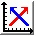

# XY Trend Chart

**XY Trend Chart Overview:**

Dynamic, variable and continuous value displayed continuously.

You can draw multiple data reference curve, and take two consecutive register address value as the horizontal axis and vertical axis coordinates respectively, in order to observe the change rules accurately and intuitively.

Up to 8 polylines can be displayed (line graph).

Operations of adding XY Trends and modifying XY Trend Properties are similar to those of Trend Chart. Users can refer to the "Trend Chart" page operation. Open the icon

Open the XY Trend Property dialog box; refer to the "Trend Chart" property settings. It should be noted that each line in the Trend Chart represents the value of consecutive addresses starting from the write address, and each in the XY Trend Chart represents the value of two consecutive addresses starting at the write address.

**XY Trend Chart Application:**

Color: The color of the detection line (reference line).

Detection address: Write the value of the current detection line (reference line) to the detection address.

For example, if 16-bit data type is selected and the number of data groups is 4, assuming that the user-input address is LW3, 8 sets of address values are continuously read,

LW3: Line1 Value of the X-axis

LW4: Line 1 Value of the Y-axis

LW5: Line 2 Value of the X-axis

LW6: Line 2 Value of the Y-axis

LW7: Line 3 Value of the X-axis

LW8: Line 3 Value of the Y-axis

LW9: Line 4 Value of the X-axis

LW10: Line 4 Value of the Y-axis

The addresses to be read are LW3-LW10, with 8 groups of addresses. Therefore, when select the 16-bit data and sets N groups of data, you can read values of 2 \* N groups of address consecutively according to address rules of different PLC models.

When the 32-bit data type is selected and the number of data groups is 3, assuming that the user-input address is LW3, then it needs to read address values of 12 data groups in succession.

LW3: Line 1 Value of the X-axis

LW5: Line 1 Value of the Y-axis

LW7: Line 2 Value of the X-axis

LW9: Line 2 Value of the Y-axis

LW11: Line 3 Value of the X-axis

LW13: Pen 3 Value of the Y-axis

The addresses to be read are LW3-LW14, with 12 sets of address. Therefore, when select 32-bit data and set N groups of data, you can read address values of 2 \* N data by plus 2 at interval according to address rules of different PLC models.
