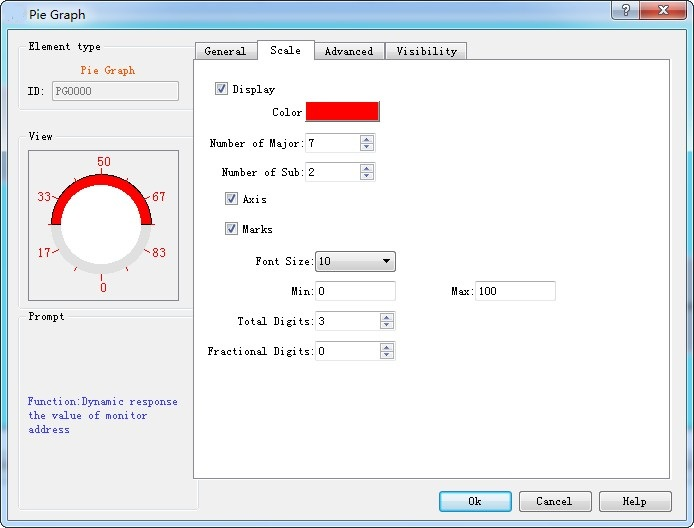

# Arc Chart

The control of Arc Chart (also called Pie chart) functions similarly to the Meter, which is applied to read and reflect the value of monitor address. In this control, the reaction area can be shown by the "Pie foreground color", "Pie background color" and "Pattern". The control icon on the toolbar is ;  click on it to pop up a dialog box as shown in Figure 4-111:

Figure 4-111   Arc Chart General Page

The Scale page dialog box, as shown in Figure 4-112:

Figure 4-112 Fascicle Scale page

Refer to the scale page of “Meter” for the settings of scale.

Refer to “Numerical display” for the parameter settings of “Advanced”.
