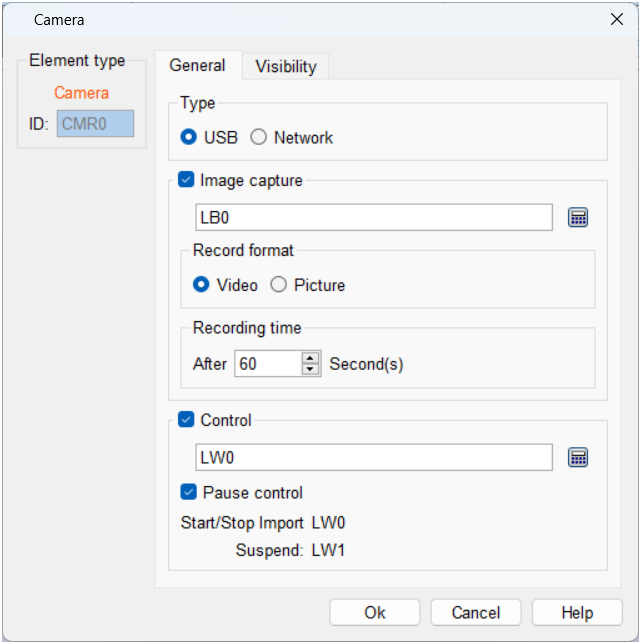

# Camera

The camera control component supports recording video or capturing images from an external camera, and clicking on the function control component's camera control component prevents the page from looking like this:

USB: Using a USB-connected camera requires an HMI system version of Linux 4.9.84 (001) or higher to be used;

Network camera: In this case, the input stream format is RTSP, for example, the code stream format of Hikvision camera is:

admin:xl123456@192.168.1.63:554/ch1/sub/av_stream;

The stream sequence is: account name: password@IP address: the first four items are custom settings by the user based on camera parameters, and the subsequent content is fixed by the camera brand.

Tip!

Whether it is a USB or network camera, if the resolution of the camera is too high, there will be a delay or stutter in touch screen playback, and the camera stream resolution, frame rate, etc. need to be lowered. USB cameras support mjepg video stream, and network cameras need to support h246 encoding stream. The Hikvision cameras have been tested and verified, and other brand cameras need to be based on the actual test results.

Image Capture Function: After the address-triggered capture function is activated, a video folder named "video" will be created under the U disk directory for saving the captured video or pictures.

Record Format: When the record format is set to image, the maximum number of images that can be recorded is 60S. The video format saved by the network camera is MP4, and the video format saved by the USB camera is AVI.

Picture: When the record format is set to picture, the file is saved in JPG format.

\[Start/Stop Import\]: When the input is 1, the continuous camera is enabled and the video stream is imported; when the input is 0, the connected camera is turned off and the information stream is also closed. \[Pause Control\]: Pause the display of the camera content, and the video will continue to be transmitted. When controlling the address setting, only the start/end address needs to be set, and the pause address is the start address plus 1.

For example, when the start/import address is set to LW N, the pause address is LW N+1.

The display page can be referenced by the "Position Switch" button.
