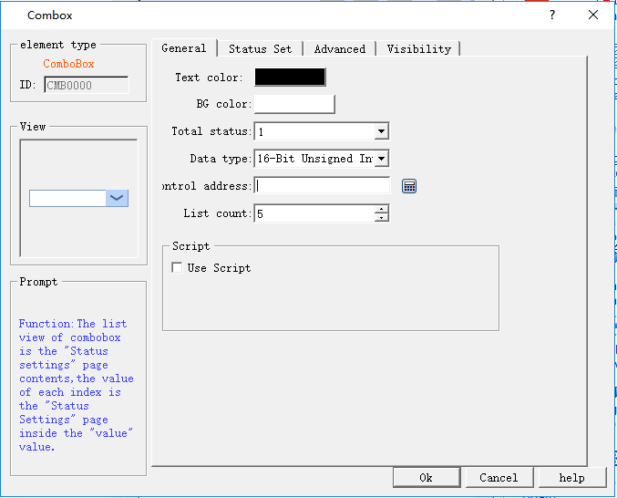
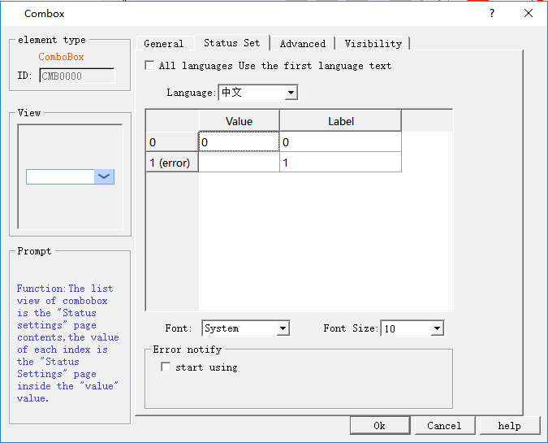

# Combo Box

The Combo Box allows you to display a list of items that can be viewed and selected by user. Once an item has been selected, the corresponding value is written to the control address of the character register.

The control icon on the toolbar is; click on it to pop up the dialog box as shown in Figure 4-115:

Figure 4-115   Combo box General page dialog box

• Total Number of States: Set the number of states for this object. Each item represents a status and is displayed on the list. The value of this item can be written to \[Control Address\].

• Background Color: Select the background color of the selected object

• Text Color: Select the text color of the selected object

• Control Address: Write address

• Use macro: Execute the selected macro if they are touchable.

Status Set: Click "Status Set" page; the following figure is shown (Figure 4-116):

Figure 4-116   Combo box Status Set page dialog box

• Language: Use a consistent "font" and "font size" for all states while different "fonts" and "font sizes" for different languages.

• Value: Set a value for each item, but it needs to be subject to the following two specifications:

a\. \[Read\]: If the system detects any change in the contents of \[Control Address\], the object will compare the content with its value and select the first matching item. If no item matches, it will jump to the error s9tate and triggers the error notification bit (if set).

b\. \[Write\]: When an item is selected, the system will write the value to \[Control Address\].

• Label: User can set text content for each item. The item menu will show texts of all the items on the list for user to view and select.

• Error notification

a\. For example, when \[Number of status\] is set to 8, state 8 is the error status. Similarly, if it is 11, the state 11 is the error state.

b\. When an error occurs, the combo menu will display the text of the error status.

When an error occurs, the system sets a specific bit to ON / OFF (written to \[Error notification address\]). Notification of this bit register can be used to trigger an operation to correct the error.

Refer to "Bit Button" for the application of "Advanced" and "Visibility".
