# Pipeline

The function of the control is to set the line diameter according to the set location of the specified control

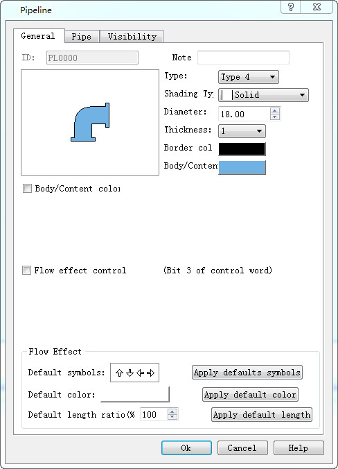

Pipeline general dialog

Ø  Style: set line display style, style has the following several effects, display effect reference "[style](#style)"

Ø Gradual layer: setting up the line of the pipeline to display the effect, the layer has the following results, the display effect is refer to the "[gradual layer](#Graduallayer)"

Ø Diameter: the diameter of the pipeline is set, which is used to change the diameter of the pipeline“[diameter](#diameter)”.

Ø Thickness: the thickness of the pipeline is set, and the thickness of the pipe is added on the basis of the diameter of the pipeline. The effect is referenced "[thickness](#thickness)"

Ø Edge: the color of the pipeline thickness is set, which is the color of the pipeline edge when the pipeline thickness is 0

Ø  Pipe wall/content: set the line main display color

Ø Wall/content color variable

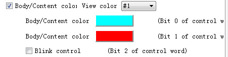

l  See color: when the pipe wall/content color variable function is enabled, the line displays the color, the color content is selected from the pipe wall/content, tube wall/content color \# 2, tube wall/content color \# 3, which is only shown in the configuration software, and the position control of the color controlled word is displayed in the actual operation

l  Tube wall/content color \# 2, tube wall/content color \# 3: set the different colors of the line

l  Scintillation control: control the line flashing

Ø  Flow control：

l  Control word: word, double word

l  Flow effect: (note that only after the pipe page is set to enable the flow effect of the pipe, the following types can be applied to the pipes that enable the flow effect).

Preset type: setting pipe flow effect

Default color: set the flow color of the pipe

The preset length ratio is (7) : the length ratio of the pipe is set

All use the preset type, color, and length: choose to apply a type to all the pipes that enable the flow effect of the pipe page

Ø Control word：

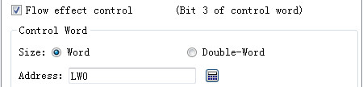

The user enables the control of the tube wall/content color variable and the effect control of the effect of the effect control, which is different from the different display effect of a control control of the selected register. Take lw0 as an example

<table>
<colgroup>
<col style="width: 11%" />
<col style="width: 11%" />
<col style="width: 11%" />
<col style="width: 11%" />
<col style="width: 11%" />
<col style="width: 11%" />
<col style="width: 11%" />
<col style="width: 11%" />
<col style="width: 11%" />
</colgroup>
<tbody>
<tr class="odd">
<td>
<strong>register</strong>
</td>
<td>
<strong>No. 0</strong>
</td>
<td>
<strong>No. 1</strong>
</td>
<td>
<strong>No. 2</strong>
</td>
<td>
<strong>No.3</strong>
</td>
<td>
<strong>No. 4</strong>
</td>
<td>
<strong>No. 5</strong>
</td>
<td>
<strong>No. 6</strong>
</td>
<td>
<strong>No. 7</strong>
</td>
</tr>
<tr class="even">
<td>
<strong>LW0</strong>

<strong>（The corresponding bit is on on）</strong>
</td>
<td>
Set the tube wall color

Tube wall/content color #3
</td>
<td>
Set the tube wall color

Tube wall/content color #3
</td>
<td>
Line flashing

The current two are on or offColor is the color of the tube wall/content set

The current two are only set up one time, the line color is inThe pipeline content is switched between the pipeline content #
</td>
<td>
Pipeline flow
</td>
<td>
retention
</td>
<td>
retention
</td>
<td>
retention
</td>
<td>
retention
</td>
</tr>
</tbody>
</table>

Pipe setting interface：

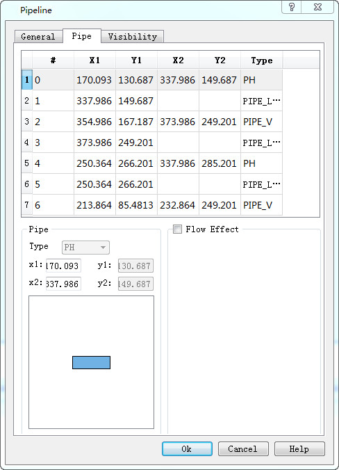

Ø  Pipe setting interface

l  X1，Y1，X2，Y2：

The coordinate point of the pipe, the left coordinate (x1,y1), the right coordinate (x2, y2).

The user can modify the tube coordinate, need to be careful, the transverse tube can only modify the x coordinate, the longitudinal tube can only modify the y coordinate, the Angle coordinate cannot be modified, but can modify the Angle coordinate style type。

l  Flow effect: the user can set up each pipe to display different kinds of flow effect, display color, length ratio, etc.

If the user USES the same type of display effect, you can only enable the flow effect here, using all the preset functions in the general interface, and can be applied to the current control for all the pipes that start the flow effect.

The display interface is the same as his control, which can refer to the "bit switch" display page.

style：

style 1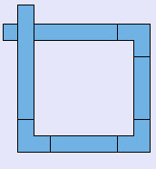 style 2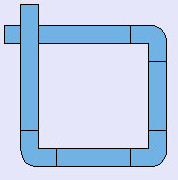 style 3 style 4 style 5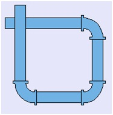

Gradual layer：

Pure color  Three-dimensional style 1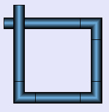 Three-dimensional style 2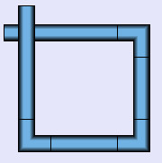 Three-dimensional style 3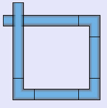

diameter：

diameter 10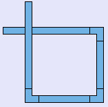 diameter 20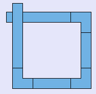 diameter 30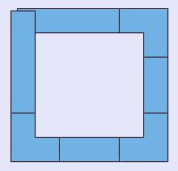

thickness：

thickness 0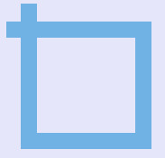 thickness 1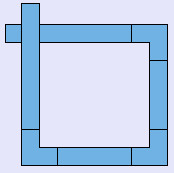 thickness 4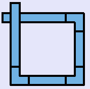 thickness 8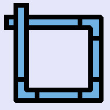
