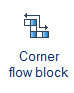
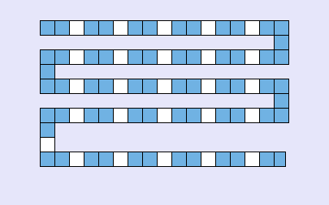
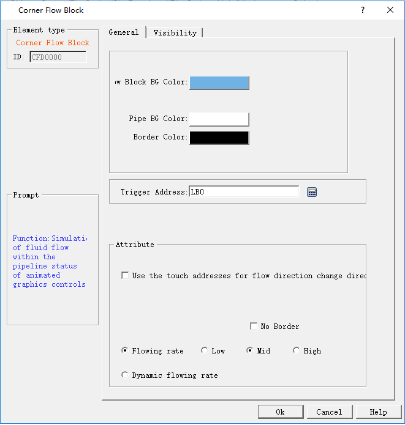

# Corner Flow Block

The function of corner flow block is similar to the flow block.The difference is coner flow block increased corner drawing function,and it is more flexible than flow block.

 Click icon on the Toolbox,move mouse cursor to  the Picture area window,it will get a tracking cross.Click the tracking  cross on the starting position of corner flow bock,and then move the mouse,there is a line between starting position and tracking  cross,click the cross on the ending position of corner flow block,you can get first block. The ending position is also the next block’s starting position,the rotation angle is 90°.So you can get multi segment flow blocks.Right click  can quit drawing.The demonstration effect as shown figure 4-134.

Figure4-134  corner flow block

After drawing complete,double click the block or right click choose attribute,it will pop up a corner flow block dialog,as shown figure 4-135.

Figure4-135corner flow block dialog

Color: Set the color properties of the Flow block.

• Flow block foreground color: Click on the color button to set the Flow block foreground color;

• Flow block background color: Click on the color button to set the Flow block background color;

• Pipe foreground color: Click on the color button to set its foreground color;

• Pipe background color: Click on the color button to set the pipe background color;

• Border color: Click on the button to set the border color of the Flow block control;

• Pattern: Click to select the pattern of the Flow block control; the default setting is “Solid”.

• Trigger Address: Address that controls the stationary or moving of the Flow block; when the value of the address is 1, then the block flows.

• Attribute: Set the properties of the Flow block, such as direction, flow speed.

• Display Mode: Select "Horizontal" to make the Flow block move horizontally; and select "Vertical” to make it flow vertically.

• Direction: When the display mode is “Horizontal”, you can choose "Left" or "Right"; in another case, "Up" or "Down".

• Change the flow direction to the opposite direction through the trigger address: when the "Trigger address" value is equal to that of the "Effective status" set by user, the Flow direction is switched to the opposite.

For example, If "Flow direction" is "Left”, this option is selected, "Trigger address" is LB2, and "Effective Status" is set to 1, then when the value of LB2 is 1, the direction of the Flow block is switched to "Right", while when the value of LB2 is 0, the direction is changed back to the original "Left".

• Blocks: The number of Flow units, ranging from 1 to 30;

• No Border: When this attribute is selected, the edges of the Flow block are hidden.

• Flow rate: Either fixed rate or dynamic rate

• Fixed Flow rate: High, Middle or Low.

• Dynamic Flow rate: The Flow rate is determined by the value of a word address, which should be between 1 and 10. When the value is 0, the Flow block does not flow; When the value is 1, the Flow block flows at the lowest rate; When the value is 10, the Flow block flows at the highest rate.

The "Visibility" page can refer to that of "Bit Button" control.
