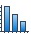
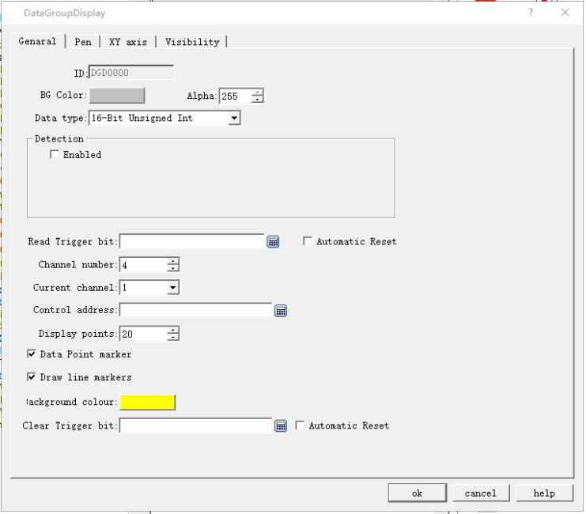

# Data Group Display

Data Group Display: A data group (or block) refers to data in a group of consecutive addresses, such as LW12, LW13, LW14, LW15 and so on. The data group display element can simultaneously display the contents of a plurality of data groups. For example, the data groups from LW12 to LW15 and fro RWI12 to RWI15 can be simultaneously shown so that user can observe and compare the data in each register. It is also available to draw reference curves for multiple data sets. Take the number of points as the horizontal axis, address value of each data as the vertical axis so as to judge the change trend of a value accurately and intuitively during a period of time. Up to 8 polylines (line graph) can be displayed.

The control icon on the toolbar is: ; click on the button, and then a dialog box pops up as shown in Figure 4-122:

Figure 4-122 Data Group Display General dialog box

• Background color: Choose the background color of the trend graph.

• Data type: 7 data types are available for users.

• Read trigger bit: Only when the "Read trigger bit address" value is 1, the curve will move around.

• Automatic Reset: When the value of "Read Trigger Bit Address" is 1, the address will be set to 0 automatically after releasing the mouse button.

• Channel number: The number of data sets, and also the number of lines.

• Current Channel: Select a different channel to set the address for \[Control Address\] of different channels.

• Control Address: Read Address. There are different control addresses for different channels.

This address can be set with diverse initial address according to different channel number; l the length of the address = Len \* Display points (when the data type is 16-digit, len = 1; when the data type is 32, len = 2 ).

For example, if the initial address of channel 1 is LW1, the data type is 32-bit integer, and the display points is 4, the address occupied by channel 1 is LW1 LW3 LW5 LW7;

• Display points: Quantity of control addresses to read for each channel.

• Detection

• Enabled: Whether the detection line (reference line) is enabled.

• Color: The color of the detection line (reference line).

• Detection address: Write the current corresponding value of the detection line to the detection address register.

• For example

16-Bit, 4 Channel number, 10 Display points, LW1 for Channel 1 \[Control Address\]; LW100 for Channel 2 \[Control Address\]; LW200 for Channel 3\[Control Address\]; RWI1 for Channel 4 \[Control Address\]. Then:

Line 1: LW1 to LW10

Line 2: LW100 to LW109

Line 3: LW200 to LW209

Line 4: RWI1 to RWI10

If 32-bit data type, other settings remain unchanged:

Line 1: LW1 to LW20

Line 2: LW100 to LW119

Line 3: LW200 to LW219

Line 4: RWI1 to RWI20

Therefore, when select 32-bit data type and set N-group data, then the N group address value can be read by plus 2 (interval) according to address rules of the different PLC models.

• Background color: The color of the line movement area.

• Clear Trigger Bit: Clears the current status of all lines when the Clear trigger bit address has a value change of 0 to 1 (rising edge); otherwise it remains no change when the value falls from 1 to 0 (falling edge) or has no change.

• Data Point marker: Each line is composed of points

• Draw line markers: Each line is composed of lines.

Refer to “Bit button” for the application of “Visibility” page.
