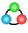
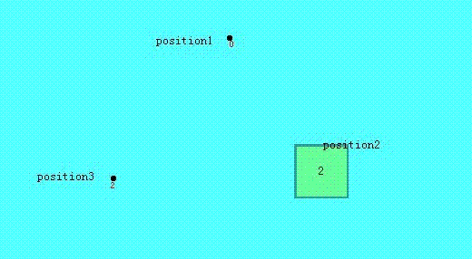
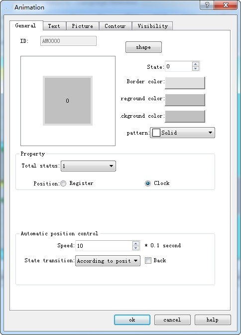
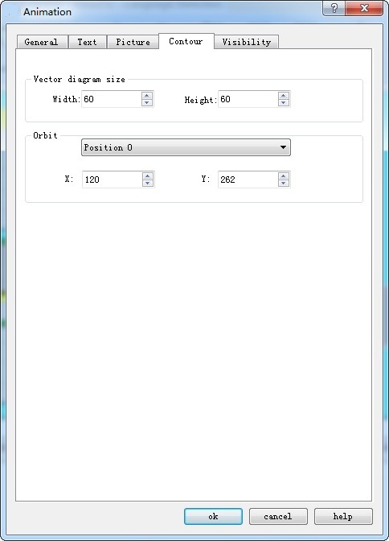

# Animation

Animation: You can define the movement of component in advance, and control its position in the trajectory through data of two registers, one controls the state and the other controls the position.

This control icon on the toolbar is: , after finishing drawing mobile points (Note: up to 64 points) in the screen area), right-click to complete the draw of moving points.

Double-click the control to bring up the pop-up dialog box shown in Figure 4-118:

Figure 4-118   Animation General Page dialog box

Total status: Set the number of element states

Location:

Register: When "Register" is selected, the status and position of the element is controlled by the register data.

Read Address: If the status and position are determined by the data in the register, the read address of the element status and position must be set correctly. The format of the read address is shown in the table below.

|           |                            |                              |
|-----------|----------------------------|------------------------------|
| Data Type | Control address for Status | Control address for Position |
| 16-Bit    | Address                    | Address + 1                  |
| 32-Bit    | Address                    | Address + 2                  |

For example, if the register is \[LW100\] and the data format is "16-bit positive integer", \[LW100\] stores the state of the element, and \[LW101\] stores the display its position. As shown in Figure 4-119, for example, \[LW100\] = 2, \[LW101\] = 1, so the element displays state 2 and appears in position 1.

Figure 4-119

• Clock: If choose "Clock" option, the component will automatically change the status and display position. The item of "Automatic position control" is used to set the status and change mode of position.

• Speed: The speed of position change; the unit is 0.1 second. For example, 10 means the element is shifted by one position every one second.

• Back: Assume the element has four positions -- position 0, position 1, position 2 and position 3. If this option is not selected, the element will move to the initial position (position 0) when it moves to the last position (position 3), and then repeat the original position change mode.

Position 0-&gt; position 1-&gt; position 2-&gt; position 3-&gt; position 0-&gt; position 1-&gt; position 2...

If this option is selected, the element will move to the initial position (position 0) when it is moved to the last position, and the original position change mode will be repeated. The sequence of movement position is as follows:

Position 0-&gt; position 1-&gt; position 2-&gt; position 3-&gt; position 2-&gt; position 1-&gt; position 0...

Status transition: The way of state change

You can choose Position-Based or Time-Based. Selecting "Position-based" indicates that the status changes with the change of position.

If the "Time-Based" is selected, the position and status will be changed according to the points on the screen.

Figure 4-120   Auto control position

**Profile page:**

Vector Diagram Size:

• Width: Width of the graphical control in the General page.

• Height: Height of the graphical control in the General page.

• Orbit: Adjust the position of different track points by selecting them.

Refer to “Multi-state Indicator Lamp” for settings of "Text" and "Picture" page.

Refer to “Bit button” for the application of “Visibility” page.
