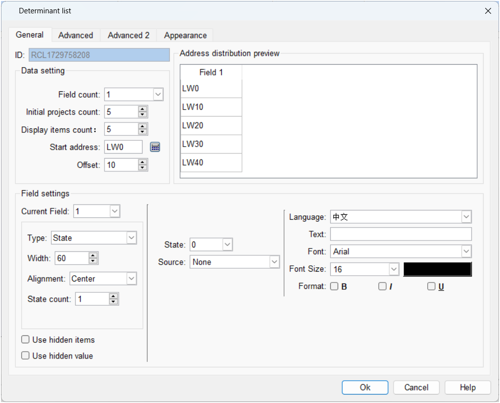
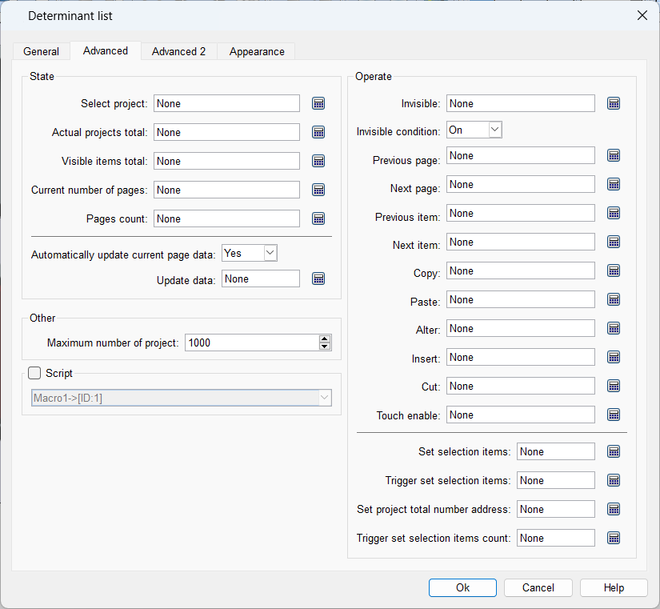
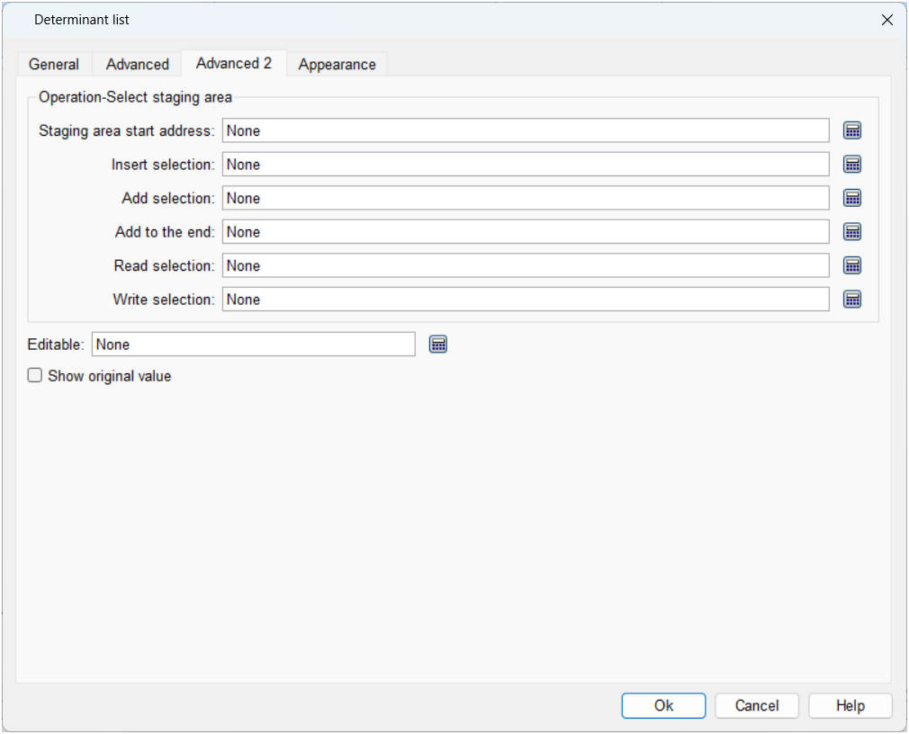
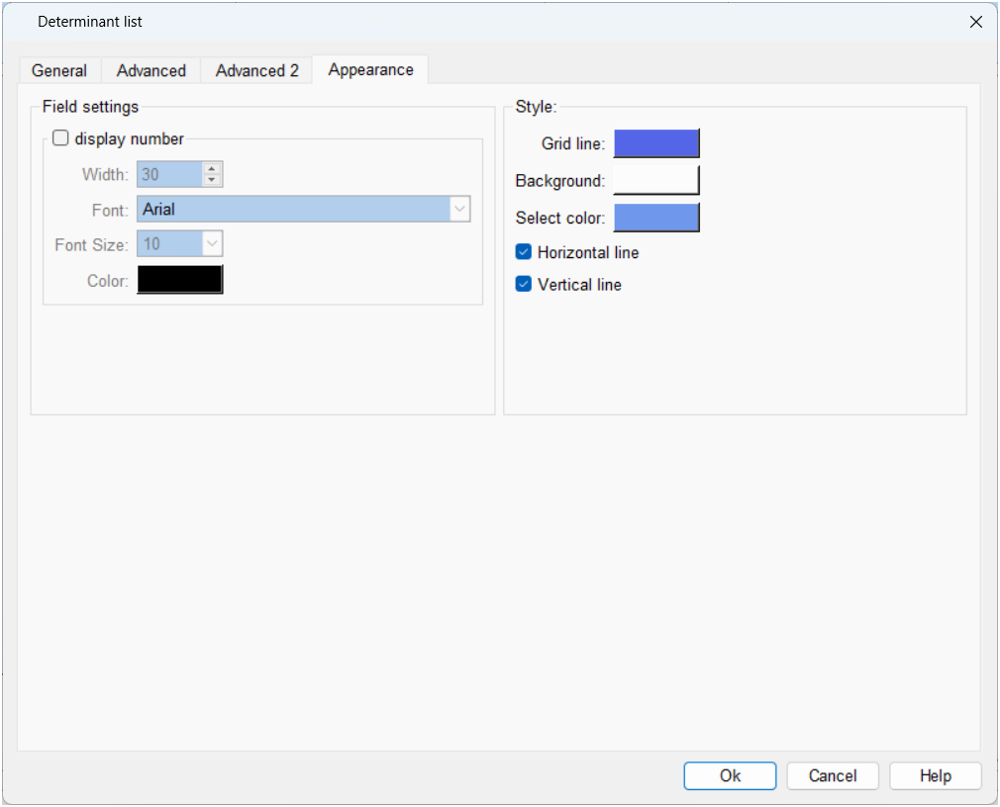

# Determinant

This element displays user-set data in grid box format, providing an easier interface Select and operate. Its functions include automatic page change, insert, delete, copy and paste.

General Page

Data settings

Total Fields: Number of Table Columns

Initial total number of items: the initial total number of rows in the table

Number of items displayed on a single page: the number of rows displayed on a single page

Start address: the address corresponding to the first element of the table

Address offset: The address offset of each row of the column

Address preview

Display the address distribution corresponding to the table

Field settings

Current Field: Current Column

Field type: including State, String, Numeric

Field Width: Column Width

Alignment: Alignment of column elements

Total number of states: The total number of states of the column element

Advanced

status

Selected Items: Selected Elements

Actual total number of items: the actual total number of elements

Total Visible Items: Total number of visible elements

Current page: current page number

Total Pages: The total number of pages

Automatically update current page data: Yes: Automatically update; otherwise, it is controlled by setting address

Update data: set update address

Operation

Invisible bit: Set the data to be invisible

Invisible level: Conditions for the invisible position to take effect

Previous page trigger address: Jump to previous page

Next page trigger address: Jump to the next page

The trigger address of the previous item: select the previous one in this column

Next trigger address: select the next one in this column

Copy trigger address: Copy current item

Paste trigger address: Paste data

Replace trigger address: Overwrite the pasted data to the current item

Insert trigger address: Insert an item in the current item

Cut trigger address: cut data

Touch protection bit: touch protection

Set the address of the selected project: set the project to be selected

Trigger setting selection item: Trigger setting selection item takes effect

Address to set the total number of items: Set the total number of items

Total number of trigger setting items: The total number of trigger setting items takes effect

Advanced two

The temporary storage area is a buffer area that can be used for elements to temporarily store data. Data in the buffer can be inserted, added and written to selected items, And the data in the selected item can also be read into the buffer.

Staging area

Start address: Set the start address of the temporary storage area

Insert selected item bit: When it is On, insert the data in the buffer (its address: buffer start address + item address offset) into the selected item, and the actual number of items will increase by 1 . If the actual number of items has already reached the maximum, the selected item cannot be inserted.

Add selected item bit: When it is On, the data in the buffer (its address: buffer start address + item address offset) is added to the selected item, and the actual number of items will increase 1. If the actual number of items has already reached the maximum, the selected item cannot be inserted.

Add to the end: When it is On, add the data in the buffer (its address: buffer start address + item address offset) to the end, and the actual number of items will increase by 1. If the actual number of items has already reached the maximum, the selected item cannot be inserted.

Read selected item: When it is On, read the content of the selected item into the buffer (its address: buffer start address + item address offset)

Write selection item: When it is On, write the buffer data (its address: buffer start address + item address offset) into the selection item

Appearance

Field settings

Set the form number, etc.

style

Set the grid line, background color, background color when selected, etc.
