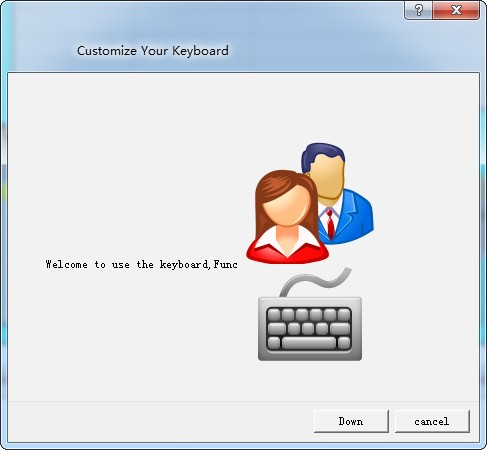
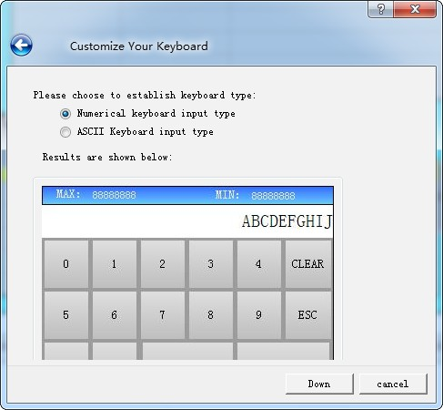
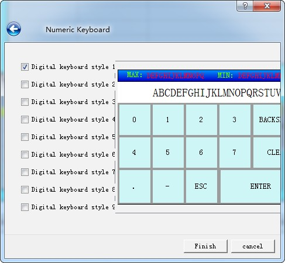

# Keyboard

**1. Keyboard:** This control is employed to customize the keyboard, composed of each button on the keyboard. The icon of the control on the toolbar is:; Click on the button, then a dialog box shown in Figure 4-123 will pop up.

Figure 4-123   Keyboard General Page dialog box

• State: Click "Before" and "After" buttons to set the border color, foreground color, background color and pattern in different states.

• ENTER: Function button, whose role is to realize the input

• BACKSPACE: Function button, which is used for backspace deletion

• CLEAR: Function button applied to clear all the contents that have been input

• ESC: Function button to cancel the currently ejected keyboard, without entering anything

• ASCII: The value entered by the keyboard

Refer to “Bit button” for the application of “Visibility” page.

**2. Way to add a user-defined keyboard**

Start up the guide to add keyboard by means of the Add User-defined Keyboard in the Setting menu. Using this guide, user may quickly add a user-defined keyboard that has been built in the program, as shown in the figure below:

Figure 4-124   Page 1 of user-defined keyboard guide

Click Next, and an interface will pop up for keyboard type choosing. You may choose the type of the keyboard to be added in this interface, as shown in the figure below:

Figure 4-125   Page 2 of user-defined keyboard guide

After selecting the keyboard type you want to add, click Next to load the pre-defined keyboard. There are nine predefined keyboards available for loading. The user can add the required keyboard as needed. The maximum added keyboard number could be 32, as shown in Figure 4-126

Figure 4-126   Page 3 of user-defined keyboard guide

Click OK to add the selected keyboard to the project.
