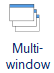
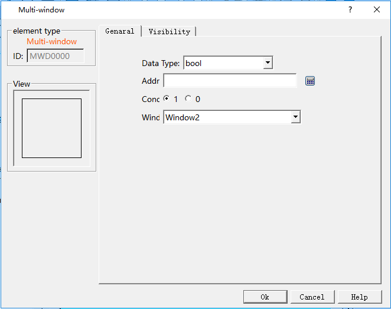
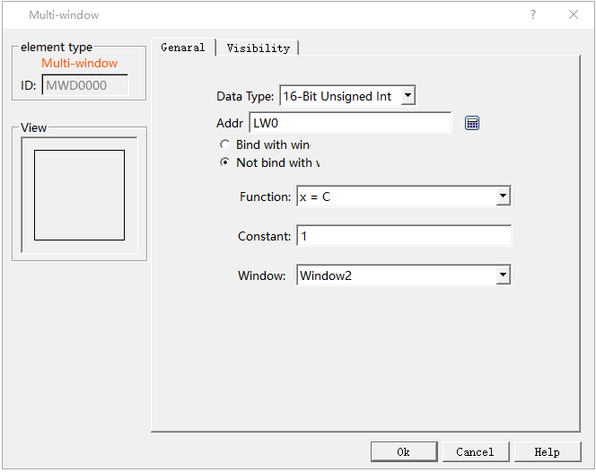
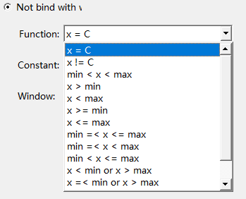
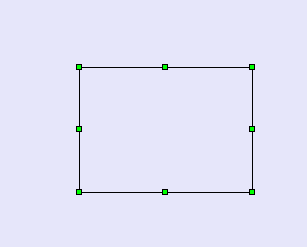
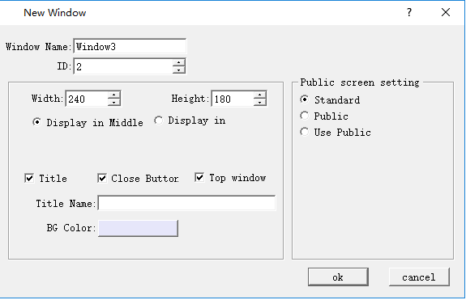

# Multi Window

Multi-window provide a rectangle area to show assigned window.

 Click icon on the Toolbox,it will pop up a multi-window dialog,as shown figure 4-136.

Figure 4-136 Multi-window dialog

• Data Type：the Type of data that control the showed window.include of bool and word.

“bool”：opening the assigned window on the rectangle area are judged by suit the condition.

“Word”：Choose the control address,and check “Bind with window”or “Not bind with window”,as figure 4-138 shown.

• Address：the value of address controls the window opening；

Figure 4-138multi-window dialog

“Bind with window”:The value of address is the ID of assigned window.

“Not Bind with window": Check a function,when fit the condition of function,open the assigned window.The functions is as shown follow。

Figure 4-139

      Refer to “Bit button” for the application of “Visibility” page.

After setting parameter of multi-window,click”ok”,drag mouse on Picture area window,and create a rectangle area.The area would display the multi-window,as shown figure 4-140.

Figure 4-140

When creating a new window,”Top window” is defaulted,as shown follow.It means that you can not operate other screen or window when this window pop up. So you should add a screen button on the window to close it.

Figure 4-141 window property
