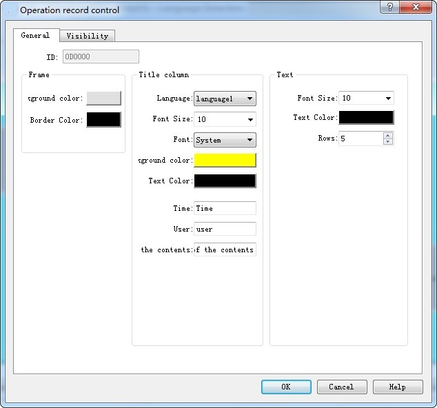

# Operation Log

Select the control icon on the toolbar and set its properties in the dialog box shown below:

Figure 4-133   Operation Log General dialog box

• Background color: Set the background color of display control

• Border color: Set the border color of display control

• Language: Set the text content on the title bar when select multi-language

• Font size: Font size of title bar

• Background color: Background color of title bar

• Text color: Font color of title bar

• Time: Text to display in the Time column of title bar

• User: Text to display in the User column of title bar

• Operation content: Text to display in the content column of title bar

• Font size: Font size of record text

• Text color: Text color of record text

• Rows: The maximum number of rows the control can display

To enable the HMI operation record, it needs to set the value of LW60600 equal to 1 and the variable table is not empty;

The operation log can only record the variable operation in the variable table.
