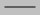
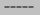
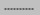
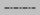
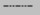

# Path display

The function of the control is to draw the corresponding graphic elements point, line, arc, circle, etc.

The relevant addresses used by this control are all internal registers LB or LW addresses

Path display general dialog box

• Foreground color, border color, background color, Visibilitiy style reference "bit button"

• Path definition area: path correlation element definition area, data specific meaning reference chapter finally "[path definition zone address description](#路径定义区地址说明)"

• The drawing trigger bit: the address data of the bit address starts drawing, the address data is off

• Remove the trigger bit: the address data is cleared for on

• Select function: select the current drawing graph to display the relevant information

• By bitability: whether to enable the selection function, the default address is off, and the selected function is enabled. The bits address data is on. close the selected function

• Select report data type: select report data store type as needed

• study report receiving area: set report receiving area for choosing store address, specific meaning refer to the last of this chapter "[report receiving area for choosing address](#选点报告接收区地址)"

• Search radius (pixel) : sets the search radius

• Cursor color: sets the cursor color

• notice：

• signal：

Position: enable the function of selecting points, select a point in the current drawing graph, this option will be triggered, and set the notification bit as the specified state. The notification bit shall be manually reset to normally monitor the status of subsequent notification of selecting points

Pulse: enable the function of selecting points, select a point in the current drawing graph, this option will be triggered, and set the notification bit to ON, and the notification bit will be automatically reset

Notification bit: sets the order and the address to be notified when the pulse function is triggered

**Path definition area address description：**

Path definition area: specify the drawing parameter address of the path display in the following format. Take the address LW0 address as an example. The data meaning is as follows

|                     |                                                             |
|---------------------|-------------------------------------------------------------|
| Word number         | instructions                                                |
| LW0                 | The number of path elements in the path                     |
| LW1~LW8             | Information about the first path element in the definition  |
| LW9~LW16            | Information about the second path element in the definition |
| ...                 | ...                                                         |
| LW（8n-7）~LW（8n） | The NTH path element in the definition                      |

Index of related elements: [point](#点), [line](#线), [arc](#圆弧), [circle](#圆), [thickness](#厚度), [color](#颜色)

point：

|         |           |                       |
|---------|-----------|-----------------------|
| Word    | Mnemonics | Describe              |
| LW1     | type      | The point code is 0   |
| LW2     | color     | [color](#颜色)        |
| LW3     | x         | X coordinate of point |
| LW4     | y         | Y coordinate of point |
| LW5~LW8 | (keep)    | Now is zero           |

line：

<table>
<colgroup>
<col style="width: 33%" />
<col style="width: 33%" />
<col style="width: 33%" />
</colgroup>
<tbody>
<tr class="odd">
<td>
Word
</td>
<td>
Mnemonics
</td>
<td>
Describe
</td>
</tr>
<tr class="even">
<td>
LW1
</td>
<td>
type
</td>
<td>
The code for the line is 1
</td>
</tr>
<tr class="odd">
<td>
LW2
</td>
<td>
color
</td>
<td>
<a href="#颜色">color</a>
</td>
</tr>
<tr class="even">
<td>
LW3
</td>
<td>
X1
</td>
<td>
Starting point x coordinate
</td>
</tr>
<tr class="odd">
<td>
LW4
</td>
<td>
Y1
</td>
<td>
Starting point Y coordinate
</td>
</tr>
<tr class="even">
<td>
LW5
</td>
<td>
X2
</td>
<td>
End point X coordinate
</td>
</tr>
<tr class="odd">
<td>
LW6
</td>
<td>
Y2
</td>
<td>
End point Y coordinate
</td>
</tr>
<tr class="even">
<td>
LW7
</td>
<td>
style
</td>
<td>
Style type:

0: Don't show

1:  The solid line

2:  Dotted line

3:  Point, line

4:  Virtual - point line

5:  Virtual dot dot line

6 Or on the: The solid line
</td>
</tr>
<tr class="odd">
<td>
LW8
</td>
<td>
(keep)
</td>
<td>
Now the 0
</td>
</tr>
</tbody>
</table>

The circular arc（Draws counterclockwise from the start point to the end point）：

|      |           |                             |
|------|-----------|-----------------------------|
| Word | Mnemonics | Describe                    |
| 0    | type      | The arc code is 2           |
| 1    | color     | [color](#颜色)              |
| 2    | X         | Center X coordinates        |
| 3    | Y         | Center Y coordinate         |
| 4    | X1        | Starting point X coordinate |
| 5    | Y1        | Starting point Y coordinate |
| 6    | X2        | End point X coordinate      |
| 7    | Y2        | End point Y coordinate      |

round：

|      |           |                      |
|------|-----------|----------------------|
| Word | Mnemonics | Describe             |
| 0    | type      | The circle code is 3 |
| 1    | color     | [color](#颜色)       |
| 2    | X         | Center X coordinates |
| 3    | Y         | Center Y coordinate  |
| 4    | r         | Circle radius        |
| 5~7  | (keep)    | Now is zero          |

The thickness of the（Affects subsequent elements until the next thickness appears）：

|      |                      |                                 |
|------|----------------------|---------------------------------|
| Word | Mnemonics            | Describe                        |
| 0    | type                 | Thickness code 8                |
| 1    | (keep)               | Now is zero                     |
| 2    | The thickness of the | Thickness of stroke.Unit: pixel |
| 3~7  | (keep)               | Now is zero                     |

The usual color value is：

|              |                                   |
|--------------|-----------------------------------|
| color        | The numerical（Hexadecimal data） |
| black        | 0x0000                            |
| blue         | 0x0010                            |
| green        | 0x0400                            |
| cyan         | 0x0410                            |
| red          | 0x8000                            |
| magenta      | 0x8010                            |
| brown        | 0x8400                            |
| gray         | 0xc618                            |
| Dark grey    | 0x8410                            |
| Light blue   | 0x001f                            |
| Light green  | 0x07e0                            |
| Pale blue    | 0x07ff                            |
| pink         | 0xf800                            |
| Pale magenta | 0xf81f                            |
| yellow       | Oxffe0                            |
| white        | 0xffff                            |

**Address description of the reception area of the selected report**

<table>
<colgroup>
<col style="width: 25%" />
<col style="width: 25%" />
<col style="width: 25%" />
<col style="width: 25%" />
</colgroup>
<tbody>
<tr class="odd">
<td>
Word number
</td>
<td colspan="3">
instructions
</td>
</tr>
<tr class="even">
<td>
0
</td>
<td colspan="3">
Select the X coordinate of the point
</td>
</tr>
<tr class="odd">
<td>
1
</td>
<td colspan="3">
Select the Y coordinate of the point
</td>
</tr>
<tr class="even">
<td>
2
</td>
<td colspan="3">
Click the element, where the sequence number of the selected point
</td>
</tr>
<tr class="odd">
<td rowspan="3">
3
</td>
<td colspan="2">
value
</td>
<td>
describe
</td>
</tr>
<tr class="even">
<td>
0
</td>
<td colspan="2">
Dot: a dot

Line: the starting point of a line

Circle: the center of a circle

Arc: the starting point of an arc
</td>
</tr>
<tr class="odd">
<td>
1
</td>
<td colspan="2">
Line: the end point of a line

Arc: the point at which an arc ends
</td>
</tr>
<tr class="even" height="0">
<td></td>
<td></td>
<td></td>
<td></td>
</tr>
</tbody>
</table>
