# Path Display Case

Through the section of the "group state guide", the "path display" chapter, we understand the meaning and setting method of the path display parameter, and this chapter will detail the function and usage of the control of the control of the "straight line", such as "line", "straight", "circular", and the "circle" of the "straight line".
Index: [point](#jump1), [straight line](#jump2), [circular arc](#jump3), [round](#jump4)
**Create the main image**
        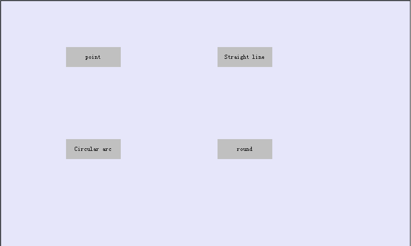**Create a public picture**
Public images allow users to put some fixed and repetitive controls in a single picture, using them when needed. For public image introduction, reference "[create new picture](../screen/new-screen.md)" chapter.
Create the following public image, including the control:
        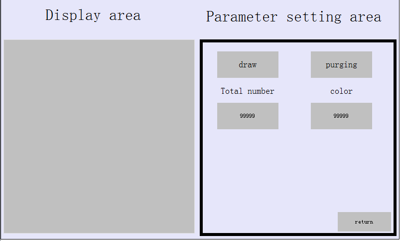

- Path display
  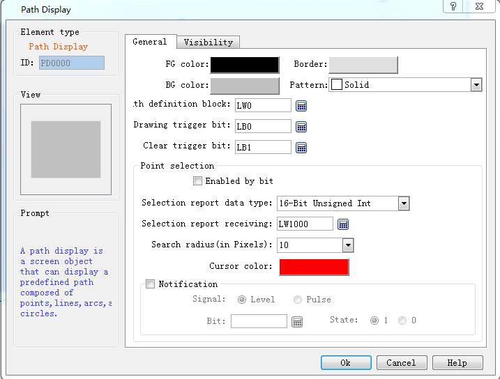
- LB0（trigger）
- LB1（Trigger clearance）
- LW50000（Set the points）
- LW50001（Set the color）
- Image button (return to the main image)

**Tip**: in the configuration program, it is convenient to display multiple points, and assign values to the address through the macro instruction
**point**

1.  Create macro instruction

\#include "MacroInit.h"

/\*\*\* @file pointInit\* @brief Path display copy point information\* @details On the starting point, the x, y coordinates each time\*/void Macro_main(IN \*p){MarcoInit//ToDo    unsigned int i = 0;

unsigned short size   = LocalWord\[50000\];           ///&lt; Drawing number    unsigned short colour = LocalWord\[50001\];           ///&lt; color    unsigned short coordinateX = LocalWord\[50002\];      ///&lt; X coordinates    unsigned short coordinateY = LocalWord\[50003\];      ///&lt; Y coordinates

LocalWord\[0\] = size;    for(i=0; i&lt;size; ++i){        LocalWord\[i\*8+1\] = 0;                   ///&lt; mode 0:point 1:line 2:circular arc 3:round        LocalWord\[i\*8+2\] = colour;              ///&lt;color        LocalWord\[i\*8+3\] = coordinateX+i;       ///&lt; X coordinates        LocalWord\[i\*8+4\] = coordinateY+i;       ///&lt; Y coordinates    }}

2.  Set up

<!-- -->

3.  - LW50002：X coordinates
    - LW50003：Y

4.  Simulation effect

        Run the online analog function, and jump to "point" in the "main picture"
        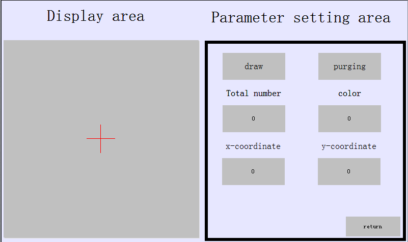Set total points 50，black，X、Y（10，10），For color properties, refer to the "[path display](path-display.md)" section.Click the "draw" button, which is shown below
        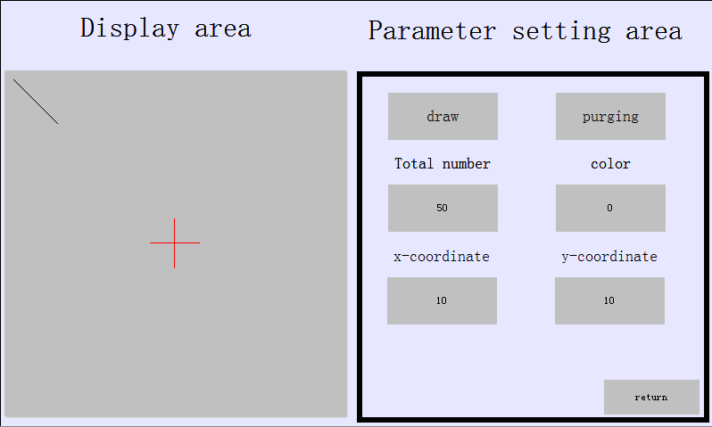Set the color white (enter ffffffff) and redraw the figure, and you need to trigger **LB1** to clear the drawing and redraw on **LB0**
        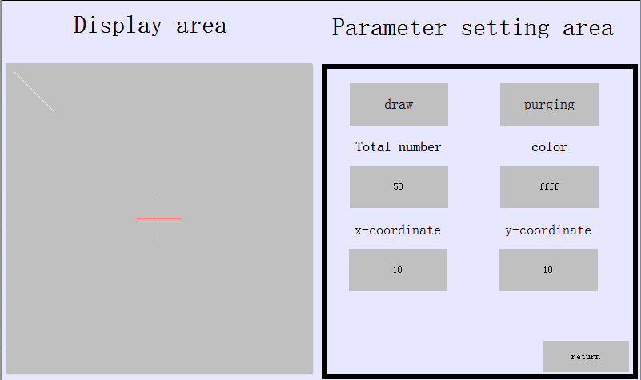The path display focuses on the filling of the "path definition zone", which can be used to assign a value section in the macro command.

[return](#jump)

**Straight line**

1.  Create macro instruction

\#include "MacroInit.h"

/\*\*\* @file straightLineInit\* @brief The path display copies the line information\* @details The x-coordinate is every time on the starting point+10\*/void Macro_main(IN \*p){MarcoInit//ToDo    unsigned int i = 0;

unsigned short size   = LocalWord\[50000\];               unsigned short colour = LocalWord\[50001\];               unsigned short coordinateX = LocalWord\[50002\];          unsigned short coordinateY = LocalWord\[50003\];          unsigned short coordinateEndX = LocalWord\[50004\];      unsigned short coordinateEndY = LocalWord\[50005\];       unsigned short mondel = LocalWord\[50006\];

LocalWord\[0\] = size;    for(i=0; i&lt;size; ++i){        LocalWord\[i\*8+1\] = 1;                        ///&lt; mode 0:point 1:line 2:circular arc 3:round        LocalWord\[i\*8+2\] = colour;                        LocalWord\[i\*8+3\] = coordinateX+i\*10;               LocalWord\[i\*8+4\] = coordinateY;                        LocalWord\[i\*8+5\] = coordinateEndX+i\*10;               LocalWord\[i\*8+6\] = coordinateEndY;                   LocalWord\[i\*8+7\] = mondel;                       }}

2.  Set up

<!-- -->

3.  - LW50002：coordinateX
    - LW50003：coordinateY
    - LW50004：coordinateEndX
    - LW50005：coordinateEndY
    - LW50006：mondel

4.  Simulation operation

        Run the online analog function, and jump to the "line" image in the main picture
        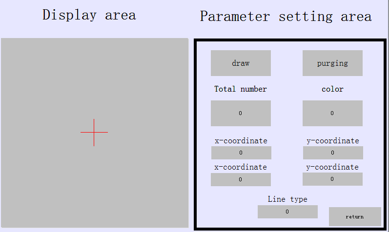size 5，black，Starting point X、Y（10，10）、End point X、Y（100，100），mondel 1，For color and line type properties, refer to the "[path display](path-display.md)" section.Click the "draw" button, which is shown below
        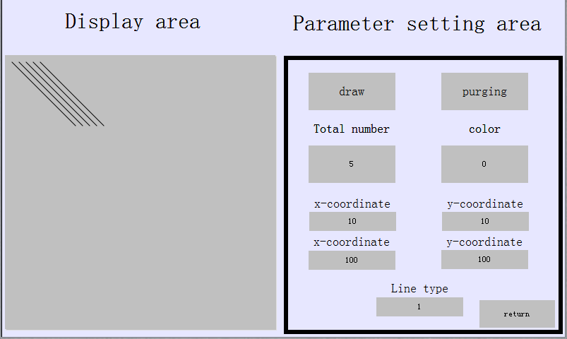mondel 2，and you need to trigger LB1 to clear the drawing and redraw on LB0        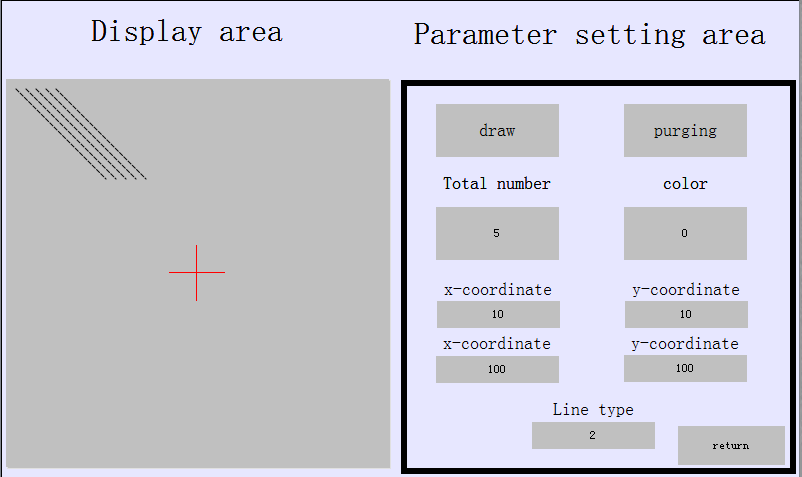

[return](#jump)

**Circular arc**

1.  Create macro instruction

\#include "MacroInit.h"

/\*\*\* @file circularArcInit\* @brief The path display copies the circular information\* @details x+10\*/void Macro_main(IN \*p){MarcoInit//ToDo    unsigned int i = 0;

unsigned short size   = LocalWord\[50000\];               unsigned short colour = LocalWord\[50001\];               unsigned short coordinateX = LocalWord\[50002\];         unsigned short coordinateY = LocalWord\[50003\];          unsigned short coordinateBeginX = LocalWord\[50004\];     unsigned short coordinateBeginY = LocalWord\[50005\];     unsigned short coordinateEndX = LocalWord\[50006\];       unsigned short coordinateEndY = LocalWord\[50007\];

LocalWord\[0\] = size;    for(i=0; i&lt;size; ++i){        LocalWord\[i\*8+1\] = 2;                        ///&lt; mode 0:point 1:line 2:circular arc 3:round        LocalWord\[i\*8+2\] = colour;                           LocalWord\[i\*8+3\] = coordinateX+i\*10;               LocalWord\[i\*8+4\] = coordinateY+i;                   LocalWord\[i\*8+5\] = coordinateBeginX+i\*10;          LocalWord\[i\*8+6\] = coordinateBeginY+i;               LocalWord\[i\*8+7\] = coordinateEndX+i\*10;               LocalWord\[i\*8+8\] = coordinateEndY+i;           }}

2.  Set up

<!-- -->

3.  - LW50002：coordinateX
    - LW50003：coordinateY
    - LW50004：coordinateBeginX
    - LW50005：coordinateBeginY
    - LW50006：coordinateEndX
    - LW50007：coordinateEndY

4.  Simulation operation

Run the online simulation function, and jump to the "arc" image in the "main picture"
            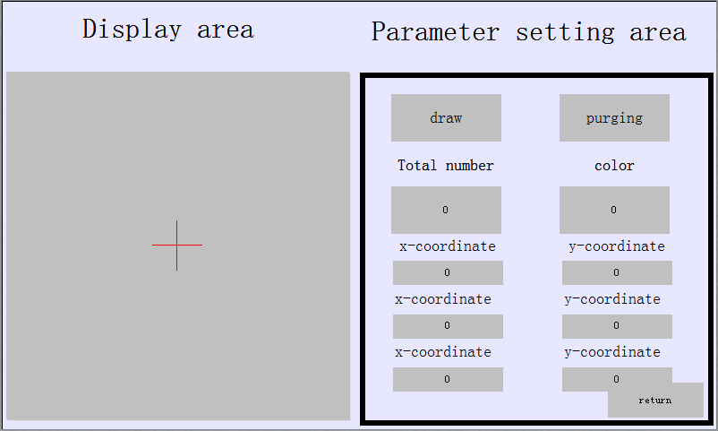size 1，black，Round center X、Y（100，100）、Arc start point X、Y（120，120）、Arc end point X、Y（90，120），On color，Refer to the "[path display](path-display.md)" section.            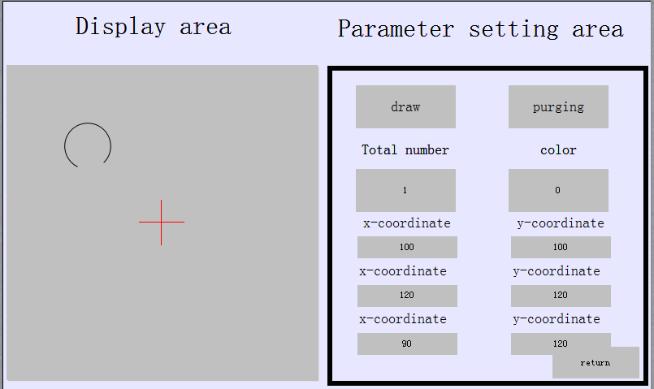size 5,and you need to trigger LB1 to clear the drawing and redraw on LB0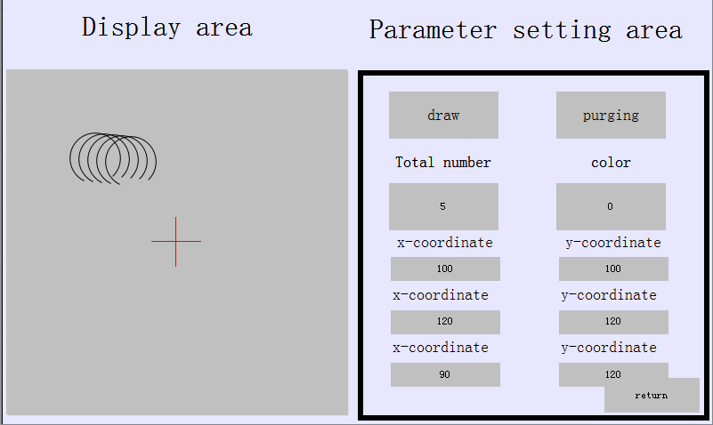

[return](#jump)

**round**

1.  Create macro instruction

\#include "MacroInit.h"

/\*\*\* @file roundInit\* @brief The path display copies the round information\* @details x+10,y+10\*/void Macro_main(IN \*p){MarcoInit//ToDo    unsigned int i = 0;

unsigned short size   = LocalWord\[50000\];              unsigned short colour = LocalWord\[50001\];               unsigned short coordinateX = LocalWord\[50002\];          unsigned short coordinateY = LocalWord\[50003\];          unsigned short coordinateRadius = LocalWord\[50004\];

LocalWord\[0\] = size;    for(i=0; i&lt;size; ++i){        LocalWord\[i\*8+1\] = 3;                   ///&lt; mode 0:point 1:line 2:circular arc 3:round        LocalWord\[i\*8+2\] = colour;                      LocalWord\[i\*8+3\] = coordinateX+i\*10;           LocalWord\[i\*8+4\] = coordinateY+i;               LocalWord\[i\*8+5\] = coordinateRadius;      }}

2.  Set up

<!-- -->

3.  - LW50002：coordinateX
    - LW50003：coordinateY
    - LW50004：coordinateRadius

4.  Simulation operation

Run the online analog function, and jump to "round"
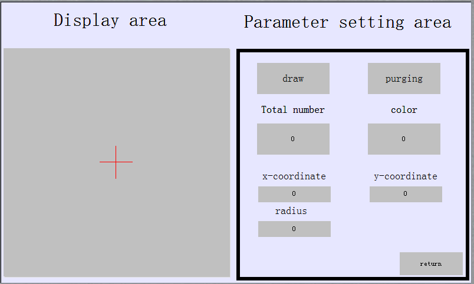
size 1，black，X,Y（100，100）、radius 10，Refer to the "[path display](path-display.md)" section.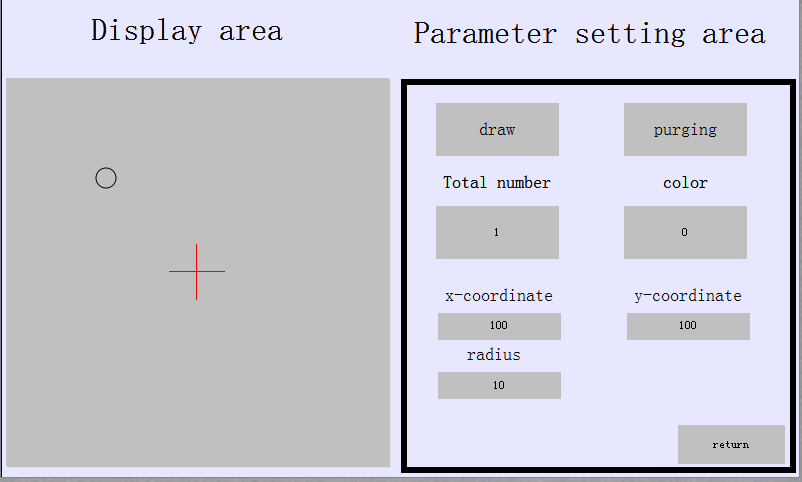
size 5，white（FFFF）redrawing,and you need to trigger LB1 to clear the drawing and redraw on LB0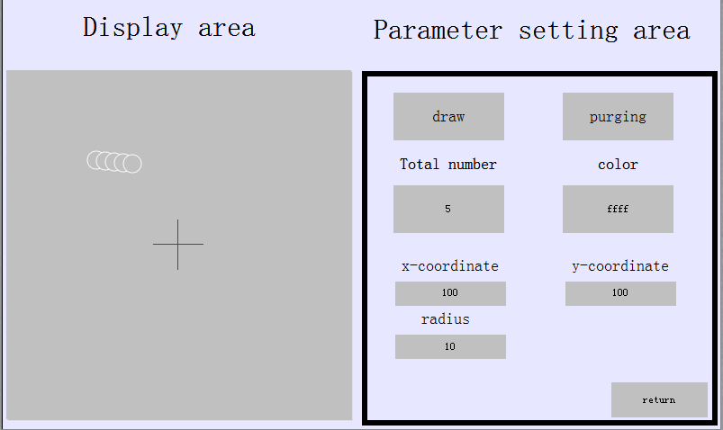

[return](#jump)

The path display control, the display diagram is mainly based on the "path definition zone" setting of the specified address data, the first address specifies the number of displays, and then each 8 addresses, describing a point message. Other functions such as "select the" notification "function of the selected point, refer to the" [path display](path-display.md) "section.
