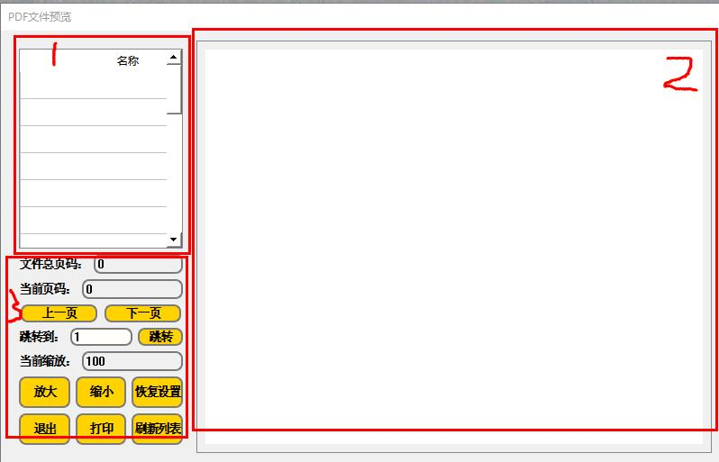

# PDF Display

The control is open in HMI and monitors the PDF document on the u plate.
Area 1 is a list of the u disk root directory suffix, the PDF file list, and if the number of PDF files in the u dish or the name changes, you can click the refresh list button in the area 2, which will refresh the PDF file shown in the list of areas 1.
Area 2 is the area where the contents of the PDF document are displayed, and the bottom and right sides of the area will have a rolling bar that can slide, which can slide the scroll bar to adjust the visual area.
The area 3 is the function button area, which is the first and next page to continuously adjust the contents of the selected PDF document, and the jump button is directly to the page number of the total page number, and the document content is not continuously checked. The zoom and reduction button is to adjust the amplification and reduction of the Chinese word of the document, by default, and the reset button is to restore the previous zoom to 100%, the exit button is to exit the current window, the print button is the connection printer, and the printer prints the selected PDF document.
Note:

1.  The PDF file only supports the use of the touch screen, which is not a PC simulation, and if the PDF document sets the PDF open the permissions password, you need to enter the correct PDF license before opening.

<!-- -->

2.  The name of the PDF document of the 2e u pan is required for letters or Numbers, and the Chinese name of the inspected u dish is displayed as a code of trouble.
