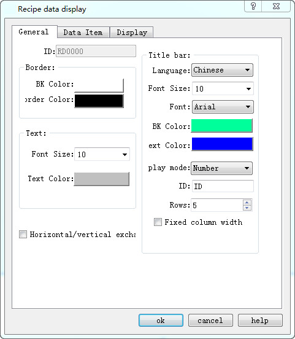
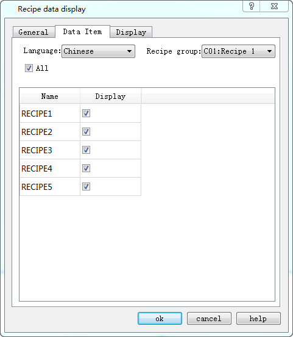
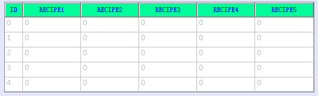
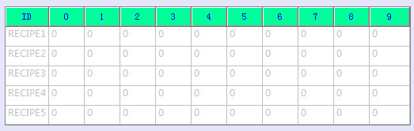
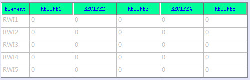

# Recipe Display

The function of recipe display is to list the data of all recipes if any recipe has been established. The icon of this control in the tool bar is. Click this icon, and then the following dialog box will pop up:

Figure 4-129   Recipe Display General page

General page consists of settings of text contents and list properties.

Data Item page, as shown below

Figure 4-130   Recipe Display Data page

• Language: Choose a different language to list recipe names in different languages.

• Name: List of all recipe names

• Display: Whether to display the recipe according to user’s need.

• ALL：Select all sections in  Display.

CommandHMI  adds the function of multiple groups of recipe; developers can choose which recipe to display while use this control, as shown below:

Figure 4-131   Recipe Display select recipe displayed

Horizontal/vertical  exchange: Cross-column exchange

Normal mode

Check the feature

play mode: Set different display patterns

Number:

Element:

