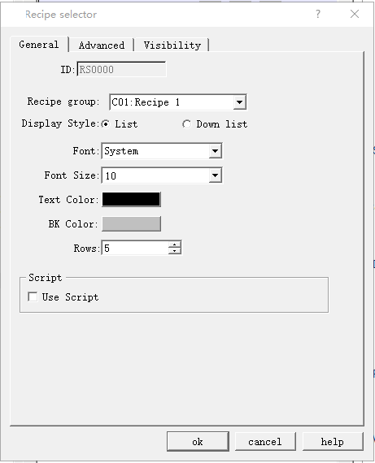
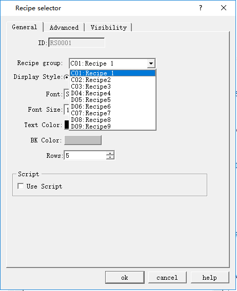

# Recipe Selector

The function of the Recipe selector is to list all recipe names in the case of recipe creation. Selecting the specified recipe name in the list causes the recipe number to be written to recipe number register RWI0. Correspondingly, if the value of the recipe number register RWI0 is changed, the recipe selector will also point to the specified recipe name accordingly. The control icon on the toolbar is: ; click the icon to pop up the dialog box shown below:

Figure 4-127 Recipe Selector dialog box

• Display style

Set the display style of the recipe selector

List: The recipe selector will be displayed in the form of a list.

Dropdown box: The recipe selector will be displayed in the form of dropdown box.

• Font, Font size, Text color, and Background color are settings for list box properties and text content properties

• Rows: This option is only available when "List" is selected for the display style.

CommandHMI adds a new function of multiple sets of recipe; developers can choose which recipe to display while use this control, as shown below:

Figure 4-128 Select the Recipe displayed
