# Scroll bar

The scroll bar is a control that is used to see the data of the table class control, which is convenient for users to browse the table data quickly. Only the following controls are supported only: alarm display, historical alarm display, formula data display, historical data display, operating log display

The control is used for the associated controls to display too much data, unable to display the complete situation once, and can be used to display the remaining part of the data

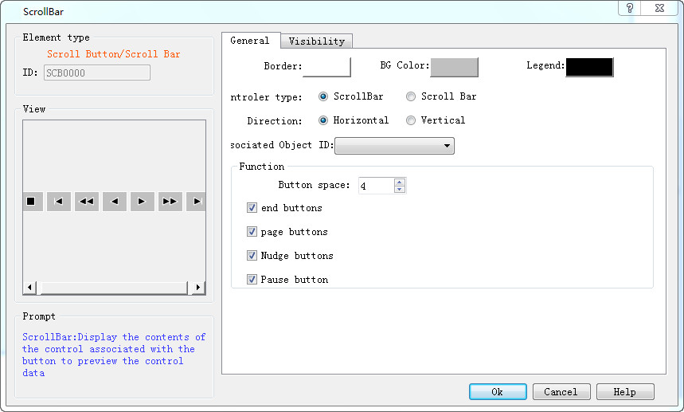

Scroll bar dialog box

The control function is described in detail below (the control is mainly divided into two categories: scroll buttons and scroll bars)

Ø  Scroll bar: control table data refresh in a scroll bar

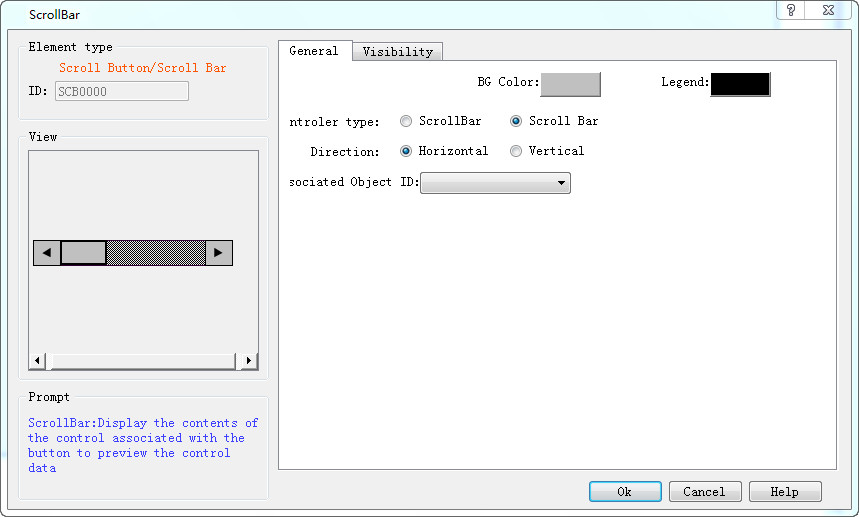

l  Background color: setting control background color

l  Symbol color: set the control symbol color

l  Direction: set the scroll bar control to control the direction of the table data

n  Level: control table horizontal data display

n  Vertical data display control table

l  The associated object number, the current page exists in any of the controls mentioned in the previous section, can be associated with the corresponding control to achieve the effect of the control. If the current page does not have any of these controls, the error message will be prompted. "the associated object cannot be empty. The object number is the data in the upper left corner number of the control.

Take the historical data display as an example, which is the effect of the scroll bar control

There are 75 data in the current historical data display, and the historical data display and the scroll bar are all at the bottom

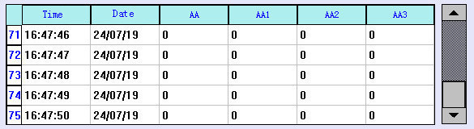

Move the scroll bar to the middle position, and the data display is shown as shown below：

Ø  Scroll button: button mode control table data refresh

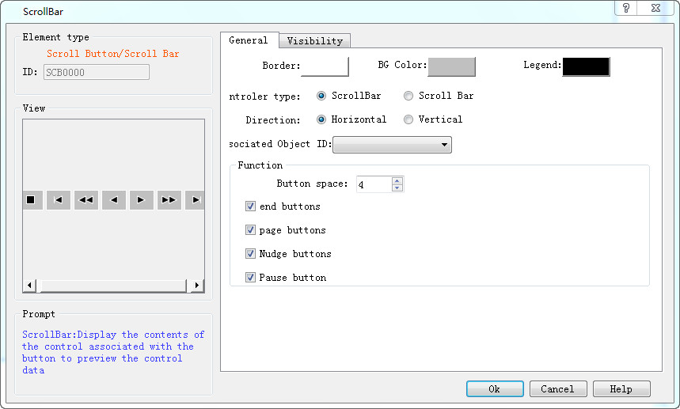

l Border color: set the border color of the control

l  Background color: setting control background color

l  Symbol color: set the color of the symbol in the control

l  direction

n  Level: control table level data display

n  Vertical: control table vertical mode data display

l  Associated object number: reference to the previous description

l Function key

n  The button interval, the spacing between the buttons

n  To the end/to the end: the mobile table data is at the start or end, as with the following two buttons, when the data is already in the starting or end location, and the click button will pop-up the dialog box prompt operation is invalid

n  Page/page/page/left page/right: move a page of pages each time

n  Top/down or left/right: move a data in the corresponding direction each time

n  Pause: if the current table data is in a changing state, clicking this button can stop the table data changes and again click back to the original state. If the current direction of the table is fixed, it will not change, click the button prompt, and the function is invalidTake the historical data display as an example, and the image below is the effect of the scroll button control

The current historical data display has 71 data

If you click the stop button during the program runtime 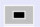，Stop the table refresh and pop up the following dialog

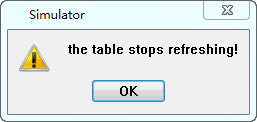

Click the stop button again ，Refresh the table and pop up the following dialog

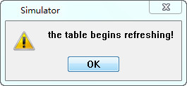

When you click the button 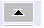，The historical data display data is changed as shown below, and the data jumps to the beginning. Again, if you click on the tail button 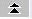，Data jump to the end

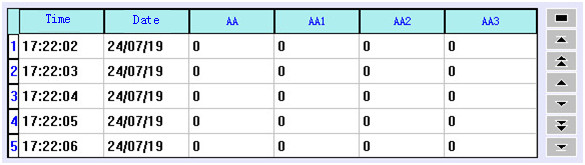

When you click the next page button 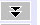，The historical data display is changed in the following diagram, the current historical data display, a page of up to 5 Numbers, and the historical data display displays the next 5 Numbers when the next page button is clicked. Again, click on the front page button ，Show the number of five Numbers

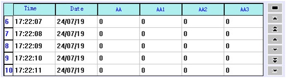

When you click on the button 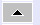，The historical data display is shown in the following diagram, showing the number of 1 in the top, and the same thing, when you click on the button 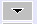，The bottom shows a number of data

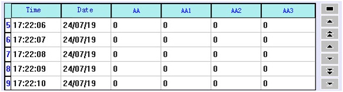
