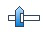
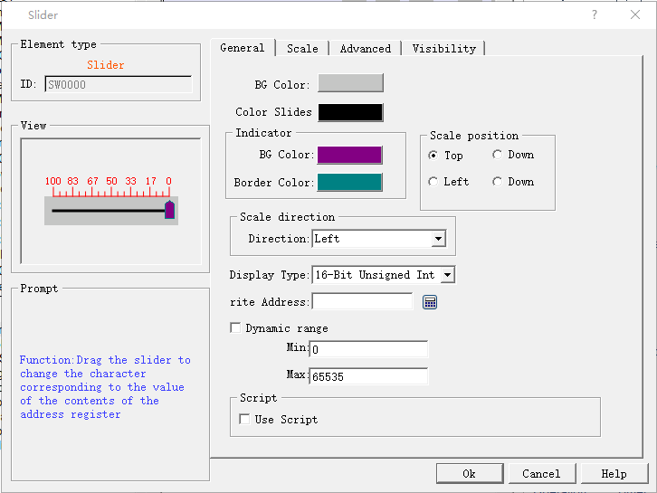

# Slider

Slide analog switch: drag the sliding block to change the value contents of the corresponding character register address.

Select the icon  in the toolbar and the attribute dialog box of "Slider" will appear, as shown in Figure 4-117:

Figure 4-117 Slide dialog box

• Scale position: Select the position of scale.

• Scale direction: Select the alignment direction of scale.

• Write address: when the slider is dragged, the set value can be real-time written and displayed.

• Dynamic range: Control the slider with the word address. When the dynamic range check box is not ticked, the maximum / minimum values can be controlled by data type, and the user can also change it freely. At the moment, the movement value of the slider is actually the value here; when the dynamic range check box is ticked, the maximum / minimum values are received in the form of word address, and the maximum / minimum values are controlled through address.

Refer to “Meter” for the settings of the Scale page.

Refer to “Bit button” for the application of “Advanced” and “Visibility”.
