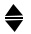
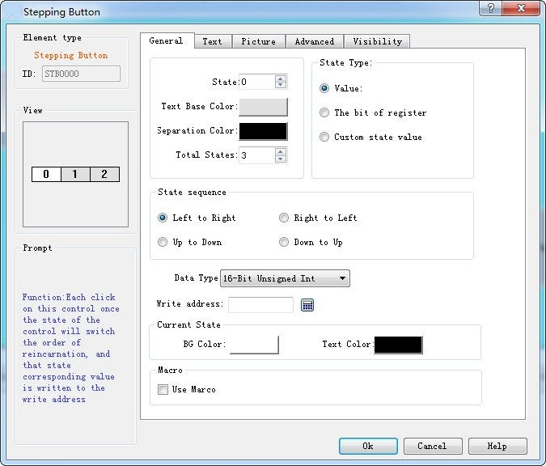

# Stepping Button

This command is applied to create a stepping button control in the current screen to realize the cyclic switching of execution states. Click the button icon to pop up a dialog box as shown in Figure 4-113:

Figure 4-113   Stepping Button dialog box

State sequence: Direction of the text on the control

For example, if the total number of states is 3, then texts of State 0, State 1 and State 2 are 0, 1, 2 respectively.

• Left to Right: The control is placed horizontally, ie the text is oriented from left to right: 0, 1, 2

• Right to Left: The control is placed horizontally, ie the text is oriented in a right-to-left orientation: 2, 1, 0

• Up to Down: The control is placed vertically; the text direction is in accordance with the direction from top to bottom: 0, 1, 2

• Down to Up: The control is placed vertically; the text direction is in accordance with the direction from bottom to top: 2, 1, 0

State Type: Refer to that of the "Multi-state Indicator Lamp".

Current state: Set the background color and text color of the text in the current state.

Refer to “Multi-state Indicator Lamp” for the parameter settings of pages of Text, Picture.

Refer to Bit button for the application of “Advanced” page and hotkeys.

E.g, assuming that the state type is "Value", the write address is LW1, the total number of states is 3, and the text of state 0, state 1 and state 2 are 0, 1 and 2 respectively; after downloading the project to HMI, keep on clicking on the control, whose state will be converted constantly between 0-2, and the corresponding value will be written to LW1.
