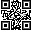

# Qrcode

Select the control icon on the toolbar and set its properties in the dialog box shown below:

Figure 4-132     Qrcode dialog box

• Monitor Address: Address to monitor through Qrcode

• Length: The maximum length of the character that can be displayed
