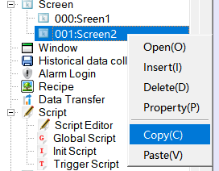
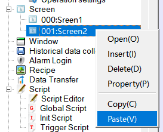
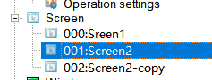

# Copy Screen

This command is to copy the screen in current project; methods are as follows:

Left-click on the screen to be copy in the project manager, then right click to bring up the context menu and select "Copy", after that  right click to bring up the context menu and select "Paste"(Figure 4-5).

It would create a new screen copying from the assigned one.

Figure 4-5      Copy and Paste Screen

