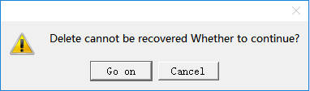

# Delete Screen

This command is used to delete the screen in the current project; methods are as follows:

Select " Delete Screen" in the Screen menu; or left-click to choose the screen to be delete in the project manager, then right click to select “Delete” key; or right click in the blank space in the screen while on object is selected in order to bring up the context menu in which you can find "Delete" command.

Figure 4-4 Delete screen

Click OK to complete the operation of deleting.

Once deleted, the screen cannot get back! Execute this command with caution.
