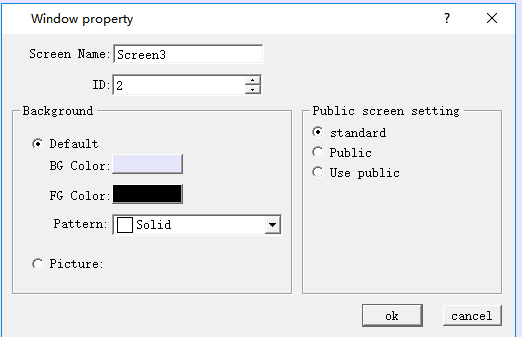

# Modify Screen Property

To modify the properties of the screen, including the name, background color, you can perform the following operations:

Under the circumstances that no object or control is selected (you can click blank space in the current screen), select the  command on the toolbar or left click to select the screen in the project manager, and then right click on it or you can right click in the screen while on object is selected in order to bring up the context menu in which you can find "Property" command.

Figure 4-3      Screen Property settings

 In the "New Screen" dialog box, set the name of the new screen, background color and public screen settings, and then click OK. The default new screen name is the screen number.

Default: set the background color, foreground color and style of the screen.

Photo: picture can be used as background.

Public picture settings

Standard screen: create a standard screen.

Set it to a public screen: Create a public screen in which the controls can be used on other screens, but the properties of the controls can only be modified on that screen.

Use the Common Screen: Use the created Common Screen, but do not modify the properties of the controls in the Common Screen.
