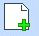
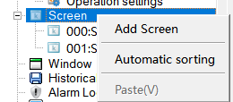
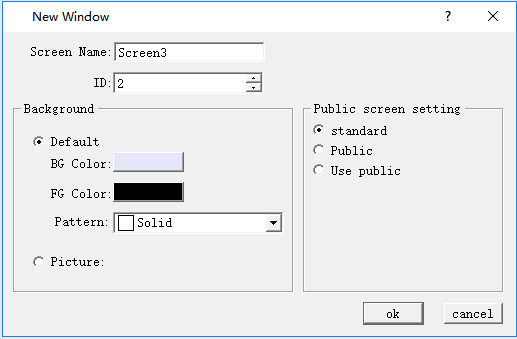

# Create a New Screen

“New Screen” command is used to create a new screen in the current project. Steps of creating new screens are as follows:

1\. Select the “New Screen” command in the Screen menu or click the button command  or right click the Screen menu in the project manager, and then select “Add Screen”, as shown in Figure 4 -1 below:

Figure 4-1 New Screen

2\. In the pop-up "New Screen" dialog box, set the name and background color of the new screen, then click OK. The default name of the new screen is a screen number; the default background color is blue, as shown in Figure 4-2:

Figure 4-2 Add screen dialog

Standard: Standard picture

Public: Public screen can be used many times, the control property can only be modified in this picture

Use public: Use a public picture that has been created, but cannot modify the properties of the control in its public screen

The Background color, Foreground color and Pattern of new screen can be set.

Picture: Picture can be set as background of new screen.
