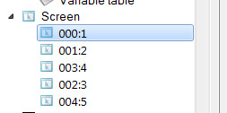
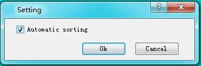
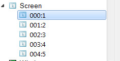

# Automatic sorting

“Automatic sorting” command is used to create a new screen in the current project. Steps of creating new screens are as follows:

The automatic sort command is used to sort the picture number in the current picture. Methods are as follows:

Select the project manager the picture option by clicking the left mouse button, then right-click menu select "automatic sorting and automatic sorting will prompt the settings screen, select the automatic sorting function, click OK, can carry out sorting operation on the current screen (from small to large order).

The specific process is shown in the following picture:

Click the left mouse button options, right-click select "automatic sorting.""

Check the automatic sorting, click OK

