# Allen-Bradley device driver

The device driver is used for HM series HMI to read and write the data or state of AIBUS device via AIBUS protocols. The serial communication connection is established through the serial port of the HMI and the serial port of AIBUS device, so as to operate AIBUS device. Prior to use of the driver, please carefully read this chapter and the related technical specifications of the AIBUS device.

**How to establish connection with AIBUS device**

**1. Hardware connection**

Connecting cable:

RS232 (serial port RS232 protocol)

|                             |     |                   |     |
|-----------------------------|-----|-------------------|-----|
| **HM series HMI COM1/COM2** |     | **AIBUS device**  |     |
| 2                           | RX  | User-defined pins | TX  |
| 3                           | TX  | User-defined pins | RX  |
| 5                           | GND | User-defined pins | GND |

ControlLogix/CompactLogix:

|                             |     |                         |     |
|-----------------------------|-----|-------------------------|-----|
| **HM series HMI COM1/COM2** |     | **Allen-Bradley（AB）** |     |
| 2                           | RX  | 3                       | TX  |
| 3                           | TX  | 2                       | RX  |
| 5                           | GND | 5                       | GND |

HM series HMI port is DB9F, and AB device port is MD8M.

**2. Software settings**

ü Select Allen-Bradley in connection device service.

ü Select the corresponding item in connection device service according to the connected PLC model or supported protocol.

ü Ensure that the communication parameters in touch screen connection parameters and PLC station number are consistent with the PLC connected.

ü For settings of the PLC connected device, refer to the technical documents of the Allen-Bradley PLC.

Default connection parameters of HM series HMI

|                             |                             |                                              |
|-----------------------------|-----------------------------|----------------------------------------------|
| **Setting item**            | **Default parameter value** | **Setting scope**                            |
| **PLC type**                | MicroLogix DF1_CRC          | MicroLogix DF1_CRC/MicroLogix DF1_BCC        |
| **Communication port type** | RS232                       | RS232/RS422/RS485                            |
| **Baud rate**               | 19200                       | 1200/2400/4800/9600/19200/38400/57600/115200 |
| **Data bit length**         | 8                           | 7/8                                          |
| **Parity bit**              | NONE                        | EVEN/ODD/NONE                                |
| **Stop bit length**         | 1                           | 1/2                                          |
| **PLC station number**      | 1                           | 1~31                                         |
| **HMI station number**      | 0                           | 0~255                                        |
| **Check**                   | CRC                         | BCC                                          |

|                         |                             |
|-------------------------|-----------------------------|
| **Supporting function** | **Whether it is supported** |
| **Off-line simulation** | Yes                         |
| **On-line simulation**  | Yes                         |
| **Extended mode**       | No                          |

**3. Operational register and address range**

SLC series/MicroLogix:

|                   |                    |                        |                                |
|-------------------|--------------------|------------------------|--------------------------------|
| **Register name** | **Address format** | **Input range**        | **Remarks**                    |
| **I**             | 1:ddd/o            | 1:0/0~1:255/15         | Bit: input shadow register     |
| **O**             | 0:ddd/o            | 0:0/0~0:255/15         | Bit: output shadow register    |
| **B**             | ddd:ddd/o          | 3:0/0~255:255/15       | Bit: bit memory                |
| **S_Bit**         | 2:ddd/o            | 2:0/0~2:255/15         | Bit: System state bit          |
| **N_Bit**         | ddd:ddd/o          | 7:0、10:0/0~255:255/15 | Bit: Bit of data register word |
| **S**             | 2:ddd              | 2:0~2:255              | Word: System state word        |
| **ST**            | ddd:ddd.dd         | 0:0.0~255:255.40       | Word: System state word        |
| **N**             | ddd:ddd            | 7:0、10:0~255:255      | Word: Data register            |
| **F**             | ddd:ddd            | 8:0~255:255            | Word: Floating number register |
| **T_ACC**         | ddd:ddd            | 4:0~255:255            | Word: Timer ACC value          |
| **T_PRE**         | ddd:ddd            | 4:0~255:255            | Word: Timer PRE value          |
| **C_ACC**         | ddd:ddd            | 5:0~255:255            | Word: Counter ACC value        |
| **C_PRE**         | ddd:ddd            | 5:0~255:255            | Word: Counter PRE value        |

ControlLogix/CompactLogix:

|                   |                    |                  |                                |
|-------------------|--------------------|------------------|--------------------------------|
| **Register name** | **Address format** | **Input range**  | **Remarks**                    |
| **B-Bit**         | ddd:ddd/dd         | 3~225:0~255/0~15 | Bit: Bit of data register word |
| **N_Bit**         | ddd:ddd/dd         | 7~225:0~255/0~15 | Bit: Bit of data register word |
| **N_Bit**         | ddd:ddd/o          | 7:0/0~255:255/7  | Bit: Bit of data register word |
| **S**             | 2:ddd              | 2:0~2:255        | Word: System state word        |
| **N**             | ddd:ddd            | 7:0~255:255      | Word: Data register            |
| **F**             | ddd:ddd            | 8:0~255:255      | Word: Floating number register |

CompactLogix_L16ER_TCP (Port number:44818)

|               |                    |                 |                                        |
|---------------|--------------------|-----------------|----------------------------------------|
| Register name | **Address format** | **Input range** | **Remarks**                            |
| **B**         | ddd.ddd            | 0.0~255.255     | Bit: bool type address                 |
| **I**         | Ddd.ddd            | 0.0~255.255     | Word: 16 int int register              |
| **F**         | ddd.ddd            | 0.0~255.99      | Double word: : 32 float float register |

MicroLogix DF1_TCP            (Port number:44818)

|               |                    |                  |                                                    |
|---------------|--------------------|------------------|----------------------------------------------------|
| Register name | **Address format** | **Input range**  | **Remarks**                                        |
| **I**         | ddd.ddd/dd         | 0.0/0~255.255/15 | Bit: input image register, read - only             |
| **O**         | ddd.ddd/dd         | 0.0/0~255.255/15 | Bit: output image register                         |
| **B**         | ddd.ddd/dd         | 0.0/0~255.255/15 | Bit: bit storage                                   |
| **T**         | ddd.ddd            | 0.0~255.255      | Bit: timer state                                   |
| **C**         | ddd.ddd            | 0.0~255.255      | Bit: counter state                                 |
| **S_Bit**     | ddd.ddd/dd         | 0.0/0~255.255/15 | Bit: the bit of the system register                |
| **N_Bit**     | ddd.ddd/dd         | 0.0/0~255.255/15 | Bits: bits of a data register                      |
| **S**         | ddd.ddd            | 0.0~255.255      | Word: system register                              |
| **N**         | ddd.ddd            | 0.0~255.255      | Word: 16-bit integer register                      |
| **F**         | ddd.ddd            | 0.0~255.255      | Double word: 32-bit floating point number register |
| **TV**        | ddd.ddd            | 0.0~255.255      | Word: current value of timer                       |
| **CV**        | ddd.ddd            | 0.0~255.255      | Word: counter current value                        |
| **TS**        | ddd.ddd            | 0.0~255.255      | Word: timer setting value                          |
| **CS**        | ddd.ddd            | 0.0~255.255      | Word: counter set value                            |

**4. Instruction of connection between HM series HMI and ControlLogix and CompactLogix series PLC of Alleb-Bradley Company**

<table>
<colgroup>
<col style="width: 50%" />
<col style="width: 50%" />
</colgroup>
<tbody>
<tr class="odd">
<td></td>
<td>
Open RSLinx and set corresponding PLC communication drivers

Create a driver; select serial port connection and RS-232 DF1 devices

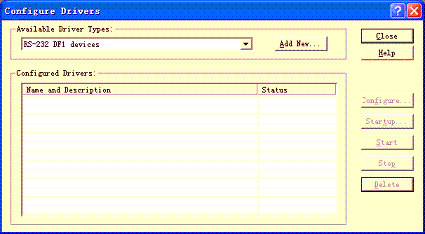

After the settings, the PLC device is available in RSLinx if there is a cable connecting PC and PLC

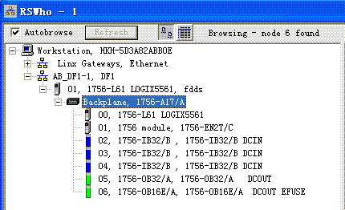

Open PLC programming software RSLogix 5000; create your project and new tags

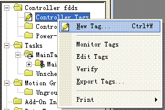

Create tags: B003, N007 and F008

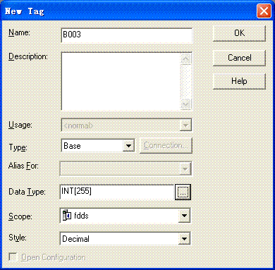

Tag list after creation:

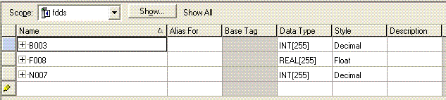

Build <a href="javascript:;">address mapping</a>

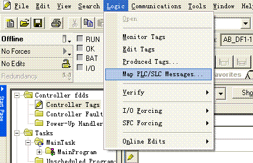<strong></strong>

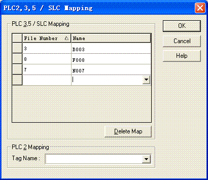<strong></strong>

<strong>Set PLC parameters</strong>

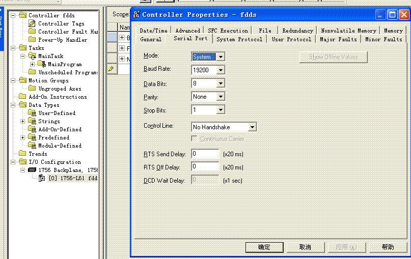<strong></strong>

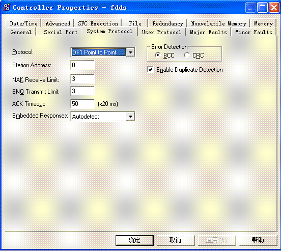<strong></strong>

·d represents decimal system, input range is 0-9;

·o represents octal system, input range is 0-7;

·Bit in the remarks: represents the register can only used as bit;

·Word in the remarks: represents the register can only used as word;

·Read only in the remarks represents that the register can only be read but not be written;

·The names of the registers supported by different equipment model may be different, and the scopes may also be different.

For detailed name and scope, please consult related technical document of the connected device 
</td>
</tr>
</tbody>
</table>

Connect 1769 series CompactLogix series PLC

PLC new address label

Address tag correspondence

The register        label type     array size

B                          bool             255

I                           int                 255

F                          real               100

The label format must be 3 characters, such as B003,I004, and F005

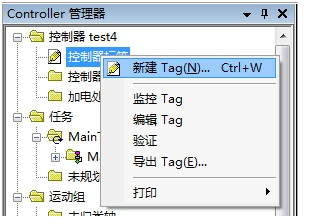

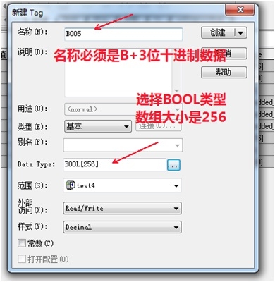

Connect the 1766 series MicroLogix DF1_TCP

Except I/O register cannot be set to size, other register array size is set to 256,The first file number in the address input format is the file number. For example, the file number of F8 is 8, the file number of I1 is 1, and so on.
