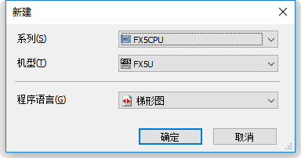
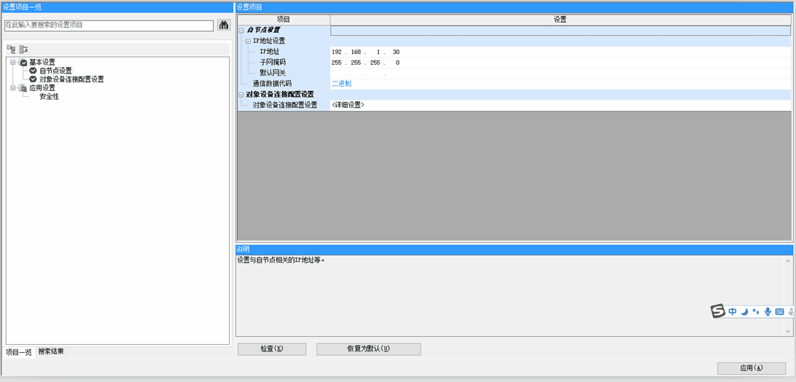
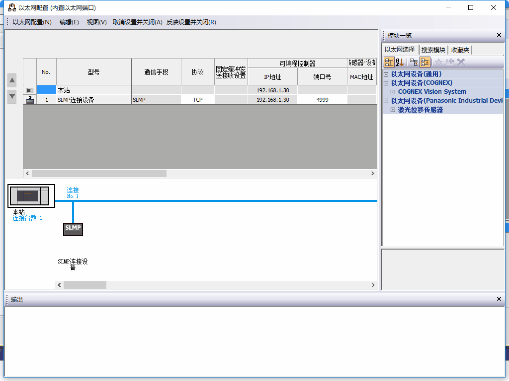
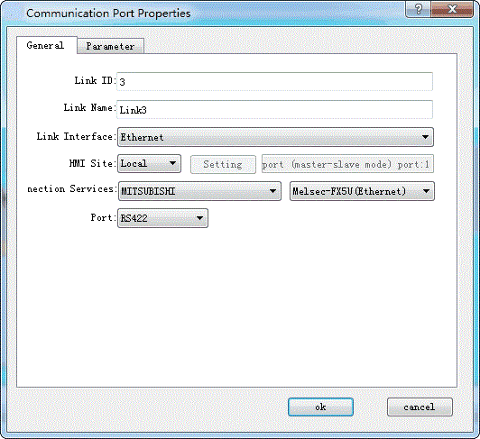
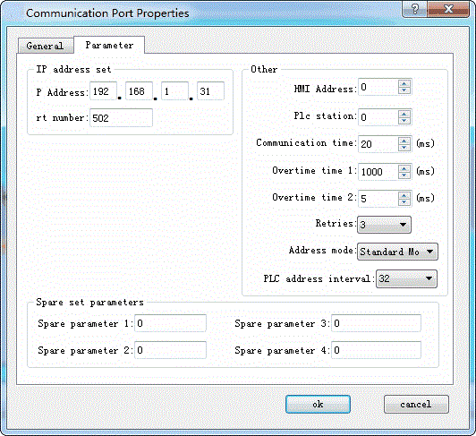

# Mitsubishi device driver

<table>
<colgroup>
<col style="width: 100%" />
</colgroup>
<tbody>
<tr class="odd">
<td>
The device driver is used for HM series HMI to read and write the data or state of Melsec FXxn/Q00J/C24N series PLC register. The serial communication connection is established through the serial port on the touch screen and the serial port of Melsec FXxn/Q00J/C24N series PLC, so as to operate Melsec FXxn/Q00J/C24N series PLC. Prior to use of the driver, one shall carefully read the related technical specifications of the chapter and Melsec FXxn/Q00J/C24N series PLC.
</td>
</tr>
<tr class="even">
<td>
How to establish connection with Melsec FXxn/Q00J/Q00U/C24N series PLC

<strong>1.  Hardware connection</strong>

Connecting cable:

RS422- Melsec-FXxn/FX3U/3G (serial port RS232 protocol)

<table>
<tbody>
<tr class="odd">
<td colspan="2">
<strong>HM series HMI COM1/COM2</strong>
</td>
<td colspan="2">
<strong>Melsec-FXxn</strong>
</td>
</tr>
<tr class="even">
<td>
6
</td>
<td>
RX-
</td>
<td>
4
</td>
<td>
TX-
</td>
</tr>
<tr class="odd">
<td>
7
</td>
<td>
RX+
</td>
<td>
7
</td>
<td>
TX+
</td>
</tr>
<tr class="even">
<td>
8
</td>
<td>
TX-
</td>
<td>
1
</td>
<td>
RX-
</td>
</tr>
<tr class="odd">
<td>
9
</td>
<td>
TX+
</td>
<td>
2
</td>
<td>
RX+
</td>
</tr>
</tbody>
</table></td>
</tr>
</tbody>
</table>

Terminal of HMI series touch screen is DB9F, and that of Melsec FXxn series PLC is MD8M.

**RS232- Melsec-Q00J/Q00U**

|                                                                                       |     |              |     |
|---------------------------------------------------------------------------------------|-----|--------------|-----|
| **HM series HMI COM1/COM2** |     | **Q00J CPU** |     |
| **2**                                                                                 | RX  | 2            | TX  |
| **3**                                                                                 | TX  | 1            | RX  |
| **5**                                                                                 | GND | 3            | GND |

Terminal of HMI series touch screen is DB9F, and that of Melsec FXxn series PLC is MD8M.

Note: Q00U connection instructions

Q00U 6 pin 5,6 short connection

MITSUBISHI programming software parameters &gt;PLC parameters -- &gt; serial communication settings

Check the use of serial communication function, baud rate select 115200, tick and check, tick the Run write

Using MITSUBISHI communications lines, via direct wiring and HMI connections

**RS232- Melsec-QC24N module**

|                             |     |              |     |
|-----------------------------|-----|--------------|-----|
| **HM series HMI COM1/COM2** |     | **Q00J CPU** |     |
| **2**                       | RX  | 3            | TX  |
| **3**                       | TX  | 2            | RX  |
| **5**                       | GND | 5            | GND |

Terminal of HMI series touch screen is DB9F, and that of Melsec QC24N module is MB9M.

**2. Software settings**

Select MITSUBISHI in connection device service.

Select the corresponding item in connection device service according to the connected PLC model or supported protocol.

Ensure that the communication parameters in touch screen connection parameters and PLC station number are consistent with the PLC connected.

For settings of the PLC connected, refer to the technical documents of the Melsec FXxn/Q00J/C24N series PLC.

Default connection parameters of HM series HMI

|                             |                             |                                              |
|-----------------------------|-----------------------------|----------------------------------------------|
| **Setting item**            | **Default parameter value** | **Setting scope**                            |
| **PLC type**                | Melsec-FX2N                 | Melsec-FX/ FX2N/ FX3U/3G /Q_C24N Q00J        |
| **Communication port type** | RS232                       | RS232/RS422/RS485                            |
| **Baud rate**               | 9600                        | 1200/2400/4800/9600/19200/38400/57600/115200 |
| **Data bit length**         | 7                           | 7/8                                          |
| **Parity bit**              | EVEN                        | EVEN/ODD/NONE                                |
| **Stop bit length**         | 1                           | 1/2                                          |
| **PLC station number**      | 0                           | 0~255                                        |
| **HMI station number**      | 0                           | 0~255                                        |

|                         |                             |
|-------------------------|-----------------------------|
| **Supporting function** | **Whether it is supported** |
| **Off-line simulation** | Yes                         |
| **On-line simulation**  | Yes                         |
| **Extended mode**       | No                          |

**3. Operational register and address range**

Melsec-FXxn/FX3U/3G/ FX3U-Ethernet

|                   |                    |                 |                                              |
|-------------------|--------------------|-----------------|----------------------------------------------|
| **Register name** | **Address format** | **Input range** | **Remarks**                                  |
| **X**             | oooo               | 0~377           | Bit: input coil, read only                   |
| **Y**             | oooo               | 0~377           | Bit: output coil                             |
| **M**             | dddd               | 0~7999          | Bit: intermediate relay                      |
| **SM**            | dddd               | 8000~8999       | Bit: special intermediate relay              |
| **S**             | dddd               | 0~999           | Bit: status bit                              |
| **T**             | dddd               | 0~256           | Bit: status of timer                         |
| **C**             | dddd               | 0~256           | Bit: status of timer                         |
| **D_Bit**         | dddd.dd            | 0.00~7999.15    | Bit: bit of 16-bit register                  |
| **D**             | dddd               | 0~7999          | Word: register                               |
| **SD**            | dddd               | 8000~8999       | Word: special register                       |
| **TV**            | dddd               | 0~255           | Word: current value of timer                 |
| **CV**            | dddd               | 0~199           | Word: current value of counter               |
| **CV32**          | dddd               | 200~255         | Double word: current value of 32-bit counter |

FX5U/FX5U-Ethernet

|                   |                    |                               |                                         |
|-------------------|--------------------|-------------------------------|-----------------------------------------|
| **Register name** | **Address format** | **Input range**               | **Remarks**                             |
| **X**             | oooo               | 0~1777                        | Bit: input coil, read only              |
| **Y**             | oooo               | 0~1777                        | Bit: output coil                        |
| **M**             | dddd               | 0~7679                        | Bit: internal relay                     |
| **L**             | dddd               | 0~7679                        | Bit: latching relay                     |
| **F**             | ddd                | 0~127                         | Bit: alarm relay                        |
| **TS**            | ddd                | 0~511                         | Bit: timer contact                      |
| **CS**            | ddd                | 0~255                         | Bit: counter contact                    |
| **S**             | dddd               | 0~4095                        | Bit: stepping relay                     |
| **SM**            | dddd               | 0~9999                        | Bit: special relay                      |
| **B**             | hh                 | 0-ff（hexadecimal notation）  | Bit: 位：link relay                     |
| **D_Bit**         | dddd.dd            | 0.0~7999.15                   | Bit: bit of 16-bit register             |
| **D**             | dddd               | 0~7999                        | Word: register                          |
| **R**             | ddddd              | 0~32767                       | Word: cumulative current value of timer |
| **W**             | hhh                | 0-1ff（hexadecimal notation） | Word: link register                     |
| **CN**            | ddd                | 0~255                         | Word: current value of register         |
| **TN**            | ddd                | 0~511                         | Word: current value of timer            |
| **SD**            | ddddd              | 0~11999                       | Word: special register                  |

  Melsec-Q00J/QC24N

|                   |                    |                 |                                |
|-------------------|--------------------|-----------------|--------------------------------|
| **Register name** | **Address format** | **Input range** | **Remarks**                    |
| **X**             | hhh                | 0~7ff           | Bit: input relay, read only    |
| **Y**             | hhh                | 0~7ff           | Bit: output relay              |
| **M**             | dddd               | 0~8191          | Bit: internal relay            |
| **L**             | dddd               | 0~2047          | Bit: latching relay            |
| **F**             | dddd               | 0~2047          | Bit: alarm                     |
| **V**             | dddd               | 0~2047          | Bit: indexing relay            |
| **S**             | dddd               | 0~2047          | Bit: stepping relay            |
| **B**             | hhh                | 0~7ff           | Bit: conversion relay          |
| **SB**            | hhh                | 0~3ff           | Bit: special link relay        |
| **T**             | ddd                | 0~511           | Bit: status of timer           |
| **C**             | ddd                | 0~511           | Bit: status of counter         |
| **D**             | ddddd              | 0~11135         | Word: data register            |
| **W**             | hhh                | 0~7ff           | Word: conversion register      |
| **SW**            | hhh                | 0~3ff           | Word: special link register    |
| Z                 | d                  | 0~9             | Word: index register           |
| TV                | ddd                | 0~511           | Word: current value of timer   |
| CV                | ddd                | 0~511           | Word: current value of counter |

Q00U

|                   |                    |                 |                                |
|-------------------|--------------------|-----------------|--------------------------------|
| **Register name** | **Address format** | **Input range** | **Remarks**                    |
| **X**             | hhhh               | 0~1fff          | Bit: input relay, read only    |
| **Y**             | hhhh               | 0~1fff          | Bit: output relay              |
| **M**             | dddd               | 0~8191          | Bit: internal relay            |
| **L**             | dddd               | 0~8191          | Bit: latching relay            |
| **F**             | dddd               | 0~2047          | Bit: alarm relay               |
| **V**             | dddd               | 0~2047          | Bit: indexing relay            |
| **B**             | ffff               | 0~1fff          | Bit: conversion relay          |
| **T**             | ddd                | 0~2047          | Bit: status of timer           |
| **C**             | dddd               | 0~1023          | Bit: status of counter         |
| **SB**            | hhh                | 0~7ff           | Bit: special link relay        |
| **SM**            | ddd                | 0~2047          | Bit: special relay             |
| **D_Bit**         | Dddd.h             | 0.0~12287.f     | Bit: bit of 16-bit register    |
| **D**             | Dddd               | 0~12287         | Word: data register            |
| **W**             | Hhhh               | 0~1fff          | Word: conversion register      |
| **TV**            | Dddd               | 0~2047          | Word: current value of timer   |
| **CV**            | Dddd               | 0~1023          | Word: current value of counter |
| **SW**            | Hhh                | 0~7ff           | Word: special link register    |
| **SD**            | Dddd               | 0~2047          | Word: special register         |
| **Z**             | Dd                 | 0~19            | Word: index register           |

Melsec-E71

|                   |                    |                 |                                |
|-------------------|--------------------|-----------------|--------------------------------|
| **Register name** | **Address format** | **Input range** | **Remarks**                    |
| **X**             | hhhh               | 0~1fff          | Bit: input relay, read only    |
| **Y**             | hhhh               | 0~1fff          | Bit: output relay              |
| **M**             | dddd               | 0~8191          | Bit: internal relay            |
| **L**             | dddd               | 0~8191          | Bit: latching relay            |
| **F**             | dddd               | 0~2047          | Bit: alarm relay               |
| **V**             | dddd               | 0~2047          | Bit: indexing relay            |
| **S**             | dddd               | 0~8191          | Bit: stepping relay            |
| **B**             | ffff               | 0~1fff          | Bit: conversion relay          |
| **T**             | ddd                | 0~2047          | Bit: status of timer           |
| **C**             | dddd               | 0~1023          | Bit: status of counter         |
| **SB**            | hhh                | 0~7ff           | Bit: special link relay        |
| **SM**            | ddd                | 0~2047          | Bit: special relay             |
| **D_Bit**         | Dddd.h             | 0.0~12287.f     | Bit: bit of 16-bit register    |
| **D**             | Dddd               | 0~12287         | Word: data register            |
| **W**             | Hhhh               | 0~1fff          | Word: conversion register      |
| **TV**            | Dddd               | 0~2047          | Word: current value of timer   |
| **CV**            | Dddd               | 0~1023          | Word: current value of counter |
| **SW**            | Hhh                | 0~7ff           | Word: special link register    |
| **SD**            | Dddd               | 0~2047          | Word: special register         |
| **Z**             | Dd                 | 0~19            | Word: index register           |

Melsec-LCPU

|                |              |              |                                |
|----------------|--------------|--------------|--------------------------------|
| **寄存器名称** | **地址格式** | **输入范围** | **备注**                       |
| **X**          | hhhh         | 0~1fff       | Bit: input relay, read only    |
| **Y**          | hhhh         | 0~1fff       | Bit: output relay              |
| **M**          | dddd         | 0~8191       | Bit: internal relay            |
| **L**          | dddd         | 0~8191       | Bit: latching relay            |
| **F**          | dddd         | 0~2047       | Bit: alarm relay               |
| **V**          | dddd         | 0~2047       | Bit: indexing relay            |
| **S**          | dddd         | 0~8191       | Bit: stepping relay            |
| **B**          | hhhh         | 0~1fff       | Bit: conversion relay          |
| **SB**         | hhh          | 0~7ff        | Bit: special link relay        |
| **T**          | dddd         | 0~2047       | Bit: status of timer           |
| **C**          | dddd         | 0~1023       | Bit: status of counter         |
| **D-bit**      | ddddd.dd     | 0~45055.15   | Bit: bit of 16-bit register    |
| **D**          | ddddd        | 0~45055      | Word: data register            |
| **TV**         | dddd         | 0~2047       | Word: current value of timer   |
| **CV**         | dddd         | 0~1023       | Word: current value of counter |
| **W**          | hhhh         | 0~1fff       | Word: conversion register      |
| **SW**         | hhh          | 0~7ff        | Word: special link register    |
| **SD**         | hhhh         | 0~2047       | Word: special register         |
| **Z**          | hh           | 0~19         | Word: index register           |

Note:

d represents decimal system, input range is 0-9;

o represents octal system, input range is 0-7;

h represents hexadecimal system, input range is 0-9, a-f;

Word in the remarks: represents the register can only be used as word;

Double-word in the remarks: represents that the data type of the register in configuration must be 32-bit;

Bit in the remarks: represents the register can only be used as bit;

Read only in the remarks represents that the register can only be read but not be written;

The names of the registers supported by different equipment model may be different, and the scopes may also be different.

For detailed name and scope, please consult related technical document of the connected device

**4. Instruction of connection between HM series HMI and FX5U PLC of Mitsubishi Company**

Open GX work3 Software-New file-Series FX5CPU-Type FX5U

Navigation-Parameter-Module Parameter- Ethernet

Object Link-Particular set

CommandHMI Software General

Link-Parameter

