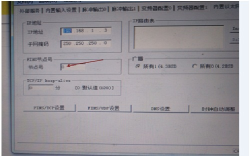

# Omron device driver

<table>
<colgroup>
<col style="width: 100%" />
</colgroup>
<tbody>
<tr class="odd">
<td>
The device driver is used for HM series HMI to read and write the data or state of SYSMAC C/CPM/CS/CJ series PLC register. The serial communication connection is established through the serial port on the touch screen and the serial port of SYSMAC C/CPM/CS/CJ series PLC, so as to operate SYSMAC C/CPM/CS/CJ series PLC. Prior to use of the driver, one shall carefully read related technical specifications of the chapter and SYSMAC C/CPM/CS/CJ series PLC.
</td>
</tr>
<tr class="even">
<td>
How to establish connection with SYSMAC C/CPM/CS/CJ series PLC

1.  Hardware connection

Connecting cable:

RS232 

<table>
<tbody>
<tr class="odd">
<td colspan="2">
<strong>HMI series touch screen COM1/COM2</strong>
</td>
<td colspan="2">
<strong>SYSMAC CS/CJ</strong>
</td>
</tr>
<tr class="even">
<td>
2
</td>
<td>
RX
</td>
<td>
2
</td>
<td>
TX
</td>
</tr>
<tr class="odd">
<td>
3
</td>
<td>
TX
</td>
<td>
3
</td>
<td>
RX
</td>
</tr>
<tr class="even">
<td>
5
</td>
<td>
GND
</td>
<td>
9
</td>
<td>
GND
</td>
</tr>
</tbody>
</table>

</td>
</tr>
</tbody>
</table>

Terminal of HMI is DB9F, and that of SYSMAC C/CPM/CS/CJ series PLC is DB9M.

**2. Software settings**

Select OMRON in connection device service.

Select the corresponding item in connection device service according to the connected PLC model or supported protocol.

Ensure that the communication parameters in touch screen connection parameters and PLC station number are consistent with the PLC connected.

For settings of the PLC connected, please refer to the technical documents of the SYSMAC C/CPM/CS/CJ series PLC.

Default connection parameters of HM series HMI

|                             |                             |                                              |
|-----------------------------|-----------------------------|----------------------------------------------|
| **Setting item**            | **Default parameter value** | **Setting scope**                            |
| **PLC type**                | SYSMAC C/CPM Series         | SYSMAC C/CPM/CS/CJ Series                    |
| **Communication port type** | RS232                       | RS232/RS422/RS485                            |
| **Baud rate**               | 9600                        | 1200/2400/4800/9600/19200/38400/57600/115200 |
| **Data bit length**         | 7                           | 7/8                                          |
| **Parity bit**              | EVEN                        | EVEN/ODD/NONE                                |
| **Stop bit length**         | 2                           | 1/2                                          |
| **PLC station number**      | 0                           | 0~255                                        |
| **HMI station number**      | 0                           | 0~255                                        |

|                         |                             |
|-------------------------|-----------------------------|
| **Supporting function** | **Whether it is supported** |
| **Off-line simulation** | Yes                         |
| **On-line simulation**  | Yes                         |
| **Extended mode**       | No                          |

**3. Operational register and address range**

SYSMAC C/CPM Series

|                   |                    |                 |                                                                                                                  |
|-------------------|--------------------|-----------------|------------------------------------------------------------------------------------------------------------------|
| **Register name** | **Address format** | **Input range** | **Remarks**                                                                                                      |
| **IR_Bit**        | dddd.DD            | 0.0~4095.15     | Bit: input/output relay                                                                                          |
| **HR_Bit**        | dddd.DD            | 0.0~4095.15     | Bit: hold relay                                                                                                  |
| **LR_Bit**        | dddd.DD            | 0.0~4095.15     | Bit: link relay                                                                                                  |
| **AR_Bit**        | dddd.DD            | 0.0~4095.15     | Bit: auxiliary memory relay                                                                                      |
| **T**             | ddd                | 0~255           | Bit: status of timer                                                                                             |
| **C**             | ddd                | 0~255           | Bit: status of counter                                                                                           |
| **IR**            | dddd               | 0~4095          | Word: input/output relay                                                                                         |
| **HR**            | dddd               | 0~4095          | Word: hold relay                                                                                                 |
| **LR**            | dddd               | 0~4095          | Word: link relay                                                                                                 |
| **AR**            | dddd               | 0~4095          | Word: auxiliary memory relay                                                                                     |
| **TC**            | ddd                | 0~255           | Word: value of timer                                                               |
| **DM**            | dddd               | 0~9999          | Word: common data area |

SYSMAC CS/CJ Series

|                   |                    |                 |                                                                                         |
|-------------------|--------------------|-----------------|-----------------------------------------------------------------------------------------|
| **Register name** | **Address format** | **Input range** | **Remarks**                                                                             |
| **CIO_Bit**       | dddd.DD            | 0.0~3189.15     | Bit: core I/O area                                        |
| **W_Bit**         | dddd.DD            | 0.0~6143.15     | Bit: work area                                            |
| **H_Bit**         | dddd.DD            | 0.0~511.15      | Bit: holding area                                         |
| **A_Bit**         | dddd.DD            | 0.0~959.15      | Bit: auxiliary area, read only: 7,168Bit: A00000～A447.15 |
| **D_Bit**         | dddd.DD            | 0.0~32767.15    | Bit: common data area                                     |
| **T**             | dddd               | 0~4095          | Bit: status of timer                                                                    |
| **C**             | dddd               | 0~4095          | Bit: status of counter                                                                  |
| **CIO**           | dddd               | 0~3189          | Word: core I/O area                                                                     |
| **W**             | dddd               | 0~6143          | Word: work area                                                                         |
| **H**             | dddd               | 0~511           | Word: holding area                                                                      |
| **A**             | dddd               | 0~959           | Word: auxiliary area, read only: 448Word: A000～A447                                    |
| **D**             | dddd               | 0~32767         | Word: common data area                                                                  |
| **TV**            | dddd               | 0~4095          | Word: current value of timer                                                            |
| **CV**            | dddd               | 0~4095          | Word: current value of counter                                                          |

CP1L Tcp/Ip       / Fins-udp

|                   |                    |                 |                                                           |
|-------------------|--------------------|-----------------|-----------------------------------------------------------|
| **Register name** | **Address format** | **Input range** | **Remarks**                                               |
| **CIO_Bit**       | dddd.DD            | 0.0~3189.15     | Bit: core I/O area                                        |
| **W_Bit**         | dddd.DD            | 0.0~6143.15     | Bit: work area                                            |
| **H_Bit**         | dddd.DD            | 0.0~511.15      | Bit: holding area                                         |
| **A_Bit**         | dddd.DD            | 0.0~959.15      | Bit: auxiliary area, read only: 7,168Bit: A00000～A447.15 |
| **D_Bit**         | dddd.DD            | 0.0~32767.15    | Bit: common data area                                     |
| **T**             | dddd               | 0~4095          | Bit: status of timer                                      |
| **C**             | dddd               | 0~4095          | Bit: status of counter                                    |
| **CIO**           | dddd               | 0~3189          | Word: core I/O area                                       |
| **W**             | dddd               | 0~6143          | Word: work area                                           |
| **H**             | dddd               | 0~511           | Word: holding area                                        |
| **A**             | dddd               | 0~959           | Word: auxiliary area, read only: 448Word: A000～A447      |
| **D**             | dddd               | 0~32767         | Word: common data area                                    |
| **TV**            | dddd               | 0~4095          | Word: current value of timer                              |
| **CV**            | dddd               | 0~4095          | Word: current value of counter                            |

Note:

d represents decimal system, input range is 0-9;

DD represents 16 bits; input range is 0-15;

Word in the remarks: represents the register can only be used as word;

Bit in the remarks: represents the register can only be used as bit;

Read only in the remarks represents that the register can only be read but not be written;

The names of the registers supported by different equipment model may be different, and the scopes may also be different.

For detailed name and scope, please consult related technical documents of the connected device

 Cp1l tcp/ip connection specificationSet

the -&gt; built-in Ethernet -&gt; set IP and port numberNote:

the proposed use of fins-udp communications, which can be connected to the same PLC in multiple touchscreens, and the need for a handshake connection before normal communication requires a certain amount of time

Fins-udp connection instructions:

Set the -&gt; built-in Ethernet -&gt; set IP and port number

The number of the number of nodes in the fins-udp configuration is consistent with the node number in the ohmlong Ethernet Settings option

