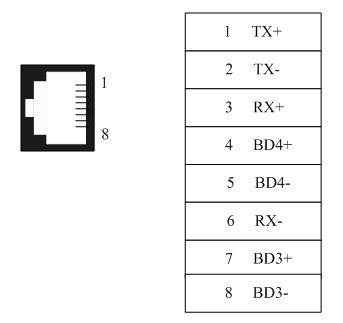
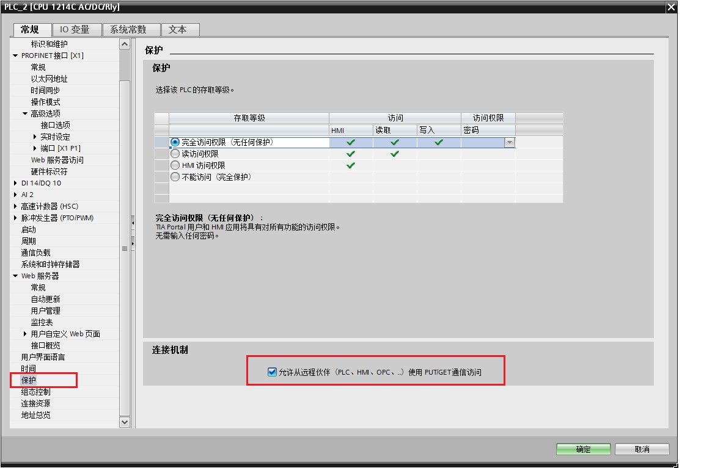

# Siemens device driver

<table>
<colgroup>
<col style="width: 100%" />
</colgroup>
<tbody>
<tr class="odd">
<td>
The device driver is used for HM series HMI to read and write the data or state of Siemens S7-200/300/1200 series PLC register. The serial communication connection is established through the serial port on the touch screen and the serial port of Siemens S7-200/300 /1200tcp series PLC, so as to operate Siemens S7-200/300/1200tcp series PLC. Prior to use of the driver, one shall carefully read related technical specifications of the chapter and Siemens S7-200/300/1200tcp series PLC.
</td>
</tr>
<tr class="even">
<td>
 How to establish connection with Siemens S7-200/300/1200tcp series PLC

<strong>1. 1 Hardware connection</strong>

Connecting cable:

RS485-Siemens S7-200

<table>
<tbody>
<tr class="odd">
<td colspan="2">
<strong>HM series HMI COM1/COM2</strong>
</td>
<td colspan="2">
Siemens S7-200 series
</td>
</tr>
<tr class="even">
<td>
8
</td>
<td>
TX-
</td>
<td>
8
</td>
<td>
TX-
</td>
</tr>
<tr class="odd">
<td>
9
</td>
<td>
TX+
</td>
<td>
3
</td>
<td>
TX+
</td>
</tr>
</tbody>
</table>

</td>
</tr>
</tbody>
</table>

  RS232-Siemens S7-300

|                             |     |                           |     |
|-----------------------------|-----|---------------------------|-----|
| **HM series HMI COM1/COM2** |     | **Siemens S7-300 series** |     |
| **2**                       | RX  | 3                         | TX  |
| **3**                       | TX  | 2                         | RX  |
| **5**                       | GND | 5                         | GND |

|     |                                                      |     |                                                      |
|-----|------------------------------------------------------|-----|------------------------------------------------------|
|     |                                                      |     |                                                      |
|     |  |     |  |

Terminal of HMI is DB9F, and that of Siemens S7-300 series PLC MPI is DB9M.

How to establish connection with Siemens S7-200/300/1200 series PLC

**1. 2 Hardware connection**

Connecting cable:

  Cable RJ45；

  Pins of RJ45:

****

1、 Settings of IP and Port Number

Select “Ethernet Port” for Connection Interface in General page of Communication Port Properties and “SIEMENS”, “Siemens S7-200(TCP/IP)/Siemens S7-300(TCP/IP)/Siemens S7-1200(TCP)” for Connection Services;

In the Parameter page of Communication Port Properties, set the IP and Port number.

Notice：

Addresses of PLC and IP must be under the same subnet with HMI, i.e. it only needs to set the subnet maHM to 255.255.255.0.

2、 In the settings of Siemens-1200 PLC, it is necessary to ensure whether the PLC has the protection function of connection; check the particular option if necessary after then recompile and download it to PLC.

Upload the PLC program or create a new one of Simens_1200 in the software of TIA Portal; right click the item and select “Property”; check “Permit communication access of PUT/GET to remote partners (PLC、HMI、OPC...) ” in “Protection”, as shown in the figure below:

****

**2. Software Settings**

Select SIEMENS in connection device service.

Select the corresponding item in connection device service according to the connected PLC model or supported protocol.

Guarantee that communication parameters in touch screen connection parameters and PLC station number are consistent with the connected PLC.

For settings of the connected PLC, please consult related technical documents of Siemens S7-200/300 series PLC

Default connection parameters of HM series HMI

|                             |                         |                                    |                                              |
|-----------------------------|-------------------------|------------------------------------|----------------------------------------------|
| **Setting item**            | Default parameter value |                                    | Setting scope                                |
| **PLC type**                | S7-200(PPI)             |                                    | S7-200(PPI)/ S7-300(MPI)                     |
| **Communication port type** | RS485                   |                                    | RS232/RS422/RS485                            |
| **Baud rate**               | 19200                   |                                    | 1200/2400/4800/9600/19200/38400/57600/115200 |
| **Data bit length**         | 8                       |                                    | 7/8                                          |
| **Parity bit**              | EVEN                    |                                    | EVEN/ODD/NONE                                |
| **Stop bit length**         | 1                       |                                    | 1/2                                          |
| **PLC station number**      | 2                       |                                    | 1 to 255                                     |
| **HMI station number**      | 0                       |                                    | 0 to 255                                     |
| **Supporting function**     |                         | **Whether it is supported**        |                                              |
| **Off-line simulation**     |                         | Yes                                |                                              |
| **On-line simulation**      |                         | Yes                                |                                              |
| **Extended mode**           |                         | Yes: S7-200(PPI)/ No.: S7-300(MPI) |                                              |
|                             |                         |                                    |                                              |

**3. Operational register and address range**

Siemens S7-200

|                   |                    |                 |                                                                                                    |
|-------------------|--------------------|-----------------|----------------------------------------------------------------------------------------------------|
| **Register name** | **Address format** | **Input range** | **Remarks**                                                                                        |
| **I**             | dd.o               | 0.0 to 4095.7   | Bit: input shadow register, read only                                                              |
| **Q**             | dd.o               | 0.0 to 4095.7   | Bit: output shadow register                                                                        |
| **M**             | dd.o               | 0.0 to 4095.7   | Bit: bit memory                                                                                    |
| **S**             | dd.o               | 0.0 to 4095.7   | Bit: sequence control relay                                                                        |
| **SM**            | ddd.o              | 0.0 to 4095.7   | Bit: special bit memory, SM0.0-SM29.7 read only                                                    |
| **T**             | ddd                | 0 to 255        | Bit: timer state: read only                                                                        |
| **C**             | ddd                | 0 to 255        | Bit: counter state: read only                                                                      |
| **VB_Bit**        | ddddd.o            | 0.0 to 10239.7  | Bit: variable memory bit                                                                           |
| **IW**            | dd                 | 0 to 4095       | Word: input shadow register, read only, 8-digit register, each word occupies two addresses         |
| **QW**            | dd                 | 0 to 4095       | Word: output shadow register, 8-digit register, each word occupies two addresses                   |
| **MW**            | dd                 | 0 to 4095       | Word: bit memory, 8-digit register, each word occupies two addresses                               |
| **SW**            | dd                 | 0 to 4095       | Word: sequence control relay, 8-digit register, each word occupies two addresses                   |
| **SMW**           | ddd                | 0 to 4095       | Word: special bit memory, SMW0-SMW29 read only, 8-digit register, each word occupies two addresses |
| **VB**            | ddddd              | 0 to 10239      | Word: variable memory, 8-digit register                                                            |
| **VW**            | ddddd              | 0 to 10238      | Word: variable memory, 8-digit register, each word occupies two addresses                          |
| **VD**            | ddddd              | 0 to 10236      | Double-word: variable memory, 8-digit register, each double-word occupies four addresses           |
| **TV**            | ddd                | 0 to 255        | Word: current value of the timer                                                                   |
| **CV**            | ddd                | 0 to 255        | Word: current value of the counter                                                                 |
| **AIW**           | dd                 | 0 to 62         | Word: analog input, read only, 8-digit register, each word occupies two addresses                  |
| **AQW**           | dd                 | 0 to 62         | Word: analog output, write only, 8-digit register, each word occupies two addresses                |

Siemens S7-300 / Siemens S7-300(MPI) / Siemens S7-300tcp

|                   |                    |                     |                                                                                                                                                            |
|-------------------|--------------------|---------------------|------------------------------------------------------------------------------------------------------------------------------------------------------------|
| **Register name** | **Address format** | **Input range**     | **Remarks**                                                                                                                                                |
| **I**             | dddd.o             | 0.0 to 4095.7       | Bit: input shadow register                                                                                                                                 |
| **Q**             | dddd.o             | 0.0 to 4095.7       | Bit: output shadow register                                                                                                                                |
| **M**             | dddd.o             | 0.0 to 4095.7       | Bit: bit memory                                                                                                                                            |
| **DB_Bit**        | DDD:dddd.o         | 0:0.0 to 255:8192.7 | Bit: bit of word of DB block storage area, block number DD 0 to 255, word of each block dddd 0 to 8192, bit of each word o 0 to 7                          |
| **IW**            | dddd               | 0 to 4095           | Word: input shadow register, 8-digit register, each word occupies two addresses                                                                            |
| **QW**            | dddd               | 0 to 4095           | Word: output shadow register, 8-digit register, each word occupies two addresses                                                                           |
| **MW**            | dddd               | 0 to 4095           | Word: bit memory, 8-digit register, each word occupies two addresses                                                                                       |
| **DBW**           | DDD:dddd           | 0:0 to 255:8192     | Word: DB block storage area, block number DD 0 to 255, word of each word dddd 0 to 8192, 8-digit register, each word occupies two addresses                |
| **DBD**           | DDD:dddd           | 0:0 to 255:8192     | Double word: DB block storage area, block number DD 0 to 255, word of each word dddd 0 to 8192, 8-digit register, each double-work occupies four addresses |

Siemens S7-1200tcp

|                   |                    |                  |                                                                                                                                                            |
|-------------------|--------------------|------------------|------------------------------------------------------------------------------------------------------------------------------------------------------------|
| **Register name** | **Address format** | **Input range**  | **Remarks**                                                                                                                             |
| **I**             | dddd.o             | 0.0~1024.7       | Bit: input shadow register                                                                                                                                 |
| **Q**             | dddd.o             | 0.0~1024.7       | Bit: output shadow register                                                                                                                                |
| **M**             | dddd.o             | 0.0~8191.7       | Bit: bit memory                                                                                                                                            |
| **DB_Bit**        | DDD:dddd.o         | 0:0.0~255:8192.7 | Bit: bit of word of DB block storage area, block number DD 0 to 255, word of each block dddd 0 to 8192, bit of each word o 0 to 7                          |
| **IW**            | dddd               | 0~1024           | Word: input shadow register, 8-digit register, each word occupies two addresses                                                                            |
| **QW**            | dddd               | 0~1024           | Word: output shadow register, 8-digit register, each word occupies two addresses                                                                           |
| **MW**            | dddd               | 0~8191           | Word: bit memory, 8-digit register, each word occupies two addresses                                                                                       |
| **DBW**           | DDD:dddd           | 0:0~255:8192     | Word: DB block storage area, block number DD 0 to 255, word of each word dddd 0 to 8192, 8-digit register, each word occupies two addresses                |
| **DBD**           | DDD:dddd           | 0:0~255:8192     | Double word: DB block storage area, block number DD 0 to 255, word of each word dddd 0 to 8192, 8-digit register, each double-work occupies four addresses |

LOGO_TCP

|                   |                    |                 |                                |
|-------------------|--------------------|-----------------|--------------------------------|
| **Register name** | **Address format** | **Input range** | **Remarks** |
| **I**             | dd                 | 1~64            | Bit: input shadow register     |
| **Q**             | dd                 | 1~64            | Bit: output shadow register    |
| **M**             | ddd                | 1~112           | Bit: bit memory                |
| **VB**            | dddd.o             | 0.0~1023.7      | Bit                            |
| **AI**            | dd                 | 1~16            | Word: input shadow register    |
| **AQ**            | dd                 | 1~16            | Word: output shadow register   |
| **AM**            | dd                 | 1~64            | Word: bit memory               |
| **VW**            | dddd               | 0~511           | Word                           |

Note：

d represents decimal system, input range is 0-9;

o represents octal system, input range is 0-7;

DDD represents block number; input range is 0-255;

Word in the remarks: represents the register can only be used as word;

Double-word in the remarks: represents that the data type of the register in configuration must be 32-bit;

Bit in the remarks: represents the register can only be used as bit;

Read only in the remarks represents that the register can only be read but not be written;

The names of the registers supported by different equipment model may be different, and the scopes may also be different.

For detailed name and scope, please consult related technical document of the connected device

