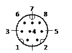

# Xinje device driver

<table>
<colgroup>
<col style="width: 100%" />
</colgroup>
<tbody>
<tr class="odd">
<td>
The device driver is used for HM series HMI to read and write the data or state of Thinget XC/XCM/XD series PLC register. The serial communication connection is established through the serial port on the touch screen and the serial port of Thinget XC/XCM/XD series PLC, so as to operate Thinget XC/XCM/XD series PLC. Prior to use of the driver, one shall carefully read related technical specifications of the chapter and Thinget XC/XCM/XD series PLC.
</td>
</tr>
<tr class="even">
<td>
How to establish connection with Thinget XC/XCM/XD series PLC

<strong>1.  Hardware connection</strong>

Connecting cable:

RS232 

<table>
<tbody>
<tr class="odd">
<td colspan="2">
<strong>HMI series touch screen COM1/COM2</strong>
</td>
<td colspan="2">
<strong>Thinget XC/XCM/XD series</strong>
</td>
</tr>
<tr class="even">
<td>
2
</td>
<td>
RX
</td>
<td>
5
</td>
<td>
TX
</td>
</tr>
<tr class="odd">
<td>
3
</td>
<td>
TX
</td>
<td>
4
</td>
<td>
RX
</td>
</tr>
<tr class="even">
<td>
5
</td>
<td>
GND
</td>
<td>
8
</td>
<td>
GND
</td>
</tr>
</tbody>
</table>

</td>
</tr>
</tbody>
</table>

Terminal of HMI is DB9F, and that of Thinget XC/XCM/XD series PLC is MD8M.

**2. Software settings**

Select Xinje Electronic in connection device service.

Select the corresponding item in connection device service according to the connected PLC model or supported protocol.

Guarantee that communication parameters in touch screen connection parameters and PLC station number are consistent with the connected PLC.

For settings of the connected PLC, please consult related technical documents of Thinget XC/XCM/XD series PLC.

Default connection parameters of HM series HMI

|                             |                             |                                              |
|-----------------------------|-----------------------------|----------------------------------------------|
| **Setting item**            | **Default parameter value** | **Setting scope**                            |
| **PLC type**                | Thinget XC Series           | Thinget XC/XCM/XD Series                     |
| **Communication port type** | RS232                       | RS232/RS422/RS485                            |
| **Baud rate**               | 19200                       | 1200/2400/4800/9600/19200/38400/57600/115200 |
| **Data bit length**         | 8                           | 7/8                                          |
| **Parity**                  | EVEN                        | EVEN/ODD/NONE                                |
| **Stop bit length**         | 1                           | 1/2                                          |
| **PLC station number**      | 1                           | 0 to 255                                     |
| **HMI station number**      | 0                           | 0 to 255                                     |

|                         |                             |
|-------------------------|-----------------------------|
| **Supporting function** | **Whether it is supported** |
| **Offline simulation**  | Yes                         |
| **Online simulation**   | Yes                         |
| **Extended mode**       | Yes                         |

**3. Operational register and address scope**

Thinget XC/XCM Series

|                   |                    |                 |                                    |
|-------------------|--------------------|-----------------|------------------------------------|
| **Register name** | **Address format** | **Input scope** | **Remarks**                        |
| **X**             | dddd               | 0 to 1037       | Bit: input coil                    |
| **Y**             | dddd               | 0 to 1037       | Bit: output coil                   |
| **M**             | dddd               | 0 to 8767       | Bit: internal coil                 |
| **S**             | dddd               | 0 to 1023       | Bit: process                       |
| **T**             | ddd                | 0 to 639        | Bit: timer state                   |
| **C**             | ddd                | 0 to 639        | Bit: counter state                 |
| **D**             | dddd               | 0 to 9023       | Word: data register                |
| **TD**            | ddd                | 0 to 639        | Word: current value of the timer   |
| **CD**            | ddd                | 0 to 639        | Word: current value of the counter |
| **FD**            | dddd               | 0 to 9023       | Word: FlashROM register            |
| **ED**            | ddddd              | 0 to 16383      | Word: extended internal register   |

Thinget XD2 Series

<table>
<colgroup>
<col style="width: 25%" />
<col style="width: 25%" />
<col style="width: 25%" />
<col style="width: 25%" />
</colgroup>
<tbody>
<tr class="odd">
<td>
<strong>Register name</strong>
</td>
<td>
<strong>Address format</strong>
</td>
<td>
<strong>Input scope</strong>
</td>
<td>
<strong>Remarks</strong>
</td>
</tr>
<tr class="even">
<td>
<strong>X</strong>
</td>
<td>
o
</td>
<td>
0~7
</td>
<td>
Input coil
</td>
</tr>
<tr class="odd">
<td>
<strong>Y</strong>
</td>
<td>
o
</td>
<td>
0~7
</td>
<td>
Output coil
</td>
</tr>
<tr class="even">
<td>
<strong>M</strong>
</td>
<td>
dddd
</td>
<td>
0~7999
</td>
<td>
Internal relay
</td>
</tr>
<tr class="odd">
<td>
<strong>HM</strong>
</td>
<td>
ddd
</td>
<td>
0~959
</td>
<td>
Internal relay
</td>
</tr>
<tr class="even">
<td>
<strong>SM</strong>
</td>
<td>
dddd
</td>
<td>
0~2047
</td>
<td>
Special internal relay
</td>
</tr>
<tr class="odd">
<td>
<strong>S</strong>
</td>
<td>
dddd
</td>
<td>
0~1023
</td>
<td>
Technological process
</td>
</tr>
<tr class="even">
<td>
<strong>HS</strong>
</td>
<td>
ddd
</td>
<td>
0~127
</td>
<td>
Technological process
</td>
</tr>
<tr class="odd">
<td>
<strong>T</strong>
</td>
<td>
ddd
</td>
<td>
0~575
</td>
<td>
timer
</td>
</tr>
<tr class="even">
<td>
<strong>TD</strong>
</td>
<td>
ddd
</td>
<td>
0~575
</td>
<td>
Timer current value
</td>
</tr>
<tr class="odd">
<td>
<strong>HT</strong>
</td>
<td>
dd
</td>
<td>
0~95
</td>
<td>
timer
</td>
</tr>
<tr class="even">
<td>
<strong>ET</strong>
</td>
<td>
dd
</td>
<td>
0~31
</td>
<td>
Precision timer
</td>
</tr>
<tr class="odd">
<td>
<strong>ETD</strong>
</td>
<td>
ddd
</td>
<td>
0~31
</td>
<td>
Extended internal register
</td>
</tr>
<tr class="even">
<td>
<strong>C</strong>
</td>
<td>
ddd
</td>
<td>
0~575
</td>
<td>
Counter
</td>
</tr>
<tr class="odd">
<td>
<strong>CD</strong>
</td>
<td>
ddd
</td>
<td>
0~575
</td>
<td>
Counter current value
</td>
</tr>
<tr class="even">
<td>
<strong>HC</strong>
</td>
<td>
dd
</td>
<td>
0~95
</td>
<td>
Counter
</td>
</tr>
<tr class="odd">
<td>
<strong> HSC</strong>
</td>
<td>
dd
</td>
<td>
0~31
</td>
<td>
High-speed counter
</td>
</tr>
<tr class="even">
<td>
<strong>D</strong>
</td>
<td>
dddd
</td>
<td>
0~7999
</td>
<td>
Data register
</td>
</tr>
<tr class="odd">
<td>
<strong>HD</strong>
</td>
<td>
ddd
</td>
<td>
0~999
</td>
<td>
Data register
</td>
</tr>
<tr class="even">
<td>
<strong>SD</strong>
</td>
<td>
dddd
</td>
<td>
0~2047
</td>
<td>
Special data register
</td>
</tr>
<tr class="odd">
<td>
<strong>HSD</strong>
</td>
<td>
ddd
</td>
<td>
0~499
</td>
<td>
Special data register
</td>
</tr>
<tr class="even">
<td>
<strong>FD</strong>
</td>
<td>
dddd
</td>
<td>
0~4095
</td>
<td>
FlashROMregister
</td>
</tr>
<tr class="odd">
<td>
<strong>SFD</strong>
</td>
<td>
dddd
</td>
<td>
0~1999
</td>
<td>
FlashROMregister
</td>
</tr>
<tr class="even">
<td>
<strong>FS</strong>
</td>
<td>
dd
</td>
<td>
0~47
</td>
<td>
Special security register
</td>
</tr>
<tr class="odd">
<td>
<strong>SEM</strong>
</td>
<td>
dd
</td>
<td>
0~31
</td>
<td>
Sequential function block WAIT 
Command coil
</td>
</tr>
</tbody>
</table>

Thinget XD3 Series

|                   |                    |                 |                                                                                                                  |
|-------------------|--------------------|-----------------|------------------------------------------------------------------------------------------------------------------|
| **Register name** | **Address format** | **Input scope** | **Remarks**                                                                                                      |
| **X**             | ooooo              | 0~20077         | Input coil (X10000~X11177 belongs to extended module) (X20000~X20277 belongs to extended BD module)              |
| **Y**             | ooooo              | 0~20077         | The output coil (Y10000~Y11177 belongs to the extended module) (Y20000~Y20277 belongs to the extended BD module) |
| **M**             | dddd               | 0~7999          | Internal relay                                                                                                   |
| **HM**            | ddd                | 0~959           | Internal relay                                                                                                   |
| **SM**            | dddd               | 0~2047          | Special internal relay                                                                                           |
| **S**             | dddd               | 0~1023          | Technological process                                                                                            |
| **HS**            | ddd                | 0~127           | Technological process                                                                                            |
| **T**             | ddd                | 0~575           | timer                                                                                                            |
| **TD**            | ddd                | 0~575           | Timer current value                                                                                              |
| **HT**            | dd                 | 0~95            | timer                                                                                                            |
| **ET**            | dd                 | 0~31            | Precision timer                                                                                                  |
| **ETD**           | ddd                | 0~31            | Extended internal register                                                                                       |
| **C**             | ddd                | 0~575           | Counter                                                                                                          |
| **CD**            | ddd                | 0~575           | Counter current value                                                                                            |
| **HC**            | dd                 | 0~95            | Counter                                                                                                          |
| **HSC**          | dd                 | 0~31            | High-speed counter                                                                                               |
| **D**             | dddd               | 0~7999          | Data register                                                                                                    |
| **HD**            | ddd                | 0~999           | Data register                                                                                                    |
| **SD**            | dddd               | 0~2047          | Special data register                                                                                            |
| **HSD**           | ddd                | 0~499           | Special data register                                                                                            |
| **FD**            | dddd               | 0~4095          | FlashROM register                                                                                                |
| **SFD**           | dddd               | 0~1999          | FlashROM register                                                                                                |
| **FS**            | dd                 | 0~47            | Special security register                                                                                        |
| **ID**            | ddddd              | 0~20099         | Ontology (ID10000~ID10999 is an extension module) (ID20000~20099 belongs to the extended BD module)              |
| **QD**            | ddddd              | 0~20099         | Ontology (QD10000~QD10999 is an extension module) (QD20000~QD20099 belongs to the extended BD module)            |
| **SEM**           | dd                 | 0~31            | Sequential function block WAIT Command coil                                                                      |

Thinget XD5/XDM Series

|                   |                    |                 |                                                                                                                  |
|-------------------|--------------------|-----------------|------------------------------------------------------------------------------------------------------------------|
| **Register name** | **Address format** | **Input scope** | **Remarks**                                                                                                      |
| **X**             | ooooo              | 0~20077         | Input coil (X10000~X11177 belongs to extended module) (X20000~X20277 belongs to extended BD module)              |
| **Y**             | ooooo              | 0~20077         | The output coil (Y10000~Y11177 belongs to the extended module) (Y20000~Y20277 belongs to the extended BD module) |
| **M**             | ddddd              | 0~20479         | Internal relay                                                                                                   |
| **HM**            | ddddd              | 0~11999         | Internal relay                                                                                                   |
| **SM**            | dddd               | 0~4095          | Special internal relay                                                                                           |
| **S**             | dddd               | 0~7999          | Technological process                                                                                            |
| **HS**            | ddd                | 0~999           | Technological process                                                                                            |
| **T**             | dddd               | 0~4095          | timer                                                                                                            |
| **TD**            | ddd                | 0~575           | Timer current value                                                                                              |
| **HT**            | dddd               | 0~1023          | timer                                                                                                            |
| **ET**            | dd                 | 0~39            | Precision timer                                                                                                  |
| **ETD**           | ddd                | 0~39            | Extended internal register                                                                                       |
| **C**             | dddd               | 0~4095          | Counter                                                                                                          |
| **CD**            | ddd                | 0~4095          | Counter current value                                                                                            |
| **HC**            | dddd               | 0~1023          | Counter                                                                                                          |
| **HSC**          | dd                 | 0~36            | High-speed counter                                                                                               |
| **D**             | ddddd              | 0~20479         | Data register                                                                                                    |
| **HD**            | ddddd              | 0~6143          | Data register                                                                                                    |
| **SD**            | dddd               | 0~4095          | Special data register                                                                                            |
| **HSD**           | dddd               | 0~1023          | Special data register                                                                                            |
| **FD**            | dddd               | 0~4095          | FlashROM register                                                                                                |
| **SFD**           | dddd               | 0~5999          | FlashROM register                                                                                                |
| **FS**            | dd                 | 0~47            | Special security register                                                                                        |
| **ID**            | ddddd              | 0~20099         | Ontology (ID10000~ID10999 is an extension module) (ID20000~20099 belongs to the extended BD module)              |
| **QD**            | ddddd              | 0~20099         | Ontology (QD10000~QD10999 is an extension module) (QD20000~QD20099 belongs to the extended BD module)            |
| **SEM**           | ddd                | 0~127           | Sequential function block WAIT Command coil                                                                      |

Note:

d represents decimal system, input scope is 0-9;

o represents octal input range 0-7;

Word in the remarks: represents the register can only be used as word;

Bit in the remarks: represents the register can only be used as bit;

Read only in the remarks represents that the register can only be read but not be written;

The names of the registers supported by different equipment model may be different, and the scopes may also be different.

For detailed name and scope, please consult related technical document of the connected device

