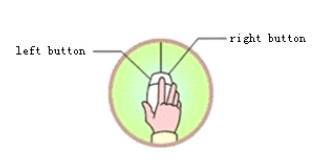
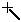
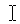
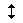
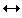
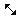

# Mouse usage and shortcut keys

When use the mouse to create configuration screens on the configuration screen editor, the mouse is as shown in Figure 2-45:

Figure 2-45        Sketch of mouse

The following is several common operations of mouse and their purposes:

◎ Left-click

Press the button on the left side, then release—this is referred to in the book \[click\], used in the selection menu, to select the object, choose Tool buttons, edit configuration picture, confirm settings.

◎ Double left click

Press the button twice in rapid succession on the left side—this is referred to \[Double\] in this book, applied to attribute setup for existing parts on the screen: screen and window attributes, touch screen connection properties, set properties; to change settings of Historical data collector, formulas, alarms and other control options.

◎ Right-click

Press the key on the right, then release —this is referred to in the book \[right-click\].  Right-click on a part can open the right drop-down menu, or right-click in the space display the context menu. You can also quit the editing state, restore the mouse state.

◎ Drag

Move the mouse while hold the button-- this is called in the book \[drag\], using the drag operation can select multiple items to move parts, mobile pop-up edit windows.

### Shapes of the mouse

While edit with CommandHMI configuration software, the shape of the mouse will changes with different operations to distinguish different types of operation.

The following table 2-1 shows available operations under various shapes of the mouse when edit screens:

|                                                   |                                                                                                           |
|---------------------------------------------------|-----------------------------------------------------------------------------------------------------------|
|  | Select objects; click tool buttons                                                                        |
| \+                                                | Paste                                                                                                     |
|  | Draw graphs                                                                                               |
|  | Input text                                                                                                |
|  | Enlarge the objet vertically                                                                              |
|  | Enlarge the objet horizontally                                                                            |
|  | Enlarge the objet vertically and horizontally |
|                                                   | Readjust                                                                                                  |
|  | Enlarge the objet vertically and horizontally                                                             |
|                                                   | Rotate the object                                                                                         |

Table 2-1        Shapes of the mouse and their meanings

### Shortcut keys

Table 2-2 below lists common shortcut keys. Designers can use these keys to quicken the configuration.

|                   |                                                     |
|-------------------|-----------------------------------------------------|
| CTRL+C            | Copy                                                |
| CTRL+V            | Paste                                               |
| CTRL+X            | Cut                                                 |
| CTRL+F            | Jump picture                                        |
| CTRL + drag       | Copy the selected objet and move it                 |
| CTRL + left click | Select multiple objects                             |
| ← → ↑ ↓           | Move the selected objet left and right, up and down |
| ESC               | Undo the operation                                  |
|                   | Delete                                              |

Table 2-2           Shortcut keys
