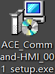
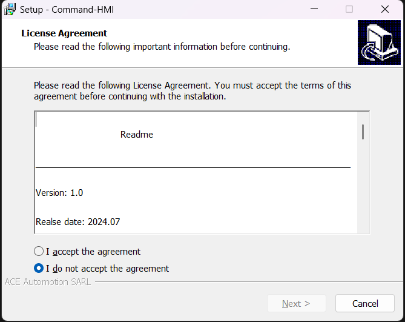
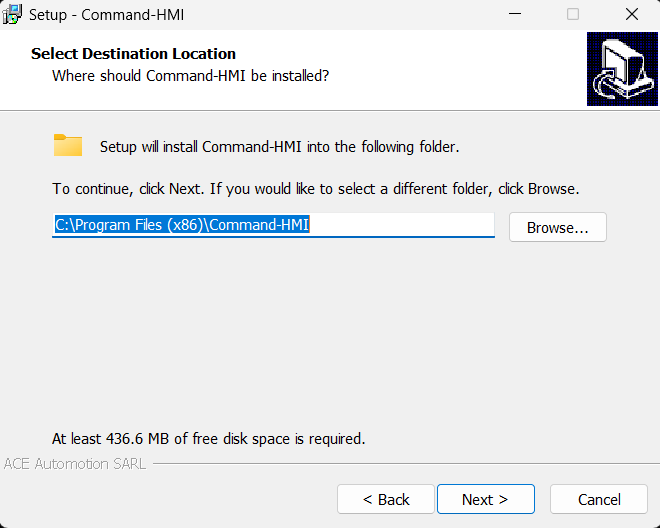
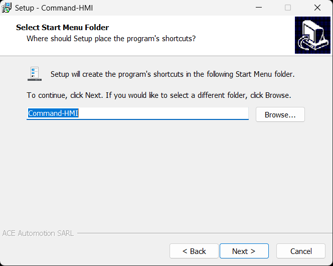
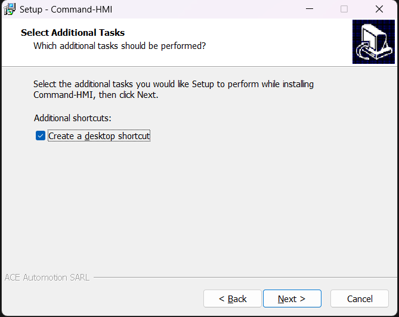
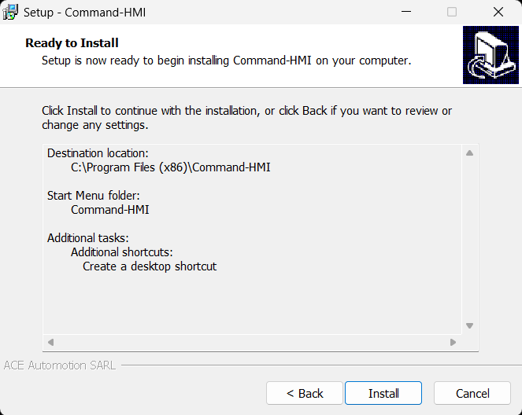
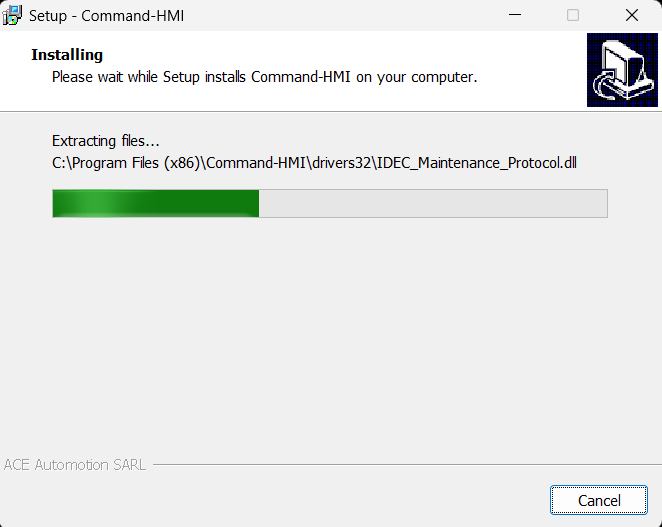
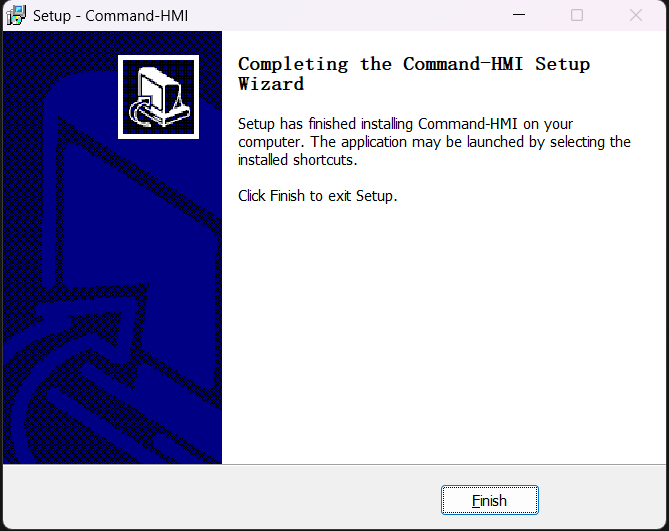
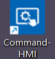

# Set Up Software

CommandHMI is an application software designed for Microsoft Windows system. Before installing the software, please make sure that the computer software and hardware meet the minimum requirements for installation.

Execute the installation CommandHMI distributed with the product to install CommandHMI. Specific steps are as follows:

Download the setup software from offical website;

Figure 2-1      CommandHMI Setup Package

After double-click the software, it will automatically pop up CommandHMI setup window.

The first dialog box is "License Agreement" dialog box, in this dialog box, select “Next” to continue the installation or choose “Cancel” to exit the installation program, as shown in Figure 2-2.

Choose I accept the agreement, then you can click Next button.

Figure 2-2      License Agreement dialog box

In the Destination Folders dialog box, select the installation folder. The default folder is "C:\Program Files (x86)\CommandHMI", click Browse... can select the installation path, then click Next

  

Figure 2-5      Installation Path Interface

Click Next in Figure 2-5, a selection interface shows where to store the file, the default file or others; click Next, as shown in Figure 2-6:

Figure 2-6      Installation File Interface

Whether to Create Desktop Shortcut Interface, click Next, as shown in Figure 2-7:

Figure 2-7      Whether to Create Desktop Shortcut Interface

Installation confirmation interface shows three elements: the installation path, files for the installation and whether to create a shortcut.

  

Figure 2-8      Installation Affirmation Interface

Installation Interface，Click Cancel to cancel the installation. As shown in Figure 2-9:

Figure 2-9      Installation Interface

Having installed the driver, it will display Installation Completed Interface; click Finish to end the installation guide. As shown in Figure 2-10:

Figure 2-10    Installation Completed Interface

After the installation, the HMITOOL6.2 icon will appear on the desktop. As shown in Figure 2-11:

Figure 2-11    desktop shortcut
