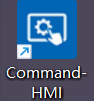
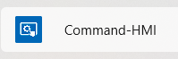
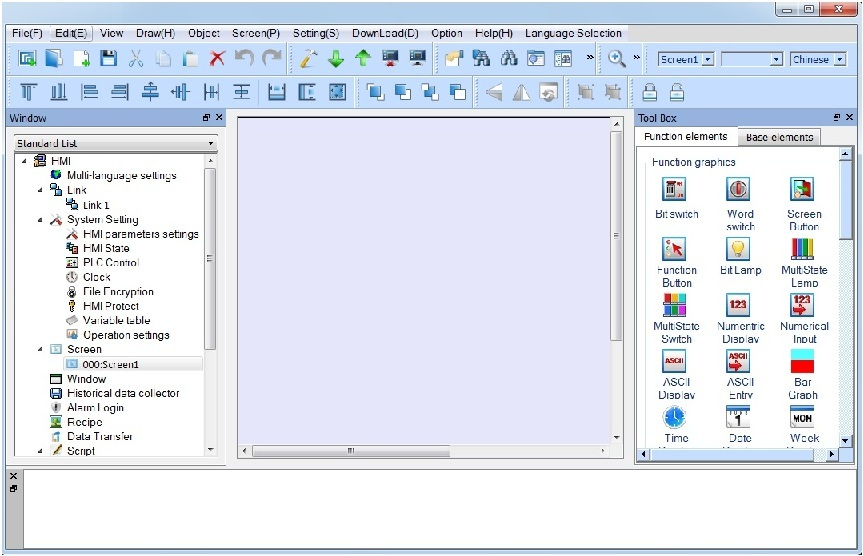

# Run CommandHMI

A shortcut will appear on the desktop after the installation of CommandHMI, as shown in Figure 2-17:

Figure 2-17    desktop shortcut

At the same time, program packages are added to the start menu of Windows, as shown in Figure 2-18

Figure 2-18    start menu program icon

Double click the shortcut on the desktop or the Start menu, click Run CommandHMI.exe CommandHMI configuration software program group, and the interface is shown as Figure 2-19:

Figure 2-19    Software running interface
