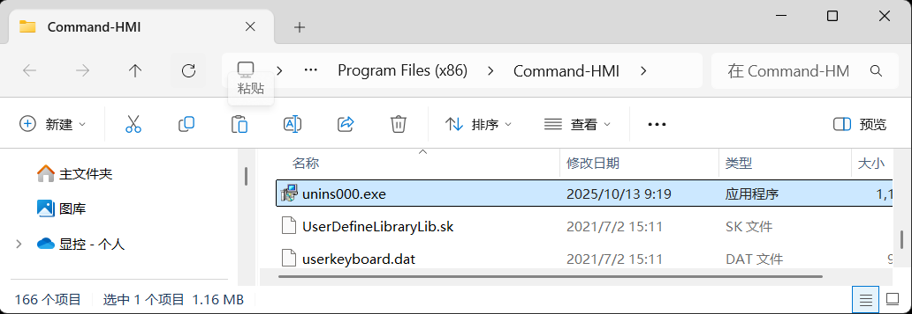
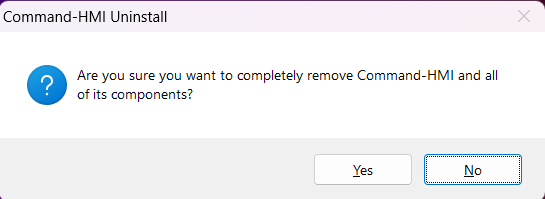
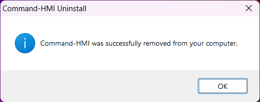
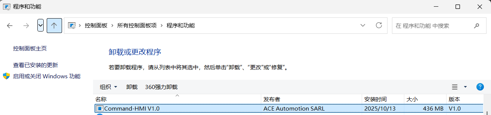

# Uninstall Software

To uninstall CommandHMI configuration software, please follow these steps:

**The first method:**

Step one: Open the folder where you install the Commad-HMI, you will find a unins000.exe.

As Figure 2-13 shows:

Figure 2-13        unins000.exe

Step Two: Double click the unins000.exe, in the pop-up dialog box, left click "Yes" and wait for Windows system to automatically delete CommandHMI software. When the removal is completed, left click "Finish" button, as shown in Figure 2 -14 and Figure 2-15:

Figure 2-14        Confirm Uninstalling

Figure 2-15        Uninstall Completed

**The second method:**

Step One: Select in the Windows "Start" - "Settings" - "Control Panel", go to the Control Panel interface and then select the "Add / Remove Programs" dialog box, as shown in Figure 2-16

Figure 2-16        Add / Remove Programs

Step Two: Select CommandHMI in the left area of the Figure 2-16, click "Change / Remove" button and follow the second and third step of the first method. Then the system will automatically delete CommandHMI configuration software and its corresponding components.
