# menu bar

Editing menu bar of CommandHMI configuration software provides users with an extensive menu options, almost covering all the engineering tools and editing commands needed. The menu bar includes File menu, Edit menu, View menu, Draw menu, Object, Screen menu, Setting menu, Download menu, Help menu, Language selection menu, and also a Right-click menu.

 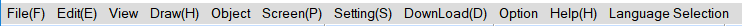

Figure 2-28        Menu bar

**File menu**

"File" menu supports operations of New project (N), Open Project (O), Close, Save (S), Save As and Quit (Q). If a certain item shows gray, it indicates that the operation is invalid in the current environment. The method of opening the file menu is to click "File (F)" on the top left corner of the software, then ejects a pull-down File menu toolbar.

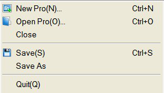

Figure 2-29 “File” menu

• New Project: shortcut key Ctrl + N; to create a blank project.

• Open Project: shortcut key Ctrl + O; to open a project file created, saved before and suffixed by .vpm.

• Close: to close the current project file without exiting CommandHMI configuration software.

• Save: shortcut key Ctrl + S; to save the current configuration file having been modified, the name and save path of the file are by default as before.

• Save As: to save the current configuration file; available to override the name and save path of the project.

• Exit: to exit CommandHMI configuration software.

**Edit menu**

"Edit" menu consists of a set of commands used to edit texts, graphics and other content in the screen. There are Undo, Restore, Cut (T), Copy (C), Multiple copy (D), Paste (P), Delete (D), Select All (A), Align, Layer, Group, Mirror, Zoom, Grid, Property setting, Find Address, Address Table, Reverse Select, Macro search, Macro Manager. If a command in the menu bar is gray, it mean in current operation, that command is invalid. To executive these commands, you should first select the graphic object to be edited, and then choose the corresponding command in "Edit" menu. But there are in "Edit" menu some commands that are group commands.  If so, a little triangle will show on the right of the command and each command, with a drop-down menu, has a corresponding shortcut.

• Undo: shortcut key Ctrl + Z; to cancel the last operation command and your recent action.

• Restore: shortcut key Ctrl + Y, to restore the last operation command and your recent action.

• Cut: shortcut key Ctrl + X, to delete your selected graphical objects and copy them into the clipboard buffer.

• Copy: shortcut key Ctrl + C; to copy the selected graphic object into the paste buffer.

• Multiple copy: to copy a quantity of selected graphical objects in horizontal and vertical directions, and then the address can be in ascending order of 0-255 units.

• Paste: shortcut key Ctrl + V, to copy and paste buffer graphics objects into the current screen.

• Delete: Del, to remove selected graphical object from the screen.

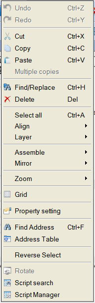

Figure 2-30 “Edit” menu

• Select: shortcut key Ctrl + A; to select all objects in the current frame of the project.

• Align: to make selected objects (more than two) aligned according to the selected type alignment, including Top, Bottom, Vertical Center, Left, Right, Horizontal Equal Interval, Vertical Equal Interval, Make same width, Make same height, Make same width and height.

• Layer: to place the selected objects to a different picture level. You can choose Bring To Top, Bring Forward, Send to Bottom or Send Backward.

• Group: to combine selected objects (more than two) into one control, or split This command can be selected more than one object (two or more) are combined into a control, an object can also can split a detachable object or split combined objects into the original object. When using Group, please be sure not to assembly objects to touch, otherwise objects can’t be touchable after being downloaded to the touch screen. Layer is recommended if it is necessary to overlay touchable objects.

When using Assemble key, do not assemble objects to be touched, or it can’t be touched after downloading to the touch screen. Users may use Layer command to superpose touch objects.

• Mirror: to rotate the selected object in accordance with certain rules, horizontally or vertically.

• Zoom: to zoom the current screen in accordance with a certain proportion scale for a more fine control operation; zoom options are Zoom In, Zoom Fit and Zoom Out.

• Grid: to place or cancel a grid with certain width in the current screen.

• Property settings: to open the Properties window of an object (when one single object is selected) and that of a screen (when nothing is currently selected).

• Find Address: to find the address you are using.

• Address Table: to open or close the list of addresses being used. Address Table is a list of address used by objects, easy to find and replace.

• Invert Selection: to select all objects not being chosen in the current screen and objects that are chosen before are not included.

• Macro Search: to locate calls of the macro in the project; you can optionally specify to search or manually enter the search.

• Macro Manager: Execute this command to see locations of all macros used; you can choose to display macros of all the screens or those of a specific screen.

**View menu**

This menu allows developers to custom their operating interface according to their own habits: decide whether certain operating window is shown in the current operating environment. The icon √ on the left of the command means the display of the toolbox on the screen, otherwise it is hidden.

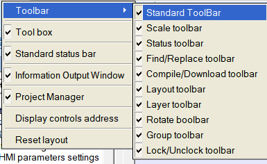

**Draw menu**

The menu is mainly used to draw graphics on the screen. CommandHMI provides straight line (L), Polyline (B), Curve / Arc (A), Free Lines, Rectangles (R), Round Rectangle, Ellipse (E), Polygon (Y), Arc, Text (T), Open Library (0), Build Library (C), Table, Scale. It’s convenient for engineers to change the color, text, size and location of picture elements created by the Tools menu.

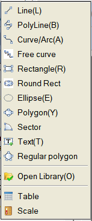

Figure 2-31        “Draw” menu

• Line: Execute this command to draw a straight line in any direction within the current screen.

• Polyline: Execute this command to draw a polyline in any direction within a current picture.

• Curve / Arc: Execute this command to draw a line in the current screen, after finishing drawing by right button, the radian of drawings can be adjusted as needed.

• Free line: Execute this command to draw a line in the current screen in any direction, lines are drawn with the movement of the mouse.

• Rectangle: Execute this command to draw a rectangle of any size in the current screen.

• Rounded Rectangle: Execute this command to draw any rectangle with rounded corners in the current screen.

• Ellipse: Execute this command to draw any size of ellipse in the current screen.

• Polygon: Execute this command to draw an arbitrary polygon in the current screen.

• Arc: Execute this command to draw any sector in the current screen.

• Text: Execute this command to create a transparent rectangle where you can enter any text inside.

• Open Library: Execute this command to open the picture library of the system.

• Build Library: Execute this command to convert the image control drawn by user into a file of library; it is easy to operate next time.

• Table: Execute this command to create a table with required ranks in the current screen.

• Scale: Execute this command to draw a desired scale.

**Object menu**

"Object" menu consists of a set of touch keys and function keys, including Bit Switch, Word Switch, Screen Button, Function Button, Multifunction key, Stepping Button, Single Button, Combo Box, Sliders, Numerical Display, Numerical Input Display, ASCII Display, ASCII Entry, Bit Lamp, Multistate Switch, Multistate Lamp, Message display, Time Display, Date Display, Weekday Display, Static Picture, Picture Display, GIF Display, Dynamic Diagram, Dynamic circle, Dynamic Rectangle, Flowing block, Graphics Move, Animation, Bar Graph, Meter, Arc chart, Trend Chart, XY Trend Chart, Historic trend, Data group, Historical data, Alarm Control, Alarm Bar, Historical Alarm, Timer, Message Board, Recipe selector, Recipe data display, Keyboard and Qrcode. 'Object' menu corresponds to the third row of the toolbar.

• Bit Switch: Execute this command to create touch keys for performing bit manipulations to the connected device, including Set ON, Set OFF, Dot and Invert.

• Word switch: Execute this command to set a touch key for performing word bit operation in the current screen to the connected device, including Add, Subtract, Increasing, Decreasing, Set Constant, Enter Value, Enter Password.

• More Button: Execute this command to reach the Screen Button, Function Button, Multifunction key, Stepping Button, Single button, Combo Box and Sliders.

• Numerical Display: This command is used to draw on the current screen a numerical display frame reflecting numerical value of certain monitored address.

• Numeric Input Display: Execute this command to draw on the current screen a numerical display frame for data input and digital value display of certain monitored address.

• ASCII Display: Execute this command to draw on the current screen a numerical display frame for ASCII code.

• ASCII Input Display: This command is used to draw on the current screen a frame of display and output for the input of ASCII code.

• Bit Lamp: Execute this command to create on the current screen a picture monitoring the bit status of one single connected device.

• Multistate Switch: Execute this command to create multi-state button monitoring numerical value changes of single address of the connected device according to the change of status.

• Multistate Lamp: You can place a picture in the current screen monitoring the word status of multiple consecutive device addresses.

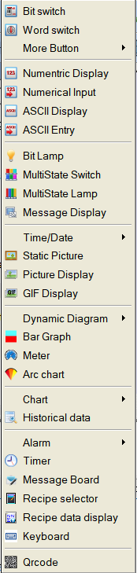

Figure 2-32        “Object” menu

• Message Display: Execute this command to create a display control showing pre-configured message on the current screen.

• Time Display: Execute this command to insert the time control on the screen to show the time.

• Date Display: Execute this command to insert the date control on the screen to display the date.

• Week Display: Execute this command to insert a week control on the current screen to display the week.

• Static Picture: Execute this command to insert a static image of the local hard disk on the current screen.

• Picture Display: This command is used to draw a picture display frame on the current screen for displaying a plurality of pictures.

• GIF Display: Execute this command to draw a picture display frame on the current screen to display a static or animated image suffixed by .GIF.

• Dynamic Diagram: Execute this command to open the windows of Dynamic Circle, Dynamic Rectangle, Flowing block, Graphics Move and Animation.

• Bar Graph: Execute this command to insert a columnar control on the current screen to observe the changes in the numerical value of monitored address according to the rise and fall or the right-left traverse of the columnar picture.

• Meter: Execute this command to create an instrument on the current screen to monitor the changes of numerical value of single address of connected device.

• Arc chart: Execute this command to insert a sector control on the current screen for reflecting the numerical value of monitored address and the reflection area can be presented by Pie FG Color, Pie BG Color or Bottom Color.

• Chart: Execute this command to open the window of Trend Chart, XY Trend Chart, historical trend and Data group.

• Historical Data: Execute this command to create a display control on the current screen to show messages saved by the historical data collector.

• Alarm: Execute this command to open windows of Alarm Control, Alarm Bar and History Alarm.

• Timer: Execute this command to insert a control on the current screen to trigger a particular function according to time conditions.

• Message Board: Execute this command to insert on the current screen a control where users can write.

• Recipe Selector: Execute this command to insert on the current screen a recipe control that shows all names of recipes if they exist.

• Recipe Data Display: Execute this command to insert a recipe data display control on the current screen, which shows all the data of recipes if they are set up.

• Keyboard: Execute this command to insert a keyboard control on the current screen, which can be any key in the keyboard when custom the keyboard.

• Qrcode: Execute this command to insert a Qrcode control on the screen for user-defined Qrcode; It should be used in concert with an input control, otherwise the address is invalid and the Qrcode won’t appear.

**Screen menu**

"Screen (P)" menu consists of commands applied to screens, including New Screen, Screen Properties (P) and Delete Screen (D)

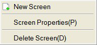

Figure 2-33        “Screen” menu

• New Screen: Execute this command to create a new screen in the current project.

• Screen Properties: Execute this command to open the properties of the current screen by which you can set the name and background.

• Delete Screen: Execute this command to delete the current screen.

Please make sure the current screen is the one you want to delete and whether there are needed controls before operating cause it cannot be undone.

**Setting Menu**

"Setting (s)" menu contains the following commands: Preference Settings (P), File Protection (M), Macro Editor, Global Macro, Initialization Macro and Add Customize Keyboard.

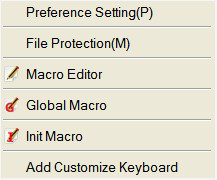

Figure 2-34        “Setting” menu

• Preference Setting: Execute this command to open the preference setting window, in which you can modify the HMI model, display mode, splash screen, screen saver time, flicker frequency, alarm sound, touch sound, password and settings of initial lever.

• File Protection: Execute this command to open the password setting window of file protection through which you can set a password to protect the file of the current project is set in the password window.

• Macro Editor: Execute this command to open the macro editor where you can add, modify, compile or delete a macro.

• Global Macro: Execute this command to open a global macro setting screen, set or modify the global macros.

• Initialization Macro: Execute this command to open the interface of initialization macros setting to set or modify initialization macros.

• Add Customize keyboard: Execute this command to open a user-defined keyboard.

Please keep in mind the password since password is necessary to open the project configuration file after the setting. And it is case-sensitive.

**Download menu**

Applied to compile and download the configuration project, “Download” menu contains eight commands, which are Compile (C), Off-line Simulation (M), Online simulation, USB download (D), Upload, Pack/Unpack, Extract project & save as and Extract Remote Simulation Engineering (A). Having connected PC to a touch screen through USB cable, the configuration project can be downloaded via USB download to the touch screen, but you have to compile it before downloading.

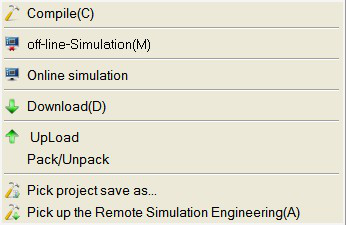

Figure 2-35        “Download” menu

• Compile: Execute this command to examine configuration projects created by users and prepare for download operations.

• Off-line Simulation: Execution of this command can invoke the application program of CommandHMI picture configuration and open the simulation interface. Users can simulate the configuration project running currently on PC to observe the effect, in order to modify the screen. Please save it Off-line simulation before you save the user first.

• Online Simulation: This command can be called CommandHMI screen configuration software application, open the simulation panel, users can simulate engineering currently run on a PC to observe the effect, in order to correct the picture. When online simulation, you can also use the PC's Ethernet or serial communication device connected to data communications and communications test status. Please save it before the online simulation.

• USB Download: Execution of this command can download engineering configuration compiled by CommandHMI software to HMI through a USB cable equipped with the touch screen. Before downloading, please compile and save the project.

• Upload: Execute this command to upload the historical data, configuration, recipes, and historical alarm from the HMI to a PC through a USB cable equipped with the product.

• Pack/ Unpack: Execute this command to compress the project configuration into an XXX.vpr file, or to extract the compressed file to the project configuration file .vpm.

• Extract Project & Save As: Execute this command to compile the current configuration project to a binary file named u-disk-prj.bin. Saving it in the U disk, instead of USB cable downloading, can update it automatically to the HMI.

Extract Remote Simulation Engineering

**Option  menu**

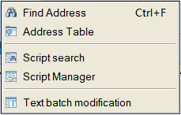

Figure 2-36        “Option” menu

• Find Address: Execute this command to find the address you want and show the using status of the address on Information Output Window.

• Address Table:Execute this command to look for all contols’ status on  all windows or  assigned window.

• Script Table:Execute this command to check the  using of  the assign macro instruction,and show it on information ouput window.

• Script Manager:Execute this command to look for all macro instructions’ status on  all windows or  assigned window.

• Text batch modification:Execute this command to bitch modify assigned text.

**Help menu**

"Help" menu can call up the Help documentation and About CommandHMI: its version number and copyright notice.

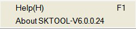

Figure 2-37        “Help” menu

The help file is shown in Figure 2-37:

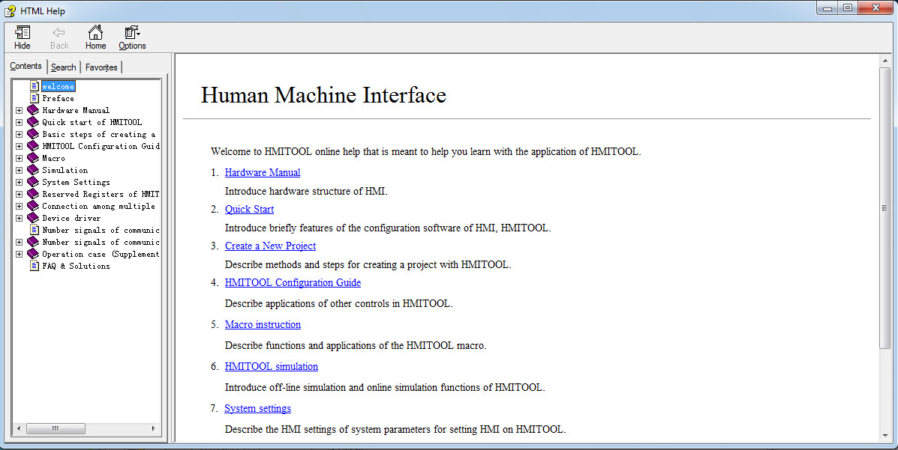

Figure 2-38      Help file

Version number and copyright statement of CommandHMI are shown in Figure 2-38:

Figure 2-39      Version number statement

**Right click menu**

Right click menu is set to facilitate user’s operations, which is consistent with most Windows user's operating habits and styles. Lots of configuration functions can be found here: Attribute, Objects, Library, Cut, Copy, Multiple copy, Paste, Delete, Select all, Align, Layer, Group, Zoom, Grid, Screen.

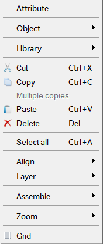

Figure 2-40        “Right click” menu

• Attribute: Execute this command to open the properties window of a control (one single object selected) and the screen (no object selected).

• Object: Execute this command to open all of the object controls in the Object menu.

• Library: Execute this command to open the gallery or generate pictures.

• Cut: Shortcut Ctrl + X; this command can delete your selected graphical objects, and copy them into the clipboard buffer.

• Copy: Shortcut Ctrl + C; execute this command to copy the graphic object of your choice into the paste buffer.

• Multiple copy: Execute this command to copy a quantity of selected graphical objects in horizontal and vertical directions, and then the address can be in ascending order of 0-255 units.

• Paste: shortcut key Ctrl + V, to copy and paste buffer graphics objects into the current screen.

• Delete: Del, execute this command to remove selected graphical object from the screen.

• Select: shortcut key Ctrl + A; execute this command to select all objects in the current frame of the project.

• Align: Execute this command to make selected objects (more than two) aligned according to the selected type alignment, including Top, Bottom, Vertical Center, Left, Right, Horizontal Equal Interval, Vertical Equal Interval, Make same width, Make same height, Make same width and height.

• Layer: Execute this command to place the selected objects to a different picture level. You can choose Bring To Top, Bring Forward, Send to Bottom or Send Backward.

• Group: to combine selected objects (more than two) into one control, or split This command can be selected more than one object (two or more) are combined into a control, an object can also can split a detachable object or split combined objects into the original object.

When using Group, please be sure not to assembly objects to touch, otherwise objects can’t be touchable after being downloaded to the touch screen. Layer is recommended if it is necessary to overlay touchable objects.

• Zoom: Execute this command to zoom the current screen in accordance with a certain proportion scale for a more fine control operation; zoom options are Zoom In, Zoom Fit and Zoom Out.

• Grid: Execute this command to create or cancel a grid with certain width on the current screen.

• Screen: Used to create a new screen, open screen property window and delete a screen.

Please make sure the current screen is the one you want to delete and whether there are needed controls before operating cause it cannot be undone.
