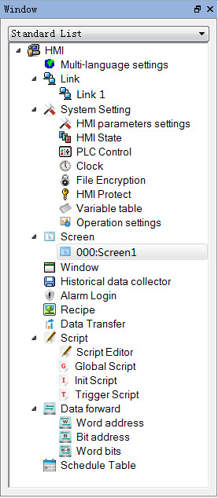

# Project Manager

CommandHMI Project Manager window is in the left of configuration software window, below the toolbar. You can here set the parameters of the touch screen, including Multi-language Settings, Connection, Setting, Screen, Window, Historical data collector, Alarm landing, Formula, Data transmission and Macro; Connection consists of Connection 1 and Connection 2 settings which contains HMI parameter settings, HMI state, PLC control, Clock, File encryption, HMI protection and Variable table.

Figure 2-41      Project Manager window
