# Standard Toolbar

CommandHMI offers a series of shortcut tool buttons, some of which are tool command buttons while some belong to editing commands. You can easily get to the needed commands here instead of seeking it in the menu bar if familiar with these buttons. Each button has tooltips that will appear when the mouse is placed on the button. CommandHMI provides a total of 55 tool buttons, which will turn gray if the If the operation is invalid in the current environment.

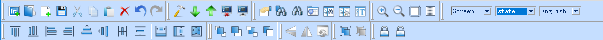

Figure 2-40        Standard Toolbar

Each command in the toolbar correspond to that in the menu, and their functions are respectively:

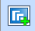New Project: shortcut key Ctrl + N; to create a blank project.

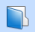 Open Project: shortcut key Ctrl + O; execute this command to open a project file created, saved before and suffixed by .vpm.

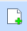 New Screen: Execute this command to create a new screen in the current project.

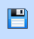Save: shortcut key Ctrl + S, used to save the current screen configuration that has been changed, with the file name and directory being the same as the original.

 Undo: shortcut key Ctrl + Z; to cancel the last operation command and your recent action.

 Redo: shortcut key Ctrl + Y, to restore the last operation command and your recent action.

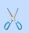 Cut: shortcut key Ctrl + X, to delete your selected graphical objects and copy them into the clipboard buffer.

 Copy: shortcut key Ctrl + C; to copy the selected graphic object into the paste buffer.

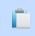 Paste: shortcut key Ctrl + V, to copy and paste buffer graphics objects into the current screen.

 Delete: Del, to remove selected graphical object from the screen.

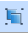 Group: Execute this command to combine several graphic objects you select into one object.

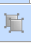 Ungroup: This command can decompose a combination of graphic objects you have selected into the original graphic objects; it’s the inverse operation of Group.

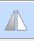 Flip Horizontal: Execute this command to make a single graphic or multiple graphics pivot horizontally.

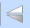 Flip Vertical: Execute this command to make a single graphic or multiple graphics pivot vertically.

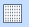 Grid: Execute this command to create or cancel a grid with certain width on the current screen.

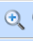 Zoom in: Execute this command to magnify the current screen two times; to continue to enlarge, please continue to execute the command.

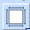 Zoom fit: Execute this command to restore the current screen to the standard size.

 Zoom out: Execute this command to shrink the current screen half the size; to continue zooming out, proceed to execute the command.

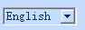 Language: Execute this command to select the language you want.

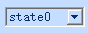 Status drop-down box: If select a control with status, the drop-down box will show the number of control status; if the number in the box changes, the status of the selected control will switch into corresponding status.

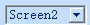Screen frames: Execute this command to jump to the page you want to view.

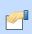 Property settings: Execute this command to get the properties of the selected key.

 Locked: Execute the command to lock the key selected on the screen and it can not be moved after locking.

 Unlock: Execute this command to remove the locking of screen buttons.

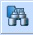Find/replace the button:click the button, and the user can find all the usage of the specific register and can be replaced by the other

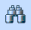 Address Find: Execute this command to find out whether an address is occupied and the search results are displayed in the "information output window".

 Address display: Execute this command to browse the used address of all controls in certain screens or all the screens.

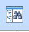 Find macro: Execute this command to find whether a macro is used; the search result is displayed in the "information output window".

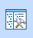 Macro Manager: Execute this command to see the macro condition of all controls in certain screens or all the screens.

Click the button to modify the selected control, screen, and text in the window.

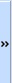 Use this command to open the tool buttons that are not displayed; when the mouse moves away, the popup disappear.

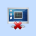 Off-line simulation: Execute this command to run directly off-line simulation command.

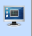 Online simulation: Execute this command to run directly online simulation command.

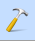 Compile: Execute this command to check user’s own configuration engineering and get ready to download.

 Download: Execute this command to pop up the download dialog; after connecting the HM series HMI to PC, you can download the configuration project to the touch screen.

 Upload: Execute this command to upload historical data, configuration, formulas and alarm history from a running HMI to a PC via the equipped USB cable.

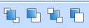

Layer: Level drop-down box, includes four operating controls: Bring to top, Send to bottom, Bring forward and Send backward

• Bring To Top (F): Execute this command to shift the graphic object you selected to the top of the screen.

• Send To Bottom: Execute this command to shift the graphic object you selected to the bottom of the screen.

• Bring Forward: Execute this command to shift the graphic object you selected forward one layer.

• Send Backward (B): Execute this command to shift the graphic object you selected backward one layer.

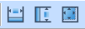

Size: Size drop-down box includes three operating controls: same width and height, same height, same width.

• Make same width: Use this command to make a group of selected patterning the same width as that marked by a black point.

• Make same height: Use this command to make a group of selected patterning the same height as that marked by a black point.

• Make same width and height: Use this command to make a group of selected patterning the same width and height as that marked by a black point.

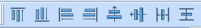

Alignment: Alignment drop-down box includes a total of eight operating controls: left-aligned, right-aligned, Vertical Center, Horizontal Center, Top, Bottom, Horizontal Equal Interval and Vertical Equal Interval.

• Left: Shortcut key Ctrl + Left, execute this command to left justify the left edges of selected graphic objects.

• Right: Shortcut key Ctrl + Right, execute this command to right justify the right edges of selected graphic objects.

• Top: Shortcut key Ctrl + Up, execute this command to align upper boundaries of selected multiple graphic objects top.

• Bottom: Shortcut key Ctrl + Down, execute this command to align lower boundaries of selected graphic objects bottom.

• Horizontal Center: Execute this command to align selected graphics horizontal center.

• Vertical Center: Execute this command to align selected graphics vertical center.

• Horizontal Equal Interval: Execute this command to make two or more controls align horizontally equal interval.

• Vertical equal interval: Execute this command to make two or more controls align vertically equal interval.
