# Toolbox

CommandHMI Toolbox provides a wealth of tool buttons, some of which are functional control buttons, and some are basic controls. After being familiar with these buttons, designers can quickly find the commands they need instead of searching in the menu bar. CommandHMI supports totally 53 function controls and 15 basic controls.

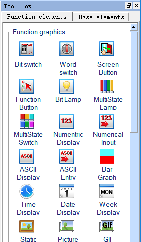

Figure 2-42        Toolbox functional control buttons

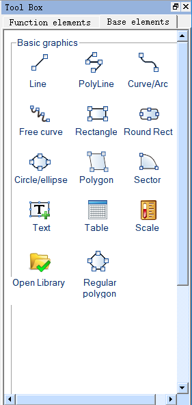

Figure 2-43        Toolbox basic control buttons

Toolbox individual operating controls and menu content corresponding to each other, each button functions are:

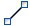 Line: Execute this command to draw a straight line in any direction within the current screen.

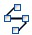 Polyline: Execute this command to draw a polyline in any direction within a current picture.

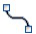 Curve / Arc: Execute this command to draw a line in the current screen, after finishing drawing by right button, the radian of drawings can be adjusted as needed.

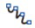 Free line: Execute this command to draw a line in the current screen in any direction, lines are drawn with the movement of the mouse.

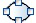 Circle/Ellipse: Execute this command to draw any size of circle or ellipse in the current screen.

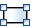 Rectangle: Execute this command to draw a rectangle of any size in the current screen.

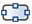 Rounded Rectangle: Execute this command to draw any rectangle with rounded corners in the current screen.

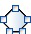 Polygon: Execute this command to draw an arbitrary polygon in the current screen.

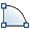 Arc: Execute this command to draw any sector in the current screen.

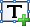 Text: Execute this command to create a text input on the screen.

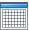 Table: Execute this command to create a table with required ranks in the current screen.

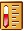 Scale: Execute this command to draw a desired scale.

 Open Library: Execute this command to open the picture library of the system.

 Bit Switch: Execute this command to create touch keys for performing bit manipulations to the connected device, including Set ON, Set OFF, Dot and Invert.

 Word switch: Execute this command to set a touch key for performing word bit operation in the current screen to the connected device, including Add, Subtract, Increasing, Decreasing, Set Constant, Enter Value, Enter Password.

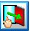 Screen Button: Execute this command to set the switching of screens, including opening screen, open the previous screen, close and Open screen, Closes screen, Open previous screen and Close open screen.

 Function Button: Execute this command to set a certain function control of the operating system, including Turn off background light, Confirm alarms, Restart HMI, Set screen saver time, Write recipe to PLC, Read recipe from PLC, Set the date and time, Clear alarm, Switch to previous recipe, Switch to later recipe, Save current recipe, Screenshots, System parameters, User login, Cancel the user login, Touch sound ON / OFF, Alarm sound ON / OFF, Clear all historical data, Clear alarm history, Unlock HMI protection, read& save recipe, Spare function, Overload recipe, Switch language, Print screen to printer, Slave devices IP config, DIP switches 1 and 3 feature set.

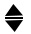 Stepping button: Execute this command to create a stepping button control in the current screen to realize the cyclic switching of execution states.

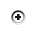 Single button: Execute this command to create a single button control in the current screen; click the designated state area, then the state will switch accordingly.

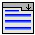 Combo box: Execute this command to create a drop-down box button control in the current screen, for viewing and selection. Once user selects an item, the corresponding value will be written into the control address of character buffer.

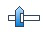 Slider: Execute this command to create a slider analog switch control in the current screen; drag the slider to change the value of corresponding character register addresses.

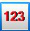 Numerical Display: This command is used to draw on the current screen a numerical display frame reflecting numerical value of certain monitored address.

 Numeric Input Display: Execute this command to draw on the current screen a numerical display frame for data input and digital value display of certain monitored address.

 ASCII Display: Execute this command to draw on the current screen a numerical display frame for ASCII code.

 ASCII Input Display: This command is used to draw on the current screen a frame of display and output for the input of ASCII code.

 Bit Lamp: Execute this command to create on the current screen a picture monitoring the bit status of one single connected device.

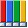 Multistate Switch: Execute this command to create multi-state button monitoring numerical value changes of single address of the connected device according to the change of status.

 Multistate Lamp: Place a picture in the current screen to monitor the word status of multiple consecutive device addresses.

 Message Display: Execute this command to display corresponding message information according to different monitoring address.

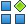 Recipe Selector: Execute this command to insert on the current screen a recipe control that shows all names of recipes and enter, monitor contents of RWIO.

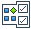 Recipe Data Display: Execute this command to insert a recipe data display control on the current screen, which shows all the data of recipes if they are set up.

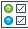 Multi-function button: Execute this command to create a multi-function button in the current screen to realize multiple functions through one key.

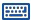 Keyboard: Execute this command to insert a keyboard control on the current screen, which can be any key in the keyboard when custom the keyboard.

 Time Display: Execute this command to insert the time control on the screen to show the time.

 Date Display: Execute this command to insert the date control on the screen to display the date.

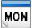 Week Display: Execute this command to insert a week control on the current screen to display the week.

 Static Picture: Execute this command to insert a static image of the local hard diHM on the current screen.

 Picture Display: This command is used to draw a picture display frame on the current screen for displaying a plurality of pictures.

 GIF Display: Execute this command to draw a picture display frame on the current screen to display a static or animated image suffixed by .GIF.

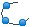 Dynamic circle: Execute this command to create a dynamic circle in the current screen whose size and location transform according to the continuous address change of connection device.

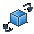 Dynamic Rectangle: Execute this command to create a dynamic rectangle in the current screen whose size and location transform according to the continuous address change of connection device.

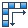 Flow block, use this command to create a simulation control of flow state in the current screen.

 Graph Move: Execute this command to create a graph display frame in the current screen whose graphic state and location change according to the continuous address change of connection device.

 Animation: Execute this command to create an animation control in the current screen to move the control.

 Meter: Execute this command to create an instrument on the current screen to monitor the changes of numerical value of single address of connected device.

 Arc chart: Execute this command to insert a sector control on the current screen for reflecting the numerical value of monitored address.

 Pie chart: Execute this command to insert a sector control on the current screen for reflecting the numerical value of monitored address

 Bar Graph: Execute this command to insert a columnar control on the current screen to observe the changes in the numerical value of monitored address according to the rise and fall or the right-left traverse of the columnar picture.

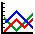 Trend Chart: Execute this command to create a trend chart control in the current screen to monitor the change trend of continuous address value of connection device.

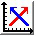 XY Trend chart: Execute this command to create a XY trend chart control in the current screen to monitor the change of two continuous address value of connection device.

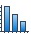 Data group display： Execute this command to create a date group display control in the current screen to display several groups of data in the trend chart.

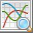 Historical Trend Chart: Execute this command to create a historical trend chart control in the current screen to display historical data in the trend chart.

 Historical record display: Execute this command to create a historical record display control in the current screen to display historical data collected.

 Historical Alarm display: Execute this command to create a display control of historical alarm record in the current screen to show historical alarm data.

 Alarm display: Execute this command to create an alert box control in the current screen to display the date, time and message of each alert.

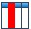 Alarm Bar: Execute this command to create an alert bar in the current screen to scroll display alert information.

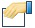 Operation log: Execute this command to create an operation log display frame in the current screen to display the time, user and contents of the operation.

 Timer: Execute this command to create a macro timer in the current screen to control the execution of the macro.

 Message Board: Execute this command to create a message board control in the current screen where users can write.

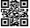 QRcode: Execute this command to create a QR code control in the current screen to display character or number with the help of input control.

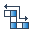Corner flow block: Execute this command to create a Corner flow block control in the current screen to display the shape and flow speed.

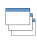Multi-Window: Execute this command to create a multi-window control in current screen to display the assigned window.
