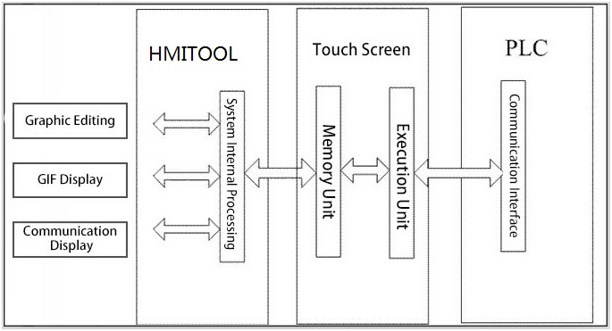

# System Composition

CommandHMI is a configuration editing software of CommandHMI HMI. CommandHMI allows engineers to edit the configuration on the PC, and then download the final configuration and required communication driver to communication and the required driver to the storage mechanism of the touch screen with a USB cable; HMIs can be controlled and monitored after being connected to PLCs or other connection devices through actuators and serial communication ports. Figure 2-44 shows CommandHMI system composition.

Figure 2-44        CommandHMI System Composition
