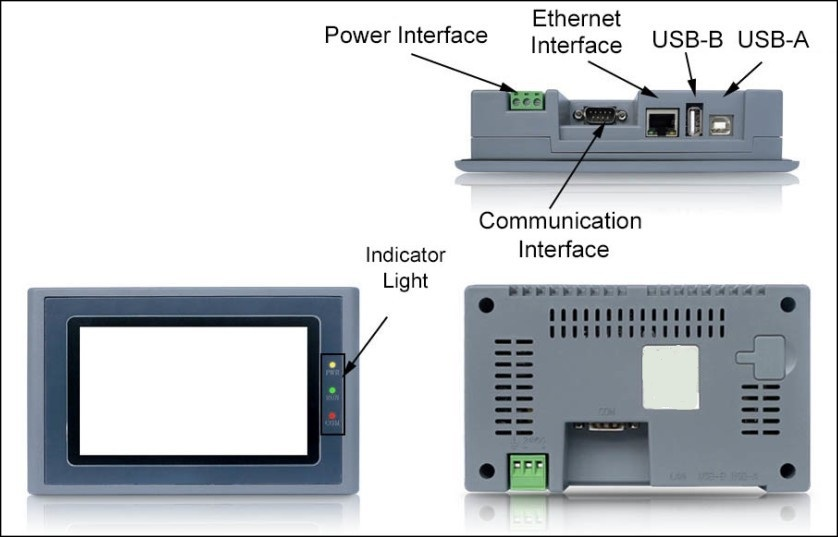

# HMI Structure

The entire structure of CommandHMI HM series HMI consists of display area, indicator light, power interface and communication ports. Color of all models accords to the industrial design standard, with the feature of soiling resistance so as to work in harsh factory environment, and indicator lights on the front panel meant to check the equipment status. Power interface and communication ports are located at the bottom of the HMI, which meets the design criteria.

• Ethernet port: Connection of Ethernet cable

• USB-B: Insert the U disk

• USB-A: Connect with PC; download the configuration file from PC to HMI

• Communication Interface: Communicate with PLC
