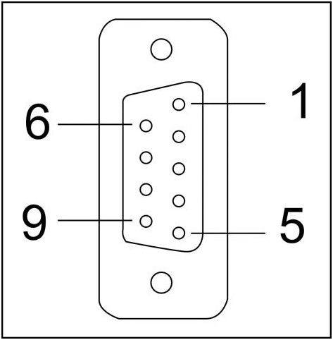

# Pin

Pareto diagram of 9-pin communication port，as the below figure ：

9-pin communication port

This port is used to connect PLC or other controllers with RS232 / RS422 / RS485 communication port

|     |       |       |       |
|-----|-------|-------|-------|
| Pin | RS232 | RS422 | RS485 |
| 1   |       |       |       |
| 2   | RX    |       |       |
| 3   | TX    |       |       |
| 4   |       |       |       |
| 5   | GND   |       |       |
| 6   |       | RX-   |       |
| 7   |       | RX+   |       |
| 8   |       | TX-   | B     |
| 9   |       | TX+   | A     |
