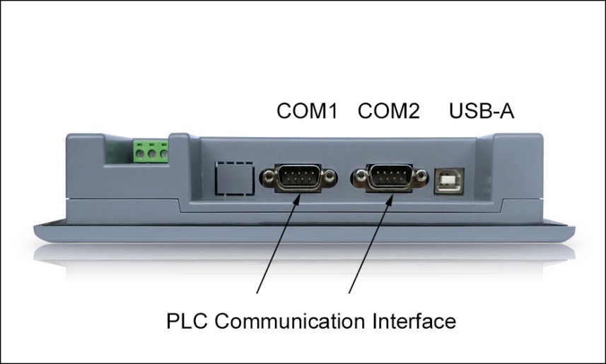

# Communication port

Communication ports of HMI are located in the bottom panel.

When using a shielded cable, RS232 communication distance shall not go over 15 meters. For connection to the computer, it has a USB communication interface used for downloading configuration (data transmission). The transmission rate can be up to 10Mbps. Definition of communication interface differs if it is connected to different PLC (Please inform us the type of PLC to be connected when ordering for facilitating the distribution of communication cables).

The model in the below Figure is equipped with double serial and USB-A port, the model in the next below the Figure is equipped with single serial and USB-A port:

