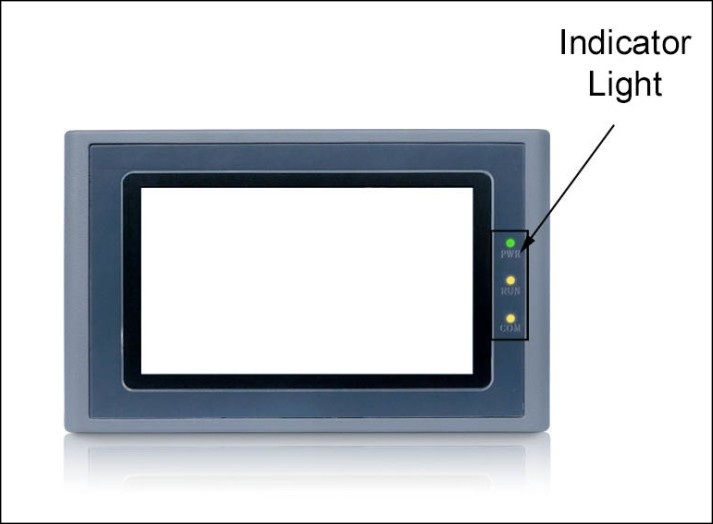

# Running Indicator Lights

Indicator lights of the touch screen consist of three LEDs, including Power (PWR), Run (RUN) and communications (COM), just as shown in the below Figure.

HM series Running Indicator Lights

PWR turns green when it is powered;

RUN turns yellow if CPU works normally while it lights out if CPU fails;

COM turns yellow when the touch screen is connected to PLC.

Table 1-1 shows the display states of the 3 LED indicator lights on different working state.

|                                                    |                  |                   |                   |
|----------------------------------------------------|------------------|-------------------|-------------------|
| Device state                                       | Green LED（PWR） | Yellow LED（RUN） | Yellow LED（COM） |
| No power supply                                    | ○                | ○                 | ○                 |
| Power on                                           | ●                |                   |                   |
| CPU running                                        | ●                | ●                 |                   |
| Communication with connected device                | ●                | ●                 | ※                 |
| ○：LED is OFF;  ●：LED is ON;   ※：LED is flashing |                  |                   |                   |

Table 1-1
