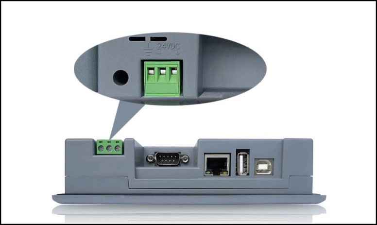

# Power Interface

The power interface of the CommandHMI HM series HMI locates in the back panel. With DC24V power supply (± 15%), it shields effectively against interference, enhancing the anti-disturbance performance of the entire system.

